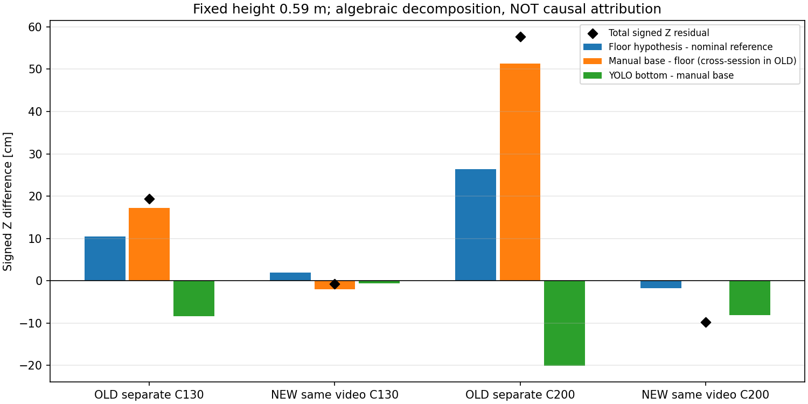
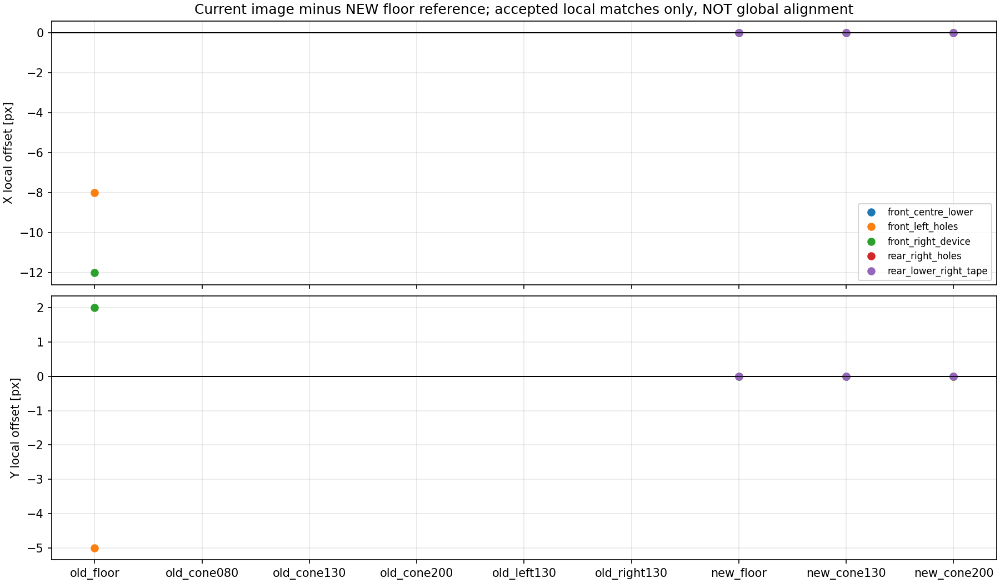

# 距離のずれの追加診断：録画間の写り方と接地点を切り分け

2026-10-15。**検出枠の下端だけを一定量補正して、過去と今回の録画を共通に直す根拠は得られなかった。**
後続の[ユーザー確認・取得経路レビュー](../capture_path_review_r01/README.md)で、固定・原点・載せ替え等に問題なしという回答を受領した。固定不良を既定の原因とせず、下記の差を画像上の観測事実に限定して扱う。
カメラ設定は8sessionで一致する一方、床基準点・車体局所特徴の写り方には録画間の差がある。
同じ校正を無条件に転用せず、カメラと車体の相対位置の再現性を確認する必要がある。
ただし、物理的なカメラ姿勢の変化を一意に診断できたわけではない。

新しいfit、元pixel修正、学習/再推論、runtime設定変更、ROS/FFB出力は行っていない。
比較に使った高さ0.59mはユーザー実測値を使うオフライン条件。記録metadataの0.58mは上書きしていない。

## 1. 同じ条件名でも録画間に差がある

| 条件 | 過去の静止録画・Z中央値 | 今回の連続録画・Z中央値 | 今回−過去 |
|---|---:|---:|---:|
| 中央1.30m | 1.494m | 1.293m | −20.1cm |
| 中央2.00m | 2.586m | 1.902m | −68.4cm |

全て同じ未調整幾何・高さ0.59m、保存済みの同じYOLOモデル出力から計算。
今回の有効218/539行、過去651/632行を使用。前段の欠測・範囲拒否は残している。
品質ゲートによる追加確認待ちを適用する前の値で、前回報告との比較基準をそろえた。

画像上の既存候補点も変わっている。

| 参照距離 | 床V先端のy（過去→今回） | 目視台座候補のy（過去→今回） |
|---|---:|---:|
| 1.30m | 412→416px | 405→417px |
| 2.00m | 387→393px | 379→393px |

候補点はassistantによる既存の非盲検目視点で、物理接地点GTではない。
実際の配置誤差やannotation誤差は未測定。数字をそのまま取付角変化へ換算しない。
床点同士の差もあるので、YOLO検出枠の誤差だけを原因と決めることはできない。

## 2. 残差を3項に分解した

既存の候補点をそのまま用いた恒等式：

`bbox推定−参照 = (床推定−参照) + (目視台座推定−床推定) + (bbox推定−目視台座推定)`

下表は、目視台座候補と同じframeのbboxを使う。中央値を投影した別結果もCSVへ保存。

| 録画・参照 | 床−参照 | 台座−床 | bbox−台座 | 合計 |
|---|---:|---:|---:|---:|
| 過去・1.30m | +10.5cm | +17.2cm | −8.4cm | +19.3cm |
| 今回・1.30m | +1.9cm | −2.0cm | −0.6cm | −0.7cm |
| 過去・2.00m | +26.4cm | +51.3cm | −20.0cm | +57.7cm |
| 今回・2.00m | −1.7cm | +0.1cm | −8.1cm | −9.7cm |

**過去の「台座−床」は別動画の差で、コーン台座の形状の影響を測定した値ではない。**
見え方・配置・候補点の不確かさを含む。今回も同じ動画だが床と台座は同時刻ではない。
式の分解は厳密でも、各項を原因へ帰属できるとは限らない。

±2pxの仮定感度もCSVに保存した。独立に動かした四隅の投影差を比較しただけで、
信頼区間や真の誤差限界ではない。特に2mでは少数画素が数～十数cmへ変換され、
今回の「bbox−台座」の仮定感度幅は約−24.5～+8.2cmと0も含む。
したがって「YOLOが正確に8cm間違った」「目視接地点なら精度完成」とは判断しない。



## 3. 一律2px補正を仮に入れた場合

参照2.00m・目視候補と同frameのbboxに対し、yだけ±2px動かす対称な感度計算。
元pixelは変えず、補正として採用していない。

| 録画 | 2px上へ動かす | 元のbbox | 2px下へ動かす |
|---|---:|---:|---:|
| 過去 | 2.719m | 2.577m | 2.448m |
| 今回 | 1.983m | 1.903m | 1.829m |

今回に良さそうな「2px上げる」を過去へ流用すると、過去の過大推定は悪化する。
これは全bbox一律補正を採用しない具体的な理由であり、新たな補正量の探索ではない。

なお作業中に「目視台座に合わせる補正方向が逆」と述べたが、それは誤りで訂正済み。
目視点に対するbbox下端は両方とも下側だった。**逆なのは、参照2.00mへの距離残差の符号**であり、
目視台座とのpixel差の符号ではない。これらを混同しない。

## 4. 設定が同じでも車体の特徴は同位置ではない

8sessionのmetadataで幾何9項目・要求1280×720/30fps・device0は一致した。
ただしmetadataは取付位置や画像の幾何を実測したものではない。
過去の固定5領域をそのまま使用し、135組を±20pxで照合。全結果・棄却理由を保存した。

今回冒頭床を基準にした採用例（差は**比較画像−今回床**）：

| 比較先 | 局所特徴 | dx / dy |
|---|---|---:|
| 過去の床録画 | 前方左の穴 | −8 / −5px |
| 過去の床録画 | 前方右の機器 | −12 / +2px |
| 今回のコーン1.30m/2.00m | 前方左の穴・右機器・後方テープ | すべて0 / 0px |



過去コーンと今回床の前方右機器は一次探索で境界へ達したため、±20px結果は不採用。
そこで[事前に補助条件を記述](wide_search_method.md)し、**全135組を一律±40px**で再評価した。
領域・相関・競合ピーク・逆照合・境界の採用条件は変更していない。

- 一次採用43組は、広域探索でも同じオフセットで採用。追加採用4組、引き続き棄却88組。
- 今回床を基準に、過去の前方右機器は：0.80m録画で(−20,−1)、1.30mで(−21,0)、
  2.00mで(−21,0)、左録画で(−20,+1)px。NCC約0.846～0.868。
- 過去の右録画は同じ採用条件を満たさず、ずれを確定していない。
- 他の領域を含め、撮影画像全体が20px並進したとは言えない。機器自体の移動、
  車体とカメラの相対姿勢、たわみ、撮影処理等は未分離。局所オフセットを距離補正へ使わない。
- 今回の連続動画内の3領域の0px一致も、カメラ姿勢の完全な物理測量ではない。

ユーザー申告の「高さ・傾きは変更していない」を否定する診断ではない。
意図的な操作の有無と、画像上の再現性は別に扱う。

## 5. 検証と現在の判断

- 新規10テスト：残差の恒等式、点一致、感度、単位スケール、前後方向、参照変更の影響、
  入力非改変、順逆投影、不正pixel拒否、広域照合の自己対照がすべて成功。
- [独立検証](verification.json)：8分解を光線式で再計算、24感度行、270局所比較、
  8metadataの設定一致、前段の元画像・本番config等のhash不変を確認。
- 既存幾何/追跡/品質ゲートは変更せず、前段の成功済み検証を再利用。
  実機・ROS・カメラ・全体テストスイートは実行していない。
- 新しい画像はCSVからのグラフ2枚のみ。元画像は一切加工せず既存PNGへの参照を保持。
- Matplotlibの未使用Axes3D警告は出たが、2D図の保存と目視確認は成功。

**距離校正を本番採用できる状態とはまだ言えない。物理原因も未確定。**
追加の学習より先に、車体とカメラの固定状態・再現性を確認し、同一状態で複数の床基準点と
コーンを比較するのが次の判断になる。今回の床2点だけへ再fitして終わりにはしない。
安定した取付状態・複数距離/左右の独立検証をそろえ、その後TTC→FFBのdry_runへ進む。
既存録画で確認できる画像差は今回保存できたため、闇雲に同じ静止コーン6条件を撮り直す必要はない。

## 成果物と再現

- [評価前の方法](method.md)
- [距離の分解8行](results_r01/distance_decomposition.csv)
- [元pixel比較6行](results_r01/pixel_comparison.csv)
- [metadata比較8行](results_r01/metadata_comparison.csv)
- [一次照合135行](results_r01/local_feature_matches.csv) / [補助照合135行](wide_search_r01/local_feature_matches.csv)
- [±2px感度24行](sensitivity_r01/uniform_pixel_shift.csv)
- [一次の来歴](results_r01/provenance.json) / [補助来歴](wide_search_r01/provenance.json) / [感度来歴](sensitivity_r01/provenance.json)

代表元画像：[過去床frame187](../cone_floor_reference_real_r01/raw_samples/floor_reference_f000187.png)、
[過去コーン2m frame211](../cone_static_distance_r01/raw_samples/center_200_f000211.png)、
[今回床frame141](../floor_cone_same_pose_analysis_r01/raw_samples/same_pose_f000141.png)、
[今回コーン2m frame1265](../floor_cone_same_pose_analysis_r01/raw_samples/same_pose_f001265.png)。

実行順は `analyze.py` → `wide_search.py` → `pixel_sensitivity.py` → `verify.py`。
すべて既存結果を上書き拒否するため、保存済みr01へそのまま再実行しない。
各script先頭の `HERE` はこのフォルダ。CPU環境 `/home/robo25/theta-env/bin/python3` を使用。
テストは次のコマンドで再実行できる。

```bash
/home/robo25/theta-env/bin/python3 -m unittest discover \
  -s Experimental_results/2026-10-15/cone_distance_bias_diagnosis_r01 \
  -p test_bias_decomposition.py -v
```

Git commit/pushと日報更新は今回依頼されていないため行っていない。
