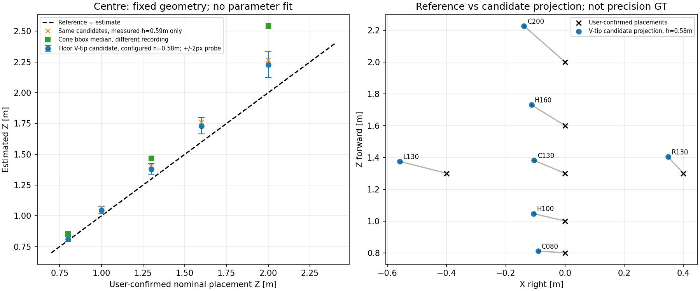

# 実カメラ床面V字基準の固定幾何診断（2026-10-15）

## 結論

**テープ7か所は原画像から確認でき、この録画で原因の切り分けを進められる。**
ただし遠方は数画素しかなく、V字の厳密な先端を高精度に特定できたわけではない。
先端候補による固定投影では床面点にも遠いほど距離を過大推定する傾向があり、YOLOのbboxだけの問題とは言えない。
レンズ中心高さはユーザー実測59cm、metadataの設定は58cm。高さだけ59cmにした計算では距離が約1.7%長くなり、今回の過大推定を解消しない。
本番config・カメラ取付・FFB安全機構は変更していない。

## 1. 受入れと実測情報

- 原本：`/home/robo25/Downloads/floor_reference_real_r01_20261015_144248_636.tar.xz`（約31MB）。
- 安全展開先：`recordings/2026-10-15_floor_reference_real_intake_r01/`。
- session：`floor_reference_real_r01_20261015_144248_636`。
- 1280×720、467frame、最終記録時刻15.623秒、記録間隔から約29.87fps。全rawをデコードし、CSV連番・時刻・枚数・解像度を検査。
- 全467frameでODOMあり、linear/angular絶対最大はいずれも0。device=`0`で、ネットワーク/WebSim由来の録画ではない。
- camera geometryは従来の収録設定と一致。AI・FFB publish・relayは無効。
- 6枚を無加工・全画角・元解像度PNGで保存し、元デコード画素とのhash一致を確認。

ユーザーからの確認：

> 全テープにおいて指定通りの距離においています。また、カメラの高さは床からカメラのレンズ中心までで59cmでした

基準は「V字になっているテープの交点の先端」。通常のカメラ直下/Kobuki中心から、右X正・前Z正として配置予定座標への設置を確認した。
これはユーザー申告の位置であり、細かな配置/測定誤差や高さの測定誤差は数値提供されていない。勝手に±1cmなどを設定していない。
撮影後の[確認記録](reference_confirmation.json)を別保存し、回答前に生成した受入れ時点の[intake_summary.json](intake_summary.json)と元metadataは上書きしていない。

## 2. 画像での見え方と先端候補

代表原画像：[frame187・約6.29秒](raw_samples/floor_reference_f000187.png)。
frame94/187/280/373を目視し、中央に5点、左右に各1点が見えることを確認。
近い中央Vは形を判別できる。一方、中央1.6m/2.0mなどは非常に小さく、遠方の正確なV先端は解像度とぼけの制約を受ける。
床の見やすい明部を確認する補助として元BGR値を数値で調べたところ、2.0m付近ではB/G/R全て90以上の画素はframe94/187/280/373で1画素だった。
これはテープ全体の面積や正解の先端を証明する閾値ではなく、数画素しかないことの補助確認に限る。

主解析には全点が見えるframe187の候補を使用。画像の見た目から固定した候補を[point_candidates.csv](point_candidates.csv)へ保存し、距離誤差からpixelを逆算・調整していない。
候補選択者はassistantで、配置予定・以前のコーン結果を知った後の非盲検レビュー。ユーザーによるpixel確定や精密な接地点GTではない。
特に遠方は「テープが見える」と「V先端が1pixel単位で確定する」を区別する。

| ID | frame187の候補pixel (x,y) | ユーザー確認X/Z [m] | 視認性 |
|---|---|---|---|
| C080 | 307,451 | 0 / 0.80 | V先端が見える |
| H100 | 307,431 | 0 / 1.00 | 小さいがVを判別できる |
| C130 | 310,412 | 0 / 1.30 | 先端が数画素 |
| H160 | 311,399 | 0 / 1.60 | テープは見えるが先端は曖昧 |
| C200 | 311,387 | 0 / 2.00 | 小さく暗く、厳密な先端は未確定 |
| L130 | 258,411 | -0.40 / 1.30 | 先端が数画素 |
| R130 | 363,408 | +0.40 / 1.30 | 先端が数画素 |

原PNGには点・枠・文字を描き込んでいない。拡大・切抜き・明るさ補正画像も保存していない。

## 3. 固定投影と高さだけを変えた比較

既存の`diagnose_box_contact_calibration.project_pixel`→`ground_contact.dual_fisheye_pixels_to_vehicle_rays`を使用。
前方は左レンズ、radius_scale=0.86、centre=(320,339)、pitch=1°/roll=2°/yaw=0°を固定。
青箱の経験的な補正・表示offsetは適用しない。59cmの列は実測高さのみを変更したオフライン比較であり、本番設定の更新ではない。
H100/H160を含めて係数fitは一切実施しておらず、確認用の2点をfitに使っていない。

| ID | 参照Z [m] | 設定58cmのZ [m] | Z差 [cm] | 同一候補で高さだけ59cmのZ [m] | 仮定±2pxのZ範囲・設定58cm [m] |
|---|---:|---:|---:|---:|---|
| C080 | 0.80 | 0.811 | +1.1 | 0.825 | 0.792～0.831 |
| H100 | 1.00 | 1.046 | +4.6 | 1.064 | 1.019～1.075 |
| C130 | 1.30 | 1.381 | +8.1 | 1.405 | 1.337～1.427 |
| H160 | 1.60 | 1.730 | +13.0 | 1.760 | 1.665～1.800 |
| C200 | 2.00 | 2.226 | +22.6 | 2.264 | 2.124～2.338 |
| L130 | 1.30 | 1.375 | +7.5 | 1.398 | 1.327～1.425 |
| R130 | 1.30 | 1.404 | +10.4 | 1.428 | 1.355～1.456 |

±2pxはx/yそれぞれを動かした25通りの**仮定の感度確認**。実測したannotation誤差、保証区間、信頼区間ではない。
従ってC200の22.6cmなどを精密な絶対測距誤差として断定しない。
それでも、この仮定範囲では遠いほど過大になる傾向は残る。高さ差だけを直せば解決するという結果ではない。
同じ光線なら床面交点は高さに比例し、59/58≒1.01724倍になる。

Xも偏る。設定58cmの中央5点は約-9.0～-13.9cm。左は-0.558m、右は+0.348mとなり、参照-0.40/+0.40mに対して左右非対称な差が残る。
この段階でどれか1つのcentre/角度/半径が原因と決めつけたり、直接offsetを本番へ足したりしない。

## 4. コーン録画との関係

| 中央の参照Z | 今回の床V候補Z | 別録画のコーンbbox・全frame中央値Z |
|---|---:|---:|
| 0.80m | 0.811m | 0.857m |
| 1.30m | 1.381m | 1.468m |
| 2.00m | 2.226m | 2.542m |

どちらも設定58cmの生投影。**別session・別の物理対象の比較で、同一frameや同一の実測点を差分処理したものではない。**
この差をそのままbboxだけの誤差量と断定しない。台座基準点、床V先端、物体配置と実画像の対応も関係しうる。
ただし、床点だけでも偏りがあるのでYOLOの再学習だけを先に進めても距離変換の問題は残る。
床面投影と物体代表点の選び方を分離して評価する材料が、実データとして得られた。

## 5. 次に行うことと安全上の扱い

同日続行：[床面幾何候補・コーン転用比較](../cone_geometry_candidates_r01/README.md)を実施済み。
確認用2点をfitへ入れずに比較し、ユーザーから台座37.5cm・左右内側の辺40cmという確認を得て、コーンの参照Xも再評価した。
本報告のコーン比較表はその確認前の記録であり、最新の横位置評価は上記リンクを参照する。

1. この録画と実測確認を使って、まずオフラインで幾何の校正候補を検討する。既存5配置を再録画・再学習する段階へは戻さない。
2. 先端が曖昧な点は単一pixelの正解へ格上げせず、仮定幅を変えた結果や高視認性の点での整合も確かめる。必要な場合だけ特定点の確認を求める。
3. 仮に補正を検討してもH100/H160をfitへ混ぜず、未使用点の誤差と感度を評価する。同一1本内の確認だけで別日・別環境への汎化を保証しない。
4. カメラ幾何が確認できてから、コーン台座の代表点→TTC→ROS dry_run→制限付き実機FFBへ進む。

今回の解析は実機出力なし、係数fitなし、本番変更なし。各候補の`physical_apex_verified`、`fit_eligible`、`usable_for_ffb`はFalseのまま。
現時点で追加録画を要求しない。遠方先端が曖昧である限界は保存し、結果を過大評価しない。

## 成果物と検証

- [解析CSV](analysis_r01/floor_candidate_errors.csv)：7点のraw投影、59cm比較、pixel感度、X/Z差、未提供の不確かさは空欄、安全フラグ。
- [解析来歴](analysis_r01/summary.json)：原本・code・PNGのhash、ユーザー確認、視認性と比較の限界。
- [無加工原画像manifest](raw_sample_manifest.csv)、[受入れ結果](intake_summary.json)。
- [検証結果](verification.json)：467frameの保持、原PNG6枚hash、7点の式を既存bbox投影器でも照合、高さ比例、未知の測定誤差を捏造していないことを確認。
- 関連テストを再実行：`test_evaluate_floor_reference.py` 15件、`test_cone_observation.py` 17件、計32件成功。合成入力・拒否条件・数学的整合性の検証であり、実測精度の合格判定ではない。
- 再現は`intake.py`→`analyze.py`→`verify.py`。既存出力への上書きを拒否するため、今回のr01にそのまま再実行しない。

カメラ画像は無加工。グラフのみ数値CSVから生成し、生成後に目視確認した。
既知のMatplotlib Axes3D警告は出たが、利用している2D図の生成・確認は成功。
これらの整合性確認は、床面校正の精度や実機FFBのPASSを意味しない。
