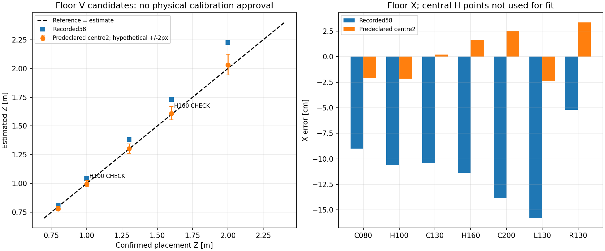
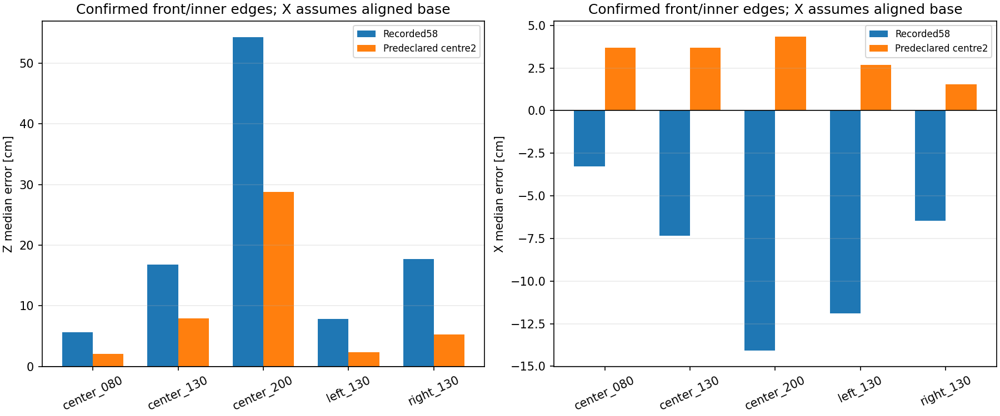

# 床面幾何候補・コーン転用・測定基準整理（2026-10-15）

## 結論

**基準点の後続確認：** [ユーザーの視認確認](../floor_visibility_confirmation_r01/README.md)で、1.30mより遠方のV字先端は潰れて特定困難と分かった。本フォルダのfitは既存の不確かなassistant候補に対する探索記録であり、物理校正として採用しない。

**同日後続の実データ確認：** [床とコーンを同じ動画で比較](../floor_cone_same_pose_analysis_r01/README.md)したところ、前回centre2は新しい床2点でも過小推定した。本候補を共通の本番校正として採用しない。以下は候補作成時点の結果として保存し、新しい2点へfitし直していない。

順に、(1)床面の幾何候補比較、(2)調整に使わない2点での確認、(3)pixel/点の感度、(4)過去コーン全frameへの転用、(5)台座の測定基準の確認・再評価、(6)撮影時の見え方の比較を実施した。

**床面の候補は改善したが、コーン距離/TTC/実機FFBの検証完了ではない。**
調整用5点・確認用2点で、事前指定した「画像中心だけ」の候補を調べた。確認用の前後差は1.00mで約-0.03cm、1.60mで約+0.95cm。
これは未確定のassistant pixel候補による同一録画内の値であり、「精度1cm保証」とは呼ばない。
コーンでは0.80/1.30/2.00mの推定中央値が0.820/1.379/2.287mとなり、遠方の差が残る。

**左右は測定基準の解釈を更新した。** ユーザー確認は、前後は台座の車体側の辺、左右は台座の内側の辺まで40cm、台座一辺37.5cm。
台座がほぼ軸に平行なら、左右の中心Xは±0.5875mであって±0.40mではない。
この基準での左右X差は候補適用後に約+2.69cm/+1.54cm。説明が得られる前の「右側で悪化」という比較は中心Xを±0.40mと仮定したもので、最終評価には使わない。
前後Zを台座中心へ読み替えて18.75cm足すことはしていない。

## 1. 方法と採用範囲

実行前に[方法・候補・探索範囲](method.md)を固定した。
調整用はC080/C130/C200/L130/R130。H100/H160はsolverとモデル選択へ入れない。
確認用2点は前段の基準モデル診断では既に見ていた点であり、完全な盲検や別環境holdoutではない。
確認用は中央だけなので、未見の左右配置を検証したとも扱わない。

pixelは以前の[候補CSV](../cone_floor_reference_real_r01/point_candidates.csv)をそのまま使用。距離に合わせて点を移していない。
高さは全fit候補でユーザー実測0.59mへ固定し、元の0.58mと高さのみ0.59mのモデルを別の基準として残した。
既存の等距離魚眼・順逆投影式だけを使い、歪み多項式や箱専用の経験的補正は導入していない。
前段で`fit_eligible=False`とした未検証pixelを、物理的GTへ格上げしたわけではない。今回は仮にそのpixel候補を使った場合の説明力を見る限定的な探索である。

## 2. 候補比較

| モデル | 自由変数 | 調整5点のpixel点RMSE | 確認2点のZ絶対差平均 | 確認2点のX絶対差平均 | 特記 |
|---|---:|---:|---:|---:|---|
| 記録値・58cm | 0 | 13.73px | 8.82cm | 10.97cm | 基準 |
| 高さだけ59cm | 0 | 14.08px | 11.21cm | 11.16cm | 高さ変更だけでは改善しない |
| **centre2：画像中心X/Y** | 2 | 3.09px | 0.49cm | 1.89cm | 実行前指定の主候補 |
| pose3：yaw/pitch/roll | 3 | 3.02px | 0.63cm | 1.53cm | 比較用 |
| centre_radius3：中心X/Y・半径 | 3 | 2.20px | 1.28cm | 1.79cm | 比較用 |
| centre_pose5：中心X/Y・3角 | 5 | 2.15px | 1.03cm | 1.27cm | 中心X/Yが探索下限へ到達 |

確認用誤差で勝者を選んだ表ではない。中心・角度の複数案で差が小さくなるため、**実際の光学中心や取付角を一意に測れたとは言えない**。
centre_pose5の正規化Jacobian条件数は約91、中心/姿勢が補償し合い、中心X/Yが探索境界へ達した。結果を見て範囲を広げたり、このモデルを本番採用したりしていない。

主候補centre2の有効設定は、元のcentre=(320,339)に対し約(307.030,334.485)。
`front_cx_offset=-92.9697403`、`front_cy_offset=-25.5149841`、h=0.59m。
pitch=1°/roll=2°/yaw=0°、radius_scale=0.86を維持。
これは**この床点集合を説明する有効値**であって、物理的な光学中心の実測値ではない。
保存した[candidate_parameters.json](results_r01/candidate_parameters.json)は探索記録であり、bird_eye用本番configとして渡すファイルではない。

## 3. 感度・除外点の影響

- 主候補を固定し、各調整点のx/yを仮に±2px動かす20通りを再fitした。H100のZは約0.995～1.005m、H160は1.598～1.621m。
- 調整点を1つずつ除く5通りでは、H100のZは約0.993～1.003m、H160は1.595～1.616m。
- これら25通りも確認用点をfitへ使わず、結果を見て主候補を置換していない。
- 仮定した±2pxは実測annotation誤差ではなく、結果の幅は信頼区間ではない。複数点が一緒に動く誤差や実測座標自体の誤差も、この20通りでは網羅しない。
- 既存の点を増幅した同一録画内の試験なので、別日・別の取付・別の物体への汎化は別に確認する必要がある。

根拠：[再fit感度CSV](results_r01/centre2_refit_sensitivity.csv)、[固定候補のpixel感度](results_r01/centre2_fixed_pixel_sensitivity.csv)。

## 4. コーン全録画への転用と基準点の更新

新しいYOLO推論は行わず、以前のbboxへ床面主候補を適用。
全3,596frameを保持し、従来使用した3,261frameを再投影。コーンなし332frameと複数正面枠3frameは引き続き不採用で残した。
コーンの正解ラベルや結果を床候補のfit/選択へ入れていない。

[ユーザーの基準点確認](cone_reference_confirmation.json)を受け、予測座標は一切変えず参照Xだけを再評価した。
左右の中心換算は、台座がほぼ車体X/Z軸に平行という前提。台座角度は実測されていないので、この前提を明記する。
もし正方形の最内側の支持点を40cmとし台座が0～45°回転していれば、中心の絶対Xは0.5875～0.6652mにもなりうる。これは実際の角度を推定したものではなく、前提による幅の説明に限る。

| 配置 | 比較X/Z [m] | 記録値のX中央値 | 主候補X中央値 | 主候補X差 | 記録値Z中央値 | 主候補Z中央値 | 主候補Z差 |
|---|---|---:|---:|---:|---:|---:|---:|
| 中央0.80 | 0 / 0.80 | -0.033 | +0.037 | +3.7cm | 0.857 | 0.820 | +2.0cm |
| 中央1.30 | 0 / 1.30 | -0.073 | +0.037 | +3.7cm | 1.468 | 1.379 | +7.9cm |
| 中央2.00 | 0 / 2.00 | -0.141 | +0.043 | +4.3cm | 2.542 | 2.287 | +28.7cm |
| 左1.30 | -0.5875 / 1.30 | -0.707 | -0.561 | +2.7cm | 1.378 | 1.324 | +2.4cm |
| 右1.30 | +0.5875 / 1.30 | +0.523 | +0.603 | +1.5cm | 1.477 | 1.353 | +5.3cm |

比較点は、横方向について台座中心、前後方向について車体側の辺、すなわち軸平行なら「車体側の辺の中点」を想定する。
bbox下端中央が実際にその物理点を表すかは未検証。台座一辺37.5cmの大きさがあるため、この対応を距離モデルと分けて調べる必要がある。
中央0.80mのX絶対差は少し増えた点も隠さない。前後差は残るため、ここから直接TTC/実機FFBへ進めない。

正しい参照条件：[reference_conditions.csv](reference_update_r01/reference_conditions.csv)。
最新の全frame：[cone_transfer_frames_updated.csv](reference_update_r01/cone_transfer_frames_updated.csv)、[最新集計](reference_update_r01/cone_transfer_summary_updated.csv)。
`results_r01/`と`contact_transfer_r01/`は回答前の仮定±0.40mを用いた歴史的な比較として残し、左右の最終評価には使わない。元の録画名やmetadataも改名・上書きしていない。

目視台座点へ置き換えた比較も実施したが、前後の推定は0.855/1.452/2.437mとなり、解消していない。
これは[以前の非盲検5点](../cone_static_distance_r01/manual_contact_candidates.csv)の転用であり、物理的な接地点の正解ではない。
参照座標から逆算したpixelは残差方向の説明にだけ使用し、その位置へラベルを動かしてはいない。

## 5. 撮影時の見え方の比較

同じmetadataでも車体の写り方が完全に同じとは限らないので、台座以外の車体付近の局所特徴を比較した。
原画像は無加工のまま、メモリ上の5領域について±20pxのテンプレート照合、離れた第2ピーク、逆向き照合を確認。
採用基準はNCC>=0.8、第2ピークとの差>=0.02、逆照合戻り差<=1px、探索境界ではないこと。あくまで説明用の経験的な基準で、誤対応確率を保証しない。
全結果・棄却を保存し、相関が高いだけで採用していない。

- 同一床録画内：採用9/15比較は全てdx=dy=0。
- 同一中央1.30mコーン録画内：採用12/15比較は全てdx=dy=0。
- 床とコーンの間：25比較中採用は5つで、いずれも前方右の機器領域。cone−floorでdx=-9～-8px、dy=-3～-1px、NCC約0.891～0.925。
- 中央の黄色テープ等は相関値自体が高くても別ピークとの差が小さいため棄却。繰り返し穴や模様も安易に確定しない。

**少なくともこの局所機器の写り方は異なる可能性があるが、これだけでカメラ姿勢変更を断定しない。**
機器自体の移動、取付の微小変化、車体のたわみ、撮影処理などを分離できていない。画像全体の平行移動や3D姿勢を推定したわけではない。
この局所ずれをコーンpixelへ足す補正は実施していない。

根拠：[全55照合CSV](view_audit_r01/local_feature_matches.csv)、[照合来歴](view_audit_r01/provenance.json)、[オフセット図](view_audit_r01/fixed_feature_offsets.png)。
手法は[OpenCV公式テンプレート照合](https://docs.opencv.org/4.13.0/d4/dc6/tutorial_py_template_matching.html)の既存機能を診断に限定して使用。画像の切抜き・注釈・変形ファイルは出力していない。

## 6. 次の確認と現時点の制限

床点とコーン点の基準が整理できたので、次の実データ確認では**同じ動画の中で、床基準→コーン1.30m→コーン2.00m→床基準**を連続して撮ると、別sessionへの校正転用と物体接地点の問題を分離しやすい。
既存の6条件の撮り直しや新しい学習を一式要求するものではない。
[次回の最小撮影手順](next_capture.md)を保存した。候補パラメータを収録PCへ適用せず、従来のFFB無効設定でrawを撮ればよい。
現時点では新しい実機コマンド、hardware adapterやFFBの起動は不要。

## 成果物・再現・検証

実行順は`run.py`→`compare_contacts.py`→`verify.py`→`view_registration.py`→`update_cone_reference.py`→`plot_updated_reference.py`→`verify_followups.py`。
各r01出力は上書きを拒否する。既に結果がある状態でそのまま再実行しない。

- [モデル別・点別結果](results_r01/floor_point_results.csv)、[モデル集計](results_r01/model_summary.csv)、[全来歴](results_r01/provenance.json)。
- [一次検証](verification.json)：確認用点を変えてもfitが変わらないこと、全42投影、3,596frameの保持、3,261座標の再計算、13本番configのhash不変。
- [追加検証](followup_verification.json)：最新参照値の再評価、全予測不変、前後基準不変、局所照合・図のhash確認。
- 新規21テスト（幾何12・参照更新5・照合4）と既存ground contact 9件が成功。未変更の床評価15・コーン投影17件の成功済結果は再利用。
- 既存ground contactテストの初回単独実行は`PYTHONPATH`不足でimport失敗。`PYTHONPATH=src`を指定した再実行で9件成功し、本体コードは修正していない。
- 参照再評価の初回CSV保存で列不一致が出たため、列を統一して修正・5テストを追加した。途中出力は`recordings/2026-10-15_cone_reference_update_failed_r01/`へ移して保存し、最終結果と混同しない。削除はしていない。

生成したのは実験用script・CSV・JSON・数値グラフだけ。元画像、モデル、元録画、runtime本体、本番設定、FFB安全機構は不変。Git commit/pushは依頼されていないため未実施。
