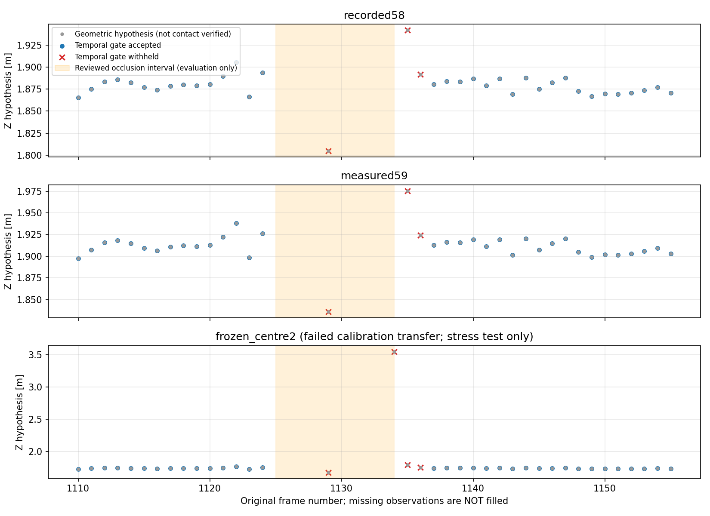

# コーン距離仮説の品質ゲート：オフライン実装・回帰評価

2026-10-15。結論：欠測後に距離を即採用せず、連続確認してから復帰する処理を実装した。
既知の部分遮蔽による不自然な距離は保留された。ただし、接地・距離精度・TTC・FFBの
実機利用を承認する結果ではない。本番への接続・設定変更・物理出力は行っていない。

## 実装

- [品質ゲート](../../../src/cone_observation_quality.py) は、既存の
  `ObstacleObservationGate`（連続確認）と `BlueObstacleTracker`（NIS付きKF）を再利用。
  **青箱の既存コードは変更していない**。
- 初回、欠測・拒否・複数候補の解消後は3フレームで再確認。
  前候補から0.15m以内、NIS上限9.21。幅・高さ・縦横比の急な2倍超/半分未満への
  変化も保留する。その他の固定値・限界は [評価方法](method.md) を参照。
- 内部予測を観測距離として返さない。欠測を「障害物なし」「距離0」と解釈しない。
  採用されても `floor_contact_verified=False`、`usable_for_ffb=False` を維持する。
- 単一対象への関連付け後の処理であり、多数コーンから危険対象を選ぶ処理ではない。
  同一姿勢録画の中央ROIは実験対象の関連付けに限って使い、正解距離・区間・frame番号を
  ゲートへ渡していない。全視野の元予測は既存CSVにそのまま保持している。

## 1. 同一姿勢録画：1547フレーム×3投影条件

静止区間の評価。連続録画全体を処理してから既存区間で集計し、区間境界で状態はリセットしない。
欠測・遮蔽・設置/移動区間も全行保存。

| 投影条件 | 1.30m区間の採用数/全数 | 2.00m区間の従来投影可→品質採用/全数 | 採用Z中央値（1.30 / 2.00m） |
|---|---:|---:|---:|
| recorded58 | 218/218 | 539→536/548 | 1.271 / 1.870m |
| measured59 | 218/218 | 539→536/548 | 1.293 / 1.902m |
| frozen_centre2：転用失敗済み・ストレス条件のみ | 218/218 | 540→536/548 | 1.203 / 1.730m |

`frozen_centre2` を推奨校正へ戻したわけではない。採用後のばらつきが小さくなっても、
校正バイアスや接地点の誤りが解決したことにはならない。

### 遮蔽区間の経過

| frame | 結果 |
|---|---|
| 1124 | 最後の採用 |
| 1125–1128 | 中央対象の検出なし。距離は返さない |
| 1129 | 一瞬検出復帰するが、連続確認待ちで保留 |
| 1130–1132 | 再欠測。確認をやり直す |
| 1133 | 全条件で既存の投影範囲チェックが拒否 |
| 1134 | recorded58/measured59は既存の範囲チェックが拒否。frozen_centre2は3.549mと投影されるが、新ゲートの確認待ちで保留 |
| 1135–1136 | 通常の矩形へ戻っても確認待ち |
| 1137 | 採用再開。復帰候補1135から約66.7ms、最後の採用1124から約424.1ms |

したがって、新ゲートが既存範囲チェック以上に効いた具体例は **frozen_centre2の1134**。
ここでNISや形状チェックが拒否したと取り違えない。既存58/59条件の1133/1134は元から拒否済み。
3フレーム確認だけでもこの事例は保留できたが、安定して誤った距離が続けば採用され得る。
「遮蔽を完全検知した」とは解釈しない。



元画像は以前保存した [frame1133](../floor_cone_same_pose_analysis_r01/occlusion_diagnosis_r01/occlusion_raw_f001133.png)
と [frame1134](../floor_cone_same_pose_analysis_r01/occlusion_diagnosis_r01/occlusion_raw_f001134.png) を参照。
どちらも元解像度・全画角・無編集PNG。新しい加工画像は生成していない。

## 2. 過去6本：3596フレームの回帰

3投影条件とも採用数は同じ。下表は1条件当たりの数。
中央ROIを流用せず、前レンズ内の候補を入力し、複数候補は最良スコア選択せず保留する。

| 録画 | 全数 | 投影可能な単一候補 | 品質採用 | 追加の確認待ち |
|---|---:|---:|---:|---:|
| 中央0.80m | 722 | 722 | 720 | 2 |
| 中央1.30m | 651 | 651 | 649 | 2 |
| 中央2.00m | 632 | 632 | 630 | 2 |
| 左1.30m | 628 | 628 | 626 | 2 |
| 右1.30m | 631 | 628 | 623 | 5 |
| コーンなし | 332 | 0 | 0 | 0 |
| 合計 | 3596 | 3261 | 3248 | 13 |

右の差3フレームは複数候補（54/56/57）として元から保留し、解消後の確認待ちも記録。
通常録画には追加のNIS・形状拒否は発生しなかった。投影可能3261行に対する採用は99.60%。
これは**検出Precision/Recallや距離精度ではない**。コーンなし332行は距離欠測として保持し、
安全確認済みとは扱わない。

## 3. 検証と再現

- 新規品質ゲート15件、CSV入出力・因果性/再現性8件：通過。
- 既存コーン投影17件、追跡12件、接地点9件、前回の同一姿勢解析6件：通過。合計67件。
- 接近・後退±0.25m/sは**合成列の単体テスト**。実走行コーンの検証ではない。
- 2入力群×3条件の全15,429行を再計算し、保存結果と完全一致。
  欠測非補完、全フレーム保存、前回固定した入力・生画像・本番設定のハッシュ一致を確認。
- 完全なテストスイート全体やROS・実機は実行していない。詳細は [verification.json](verification.json)。

```bash
cd ~/theta_ws/RICHO-theta
/home/robo25/theta-env/bin/python3 -m unittest discover -s tests -p test_cone_observation_quality.py -v
/home/robo25/theta-env/bin/python3 -m unittest discover -s Experimental_results/2026-10-15/cone_observation_quality_r01 -p test_replay_quality.py -v
# 再評価時は未使用の出力先を指定する。保存済みresults_r01は上書き拒否。
/home/robo25/theta-env/bin/python3 Experimental_results/2026-10-15/cone_observation_quality_r01/replay.py \
  --output-dir Experimental_results/2026-10-15/cone_observation_quality_r01/results_r02
```

元予測は `../floor_cone_same_pose_analysis_r01/inference_r01/` と
`../cone_static_distance_r01/inference_r01/`。本評価は再推論せず、そのCSVを利用した。
全行 [observations.csv](results_r01/observations.csv)、集計 [summary.csv](results_r01/summary.csv)、
遮蔽周辺 [occlusion_rows.csv](results_r01/occlusion_rows.csv)、入力・設定・出力ハッシュ
[provenance.json](results_r01/provenance.json) を保存。
Matplotlibのキャッシュ書込み先警告・未使用の3D投影警告は出たが、2Dグラフの保存・目視確認は完了。

## 次の判断

品質ゲート開発は一区切り。残る主課題は、録画間で変わる距離バイアスの原因と
台座の実接地点の扱いである。単なる時間平滑化で校正完了としてはならない。
距離推定を独立に検証し、複数対象・実走行・遅延/欠測時のUNKNOWN動作を確認した後に、
コーン用TTC→FFBのdry_runへ接続する。今回の実装をそのまま実機出力へ接続しない。
