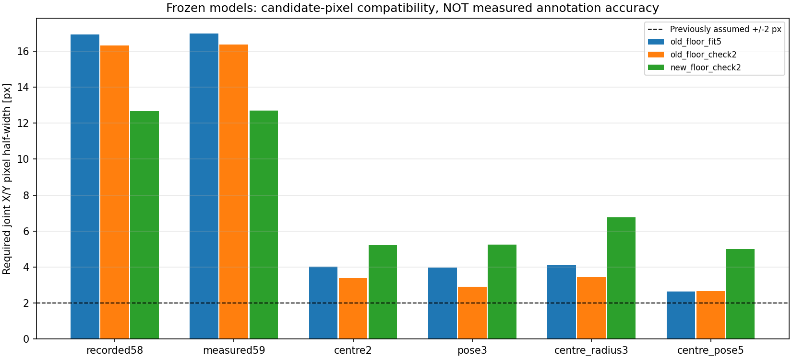
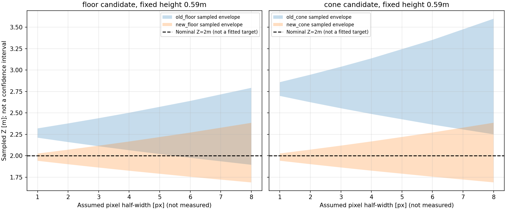

# 床・台座の読取り幅と固定投影モデルの再検証

2026-10-15。**既存の目視pixel候補を精密な正解として扱って校正値を決めるには、根拠が不足している。**
後続の[ユーザーによる視認確認](../floor_visibility_confirmation_r01/README.md)で、1.30mはかろうじて見えるが、それより遠方のV先端は潰れて特定困難と分かった。以下は仮定感度の探索記録として残し、遠方pixelを校正GTへ昇格しない。
固定状態・原点等は問題なしというユーザー確認を維持する。画像差を固定不良と決めつけず、
読取り幅とレンズ投影の仮定を分けて検証した。

元の床/台座候補14点と保存済み6モデルは変更せず、84組の点別残差と504組の感度を保存した。
元画像を目視し直したが、新しい点へ移動していない。今回新fit・新モデル選択はしていない。
本番設定、モデル重み、ROS/FFB出力は変更していない。

## 1. 床の6px差は、読取り誤差が3pxずつあれば重なる

同じ物理座標が同じpixelに写ると仮定し、以前と今回の候補点の正方形範囲が
重なるために必要な、両方に等しく与える最小pixel半幅を求めた。

| 対象 | 今回−過去のX/Y差 | 範囲が重なる最小の共通半幅 |
|---|---:|---:|
| 床1.30m | 0 / +4px | ±2px |
| 床2.00m | 0 / +6px | ±3px |
| 台座目視1.30m | −3 / +12px | ±6px |
| 台座目視2.00m | −2 / +14px | ±7px |

**これは実際の読取り誤差の測定ではない**。例えば床2mの過去387±3pxと今回393±3pxは
y=390pxで接するが、実際の先端が390pxだと判定したわけではない。
配置誤差・台座の物理的な代表点の違いも未測定。候補範囲の重なりだけで
カメラモデルが全点に整合すると証明することもできない。

従来の±2pxは感度を見るための仮定で、根拠を持ったannotation精度ではなかった。
特に床の遠方V字は数画素しかないため、6px差だけで物理姿勢変化を確定できない。
一方、台座候補は±2～3px程度の読取り幅だけでは過去と今回を同じpixelとして説明できない。
目視点が同じ物理部分を選べているかも含め、原因は未確定のままとする。

根拠：[point_overlap.csv](results_r01/point_overlap.csv)。

## 2. 6モデルを凍結したまま、床9点に対するpixel残差を比較

参照座標を順投影したpixelと、目視候補のX/Y両方を比べた。
下表は各群の最大L∞残差で、全点を候補pixelの範囲に含めるのに必要な半幅。

| 固定モデル | 過去の調整5点 | 過去の確認2点 | 今回の床2点 |
|---|---:|---:|---:|
| recorded58 | 16.94px | 16.32px | 12.67px |
| measured59 | 16.99px | 16.37px | 12.71px |
| centre2 | 4.02px | 3.40px | 5.23px |
| pose3 | 3.98px | 2.92px | 5.26px |
| centre_radius3 | 4.09px | 3.43px | 6.76px |
| centre_pose5 | 2.64px | 2.66px | 5.00px |

全て過去の保存パラメータをそのまま使用。調整に使った点も含むので、盲検評価や
モデル選択のランキングではない。今回の2点へ合わせ直していない。
centre_pose5等の自由度を増やして以前の点へ合わせても、新しい2点で残差が増える。
少なくとも**仮定±2pxで全床点を説明できる保存済みモデルはない**。

ただし、これで魚眼モデルそのものの不成立を証明したわけではない。点候補・参照設置・
撮影状態・パラメータの誤差を分離できておらず、広い読取り幅を許せば整合して見えるモデルもある。
その幅を実測せず、都合よく広げて合格にすることはしない。
前回のcentre2を本番採用しない判断は維持する。他のモデルへ勝手に切り替えない。



根拠：[点別84行](results_r01/fixed_model_residuals.csv)、[モデル別集計](results_r01/fixed_model_summary.csv)。
順投影pixelは残差を説明する数値であり、実画像の候補位置をそこへ移す指示ではない。

## 3. 前後が合っても横位置が合ったとは言えない

高さ0.59m・未調整モデルの2.00m床点を、候補x/yの周囲±2pxで投影した例：

| 床点 | サンプルZ範囲 | サンプルX範囲 |
|---|---:|---:|
| 過去 | 2.160～2.378m | −0.174～−0.110m |
| 今回 | 1.901～2.071m | −0.155～−0.100m |

今回のZ範囲は参照2.00mを含むが、中央X=0を含まない。
「2mに近いからこの高さ/校正を採用」という判断では横位置を見落とす。
ここでのX偏りも精密な真値誤差の確定値ではなく、既存候補と固定幾何の対応結果。



1/2/3/4/6/8pxの全整数オフセット格子を評価した。範囲外は補正・clipせず、無効数を保存。
最小/最大は格子サンプルの包絡で、連続領域の厳密な上下限や信頼区間ではない。
サンプルZ範囲に参照が入る判定と、X/Z両方の整合を別列にした。
根拠：[感度504行](results_r01/pixel_band_sensitivity.csv)。

## 4. 次に必要なこと

ここから不確かな点へfitを繰り返しても、「読取り点に合わせた」のか
「正しいカメラモデルになった」のかを区別できない。
**まず既存画像の床V先端を人が確認し、特定できる点と特定困難な点を分けることが優先**。
特定困難な点は、既知の距離から逆算したpixelへ寄せず、未確定として残す。
現在のassistant候補を人が承認したGTとして扱ってはいけない。

この段階では撮影一式のやり直しは要求しない。既存画像で確定可能かを先に確認する。
その確認でも遠方の基準が決まらない場合に限り、高視認性の基準による追加取得を検討する。
レンズ歪み係数を増やす、YOLOを再学習する、FFBへ直接つなぐことでこの不足を代替しない。

## 5. 検証・再現・限界

- 新規10テストが成功：候補範囲の重なり/対称性、両軸、同一点、不正入力、格子数、
  無効値非補完、格子包含、画像境界、入力非改変、高さ比例を確認。
- [独立検証](verification.json)：84残差・4組の範囲交差・504感度行を確認。
  感度はスカラー評価と別のベクトル光線経路で再計算し、サンプル数と極値が一致した。
- 元候補・保存パラメータ・原PNG・本番設定等のhash不変を確認。
  幾何/品質/追跡の実装を変更していないため成功済み既存テストは再利用。
- 全体テストスイート、実機、ROS、モデル推論は実行していない。
- 元画像は全画角・元解像度で閲覧しただけ。注釈・切抜き・リサイズ・色補正画像は保存していない。
  保存した新画像はCSV由来のグラフ2枚のみ。既存の未使用Axes3D警告は出たが2D図の保存・目視確認は成功。
- 元画像：
  [以前の床frame187](../cone_floor_reference_real_r01/raw_samples/floor_reference_f000187.png)、
  [今回の床frame141](../floor_cone_same_pose_analysis_r01/raw_samples/same_pose_f000141.png)、
  [以前のコーン2m frame211](../cone_static_distance_r01/raw_samples/center_200_f000211.png)。

実行条件：[method.md](method.md)、入力/出力のhash：[provenance.json](results_r01/provenance.json)。
`analyze.py`→`verify.py`は既存結果を上書き拒否する。保存済みr01へそのまま再実行しない。
テストは以下で再実行できる。

```bash
/home/robo25/theta-env/bin/python3 -m unittest discover \
  -s Experimental_results/2026-10-15/cone_pixel_uncertainty_r01 \
  -p test_pixel_uncertainty.py -v
```

Git commit/push・日報は今回依頼されていないため行っていない。
