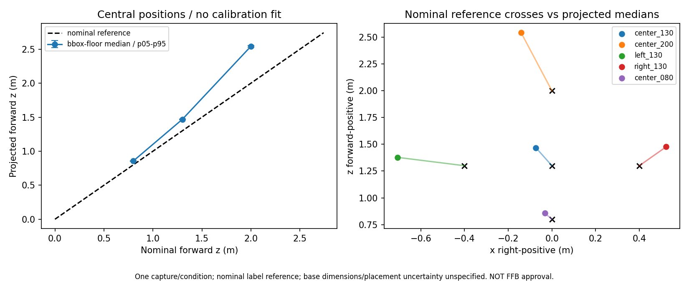
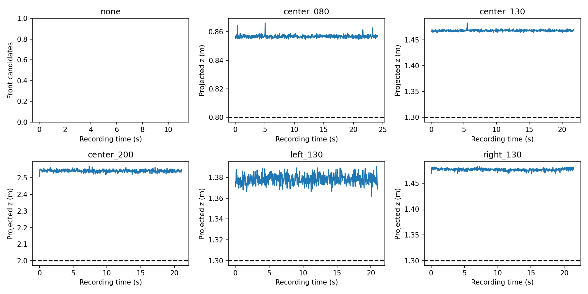

# 赤コーン静止6条件の検出・距離解析（2026-10-15）

## 結論

**録画6本は正常に受け入れでき、固定した36枚版・confidence0.50による検出は安定していた。一方、距離・横位置の系統偏りが残り、そのままTTC/実機FFBへ接続する段階ではない。**
現時点で同じ6本の撮り直しは不要。まず保存済みの画像と座標変換を診断する。
ユーザー回答は「従来のやり方です。今回だけ変更しているとかはありません」。
従来と同じカメラ直下/Kobuki中心を起点として比較し、今回だけ測定起点や取付を変えたとは仮定しない。
細かな実測値/設置誤差/台座寸法の追記はなく、距離ラベルを参照座標として保持した。1cm程度の差を理由に録画全体を不合格にしていない。

## 1. 受入れ・収録条件

原本：`/home/robo25/Downloads/10151400.tar.xz`、約209MiB。
展開先：`recordings/2026-10-15_cone_static_distance_intake_r01/`。元動画はGit対象外。
既存の安全展開関数を使用し、全rawを逐次デコード、CSV連番/狭義単調時刻/動画枚数/native geometryを照合。
全録画1280×720、前段と同じcamera geometry、camera height設定0.58m。
全3,596frameでODOMあり、linear/angularの絶対最大はどちらも0。
録画metadataのAI/FFB publish/relayは全て0。今回の解析もROS送信・実機出力をしない。

| 条件 | frame | 最終記録時刻 | sample read rate |
|---|---:|---:|---:|
| コーンなし | 332 | 11.05秒 | 30.01fps |
| 中央0.80m | 722 | 24.12秒 | 29.92fps |
| 中央1.30m | 651 | 21.76秒 | 29.91fps |
| 中央2.00m | 632 | 21.10秒 | 29.94fps |
| 左x=-0.40m/z=1.30m | 628 | 21.00秒 | 29.91fps |
| 右x=+0.40m/z=1.30m | 631 | 21.39秒 | 29.50fps |

0.80mの元label/sessionは先頭cが抜けた`one_static_center_z0p80_r01...`。
明示的な対応表で0.80m条件へ対応させ、元ファイル・metadataは改名しない。
各録画4frame、合計24枚を1280×720の全画角・無加工PNGで保存し、元デコード画素とのhash一致を検証。
各条件の中盤代表1枚と後述のextra出力1枚を目視。全frameの人によるbbox annotationは未実施。

根拠：[session_conditions.csv](session_conditions.csv)、[intake_summary.json](intake_summary.json)、[raw_sample_manifest.csv](raw_sample_manifest.csv)、[目視所見](visual_review.csv)。

## 2. 固定モデルの全frame検出

前段で選んだ次の開発候補を変更せず使用：

- 自作36枚版YOLOv8n、best SHA256 `3a6e124adb15c16efd7d22c853406066371f48873c82f1d3cfc445b22ae5997b`。
- confidence0.50、imgsz960、FP32、batch1、rect=false、NMS IoU0.7、max_det300。
- RTX3070、torch2.14.1+cu130。学習・閾値探索・友人モデルの追加試験なし。
- 推論前後の元raw/metadata/CSV/model hash一致。

| 条件 | 正面出力あり / 全frame | 正面2件以上 | 座標統計に使用 |
|---|---:|---:|---:|
| コーンなし | 0 / 332 | 0 | 対象なし |
| 中央0.80m | 722 / 722 | 0 | 722 |
| 中央1.30m | 651 / 651 | 0 | 651 |
| 中央2.00m | 632 / 632 | 0 | 632 |
| 左1.30m | 628 / 628 | 0 | 628 |
| 右1.30m | 631 / 631 | 3 | 628 |

コーンありの全3,264frameで正面出力が継続。
ただし全frameの正解bboxがないため、Recall/Precision100%と呼ばない。
コーンなしは全332frameで全画角とも予測0。今回の条件での出力であり、未知背景全ての誤検出率0を保証しない。

右条件frame54/56/57（約1.79～1.90秒）にextraの正面枠が1つずつ出た。
[frame54の原画像](diagnosis_r01/right_130_f000054.png)では、extra枠は通過する人物の上半身/腕付近に対応し、右床上の赤コーンとは別。
その3frameでもコーン自体の枠は継続。confidence最大の枠を黙って選ばず、**正面枠が複数ある3frameは曖昧として距離統計から除外**した。
全frameの候補・除外理由は保存し、良い区間だけを切り出していない。
extra枠の下端はhorizonより上で、床面投影候補にはならなかった。ただしこれだけで複数対象/欠測の運用仕様が完成したとは扱わない。

推論の初回除外pipeline p95は19.50～25.25ms。offline decode/推論/枠対応/CSV書込の範囲であり、live GUI/ROS/FFBの遅延ではない。
根拠：[推論summary](inference_r01/video_summary.json)、[予測CSV](inference_r01/predictions.csv)、[推論来歴](inference_r01/provenance.json)。

## 3. 距離・横位置：未補正の床面仮説

同日追記：以下の左右参照X=±0.40mは、台座中心の値と解釈していた段階の記録。
その後、ユーザーから「台座の内側の辺まで40cm、一辺37.5cm」と確認したため、辺が軸に平行なら中心Xは±0.5875mになる。
予測や元録画は変更せず、[最新の測定基準による再評価](../cone_geometry_candidates_r01/README.md)を別保存した。左右の最終判断はそちらを使う。

既存の魚眼光線モデルへbbox下端中央を入力し、床平面との交点を計算した。
recorded metadataのcamera geometryを使用し、青箱用のx補正/距離補正やBEV車体描画offsetは流用しない。
参照値へ合わせるfit、平滑化、外れ値除去、前値/0距離の補完は実施しない。
正面1枠かつ投影できるframeだけを統計へ入れ、欠測/曖昧frameは元の全frame表に残す。

| 条件 | 参照x/z [m] | 推定x中央値 [m] | 推定z中央値 [m] | x差 [cm] | z差 [cm] | zの時間標準偏差 [cm] |
|---|---|---:|---:|---:|---:|---:|
| 中央0.80m | 0 / 0.80 | -0.033 | 0.857 | -3.3 | +5.7 | 0.094 |
| 中央1.30m | 0 / 1.30 | -0.073 | 1.468 | -7.3 | +16.8 | 0.151 |
| 中央2.00m | 0 / 2.00 | -0.141 | 2.542 | -14.1 | +54.2 | 0.739 |
| 左1.30m | -0.40 / 1.30 | -0.707 | 1.378 | -30.7 | +7.8 | 0.435 |
| 右1.30m | +0.40 / 1.30 | +0.523 | 1.477 | +12.3 | +17.7 | 0.216 |

時間変動は小さいが、位置の偏りは残る。**安定性と正確性は別**。
中央は遠いほど過大な距離になり、横位置にも左右非対称の偏りがある。
細かな1～2cmの設置/停止位置誤差を許容することと、2mで約54cmの偏りをそのまま実機FFBへ使うことは別である。
同じ配置の連続frameは独立した多数の設置試験ではなく、各条件1回の記録。
台座の参照点・絶対camera height/angle・設置誤差が数値化されていないので、表はラベル参照との差であり厳密な校正精度の合格判定ではない。
左右配置の平面斜距離はsqrt(0.4²+1.3²)≒1.360m。これを前後z=1.30mと混同せず、CSVでは別々に集計した。

## 4. 追加録画なしの限定診断

画像のbbox下端は見える台座付近にあり、大きな反射領域へ枠が伸びている様子は代表点では確認しなかった。
ただし、bbox下端中央が物理的な接地点と一致するという独立の正解はまだない。

各条件のmedian bboxを固定し、x方向/下端y方向をそれぞれ±2pxずらす説明用の25通りを計算した。
±2pxは**仮定**であり、人が測ったannotation誤差や統計的な信頼区間ではない。

| 条件 | 固定median pixelのZ [m] | 仮定±2pxでのZ範囲 [m] | 参照Zにするための下方向pixel差 |
|---|---:|---|---:|
| 中央0.80m | 0.857 | 0.835～0.879 | +5.64px |
| 中央1.30m | 1.468 | 1.419～1.520 | +7.61px |
| 中央2.00m | 2.542 | 2.412～2.687 | +10.15px |
| 左1.30m | 1.378 | 1.328～1.431 | +3.47px |
| 右1.30m | 1.477 | 1.421～1.536 | +7.73px |

この仮定内では単なる1～2pxの揺れだけで偏りは解消しない。
右列は「どれくらいpixelが違えば数値が変わるか」の逆算であり、その量だけbboxをずらす推奨補正ではない。
表示原画像・label・本番設定は変更しない。
幾何設定と実カメラの対応、bbox下端と台座参照点の対応を次に調べる必要があり、原因の確定まではしていない。

過去の[青箱の距離診断](../../2026-10-07/distance_reference_analysis/geometry_diagnosis.md)でも、表示座標/描画offset/物理投影を分離する必要があった。
青箱の経験的な補正係数をそのままコーンへ貼って解決した扱いにはしない。
ローカルのWebSim側にある10/14のfloor_reference録画も確認したが、metadataのdeviceは`http://127.0.0.1:8100/mjpeg`。
シミュレーション映像であり、今回の実カメラを独立に校正した実測データには転用していない。

根拠：[pixel_sensitivity.csv](diagnosis_r01/pixel_sensitivity.csv)、[診断来歴](diagnosis_r01/provenance.json)。

### 4.1 台座下端の目視候補との比較（続行分）

保存済みの中盤原画像5枚で台座下端付近をassistantが参考指定し、**同一frameのYOLO枠**と同じ未補正投影で比較した。
中央0.80/1.30/2.00mの目視点Zは0.894/1.550/2.730m、左右1.30mは1.468/1.536m。
今回の指定では枠下端から目視点へ変更しても過大推定は解消せず、枠だけを直せばよいという説明では足りない。
非盲検の説明用5点であり、人によるGTや校正完了とは扱わない。原画像は加工せず、camera geometry/本番設定も変更していない。
仮定±3px感度、原PNGhash、同一frame比較CSVとグラフ、追加7テストを保存した。
詳細：[台座接地点の限定診断](contact_diagnosis_r01/README.md)。

## 5. 現在地と次

1. 新しい背景でも、今回の正面・静止5配置では赤コーンの出力が継続した。検出モデルを作り直す前に距離側を切り分ける。
2. 原画像の目視候補との比較に続き、[実カメラ床面基準の収録手順](../cone_floor_reference_preparation/README.md)で取得した録画を受領し、[床V字基準の診断](../cone_floor_reference_real_r01/README.md)も実施済み。床点でも距離・横位置に偏りが見られ、59cmの実測高さだけに変更しても解消しない。遠方のV先端は数画素で未確定という限界を残し、幾何の校正候補を検討する。同じ6本の撮り直しや再学習を先に要求しない。
3. もし補正を検討する場合も、この5配置へ合わせた値だけで合格とせず、確認用の配置を分離して検証する。
4. 距離が未検証のまま、TTC→ROS dry_run→実機FFBへは進めない。既存の青箱系・FFB上限・watchdogは変更しない。

画像を増やすための再学習・ラベルの自動追加・距離補正の本番実装は行っていない。
解析出力の全ては`floor_contact_verified=False`・`usable_for_ffb=False`。

## 成果物・検証

- [全frameの座標/除外理由](analysis_r01/positions.csv)、[位置統計](analysis_r01/summary.csv)。
- [全予測の床面仮説](analysis_r01/projection_hypotheses.csv)、[ゼロ区間](analysis_r01/zero_runs.csv)。
- [解析来歴](analysis_r01/analysis_summary.json)、[診断原画manifest](diagnosis_r01/raw_manifest.csv)。
- [無加工PNG24枚のmanifest](raw_sample_manifest.csv)、各`raw_samples/`。
- 再現scriptは`intake.py`→`infer.py`（GPU）→`analyze.py`→`diagnose.py`。
  固定されたr01出力への再実行は拒否する。再実行する場合は新しいrun名を明示し、原本/結果を上書きしない。

全raw 3,596frameデコード、model/原本/PNG hash、録画設定/ODOM、1対1frame/prediction対応、未使用frameの保持、集計/グラフを確認。
既存コーン関連179件の成功は変更のない本体について再利用。追加scriptの構文、統計の独立再計算、診断の逆算結果を確認済み。
[verification.json](verification.json)に全3,596frameの保持、座標3,261行の再計算、原PNG24枚＋診断1枚、曖昧3frameの保持、元入力/hashと図のhashを記録。これは内部整合性のPASSで、測距精度PASSではない。
既存MatplotlibのAxes3D警告は出たが、2D図生成と目視は成功。
新規学習・ROS/FFB駆動・Git commit/pushは今回依頼されていないため実施していない。
