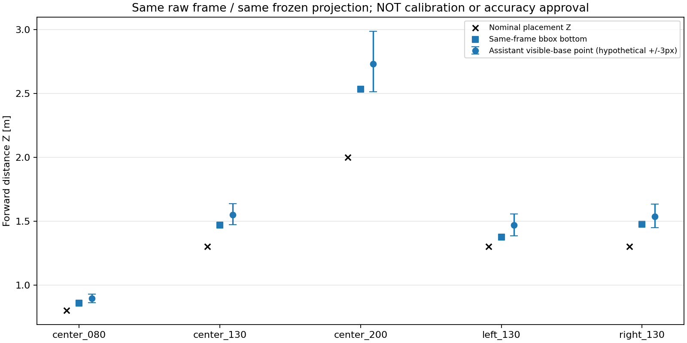

# 台座の目視点とYOLO枠下端の同一frame比較

## 結論

保存済みの無加工原画像から台座下端付近を選び、YOLO枠下端と**同じframe・同じ固定カメラ幾何**で比較した。
今回選んだ5点では、目視点へ置き換えても距離の過大推定は解消せず、むしろ大きくなった。
**「YOLO枠が台座より上で切れているため遠く見積もった」という説明だけでは、この代表画像の結果を説明できない。**
次に優先するのは再学習ではなく、実カメラ画像と床面投影の対応の検証である。
ただし、これだけで特定のカメラパラメータが誤りと確定したわけではない。正解の接地点や実カメラ校正が得られたとも扱わない。

## 方法と限界

- 前回保存した各正配置の中盤代表frameを各1枚使用。無加工1280×720のPNGをそのまま参照し、新しい画像加工・モデル推論・録画はしていない。
- 原画像の見た目から、台座の下側の辺の中央付近をassistantが指定した。[候補点CSV](../manual_contact_candidates.csv)に記録。
- **参照距離と前回結果を見た後の非盲検・説明用の指定**。ユーザーによるannotationでも、測量した接地点でもなく、訓練labelや校正GTに流用しない。下辺の正確な中央と物理的な測距終点が一致する保証もない。
- 比較対象は全frame中央値ではなく、**指定した同一frameの実際のYOLO枠**。前回全録画の表とは少し数値が異なる。
- metadataのcamera height=0.58m、pitch=1°、roll=2°、radius_scale=0.86、front centre=(320,339)等を固定。青箱の経験的な補正・表示offsetは適用しない。
- `ground_contact.dual_fisheye_pixels_to_vehicle_rays`による既存の光線を使い、床面との交点を計算。選んだ点も枠下端も同一式。枠下端について前回保存座標との1e-12m以内の一致を検査。
- 選んだ点をx/y各±3px動かす49通りも計算。この幅は**仮定した感度確認**であり、実測した目視誤差や信頼区間ではない。
- 従来どおりカメラ直下/Kobuki中心を距離起点として比較。取付高さ/傾きが今回だけ変わったとは仮定していない。元の参照値は配置labelであり、細かな実測値・台座寸法は追加されていない。

## 数値結果

Zは前後方向の距離で、左右条件の平面斜距離ではない。

| 配置 | frame | 参照Z [m] | 枠下端Z [m] | 目視点Z [m] | 目視点の仮定±3pxのZ範囲 [m] |
|---|---:|---:|---:|---:|---|
| 中央0.80m | 241 | 0.80 | 0.857 | 0.894 | 0.860～0.929 |
| 中央1.30m | 217 | 1.30 | 1.468 | 1.550 | 1.471～1.637 |
| 中央2.00m | 211 | 2.00 | 2.533 | 2.730 | 2.512～2.988 |
| 左x=-0.40/z=1.30m | 210 | 1.30 | 1.375 | 1.468 | 1.386～1.557 |
| 右x=+0.40/z=1.30m | 211 | 1.30 | 1.476 | 1.536 | 1.449～1.633 |

5点とも目視点のy座標は枠下端より約2.2～3.8px上だった。固定投影では、より上の床点を使うほど遠くなる。
したがってこの置換は偏りを打ち消す向きではなかった。
仮定±3pxの範囲も全5配置で参照Zを含まないが、これは感度確認の範囲内の結果であり、有意差検定や精度不合格の閾値ではない。

横方向も残る。目視点のXは中央0.8/1.3/2.0mで-0.032/-0.086/-0.148m、左で-0.757m、右で+0.538m。
下端の取り方を変えるだけで横位置の偏りも解決したとは言えない。



全座標、同一frameのbbox、原PNGのhash：[paired_contact_comparison.csv](paired_contact_comparison.csv)。
原画像は[候補点CSV](../manual_contact_candidates.csv)のfile列にある`../raw_samples/`の5枚。注釈を描き込んだ画像は保存していない。

## ここからの進め方

1. 検出モデルと閾値は固定して維持する。この結果だけを理由に再学習や同じ静止6本の撮り直しはしない。
2. 実THETA画像で座標が分かる床面点を使い、光線モデル/画像中心/半径/取付姿勢と床面の対応を独立に確かめる。既存WebSimの床面録画はシミュレーション由来で、この実カメラの正解にはしない。
3. 補正を検討するときは、校正に使う点と確認に使う点を分ける。今回の5配置へ合わせた値を同じ5配置で評価して合格とはしない。高さだけ、定数offsetだけ、bboxの下方移動だけを根拠なく採用しない。
4. 距離が確認できてから、コーン座標→既存TTC判定→ROS dry_run→制限付き実機FFBへ進む。今回ROS送信・実機駆動は実施していない。

この診断は原因候補の絞り込みまで。原画像からの目視点を厳密なGTへ格上げしたり、距離の正確さが検証済みと宣言したりしない。
全5行の`floor_contact_verified`、`usable_for_ffb`はともにFalseのまま。

## 再現・検証

初回生成コマンド（既存r01への上書きを拒否するため、今回の出力がある状態では再生成しない）：

```bash
/home/robo25/theta-env/bin/python3 Experimental_results/2026-10-15/cone_static_distance_r01/contact_diagnose.py
```

読み取り検証コマンド：

```bash
/home/robo25/theta-env/bin/python3 -m unittest discover \
  -s Experimental_results/2026-10-15/cone_static_distance_r01 \
  -p test_contact_diagnose.py -v
```

追加7テスト：既存bbox式との一致、非有限/画像外入力、上向き/レンズ外の拒否、高さの入力制約、床面交点の高さ比例、感度範囲/幅の検証、保存結果のhash/座標/安全フラグ。
元PNG5枚のファイルhash・デコード画素hashを生成時に照合し、終了時も入力/code/画像hashが変わっていないことを確認。
保存結果と根拠は[provenance.json](provenance.json)。これは整合性検証であり、実機精度・FFB試験のPASSではない。
既存のAxes3D警告は出たが、使用している2Dグラフは生成後に目視確認できた。
本体コード・モデル・本番config・FFB安全機構・Git履歴は変更していない。
