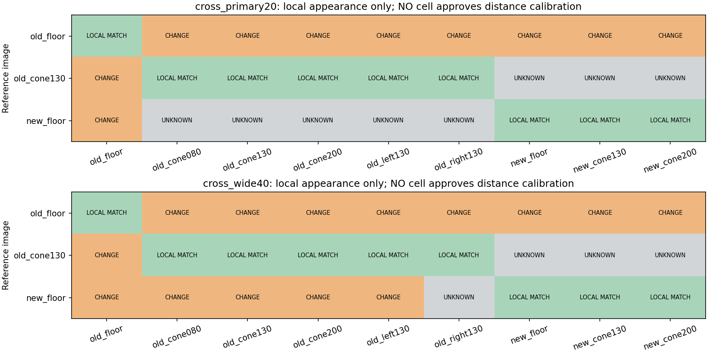

# 校正流用前の局所画像状態チェック：オフライン実装

2026-10-15。**撮影状態の違い・照合材料不足を自動で区別して記録する処理を追加した。**
後続の[ユーザー確認・取得経路レビュー](../capture_path_review_r01/README.md)では、固定・原点・載せ替え等に問題なしという回答を受領した。以下の画像上の局所変化を固定不良の確定診断とは扱わない。
距離補正器やカメラ姿勢推定器ではなく、校正を無条件に流用しないための開発用診断である。
今回の連続録画内の15比較点は局所一致したが、以前の録画との間には変化/判定不能が残る。

実装：[src/cone_view_consistency.py](../../../src/cone_view_consistency.py)。
既存の照合CSVを読み込むだけで、カメラ・モデル・ROSを起動しない。FFBにも接続していない。
前段の局所照合手法を再利用し、新しい画像アルゴリズムや依存関係は導入していない。

## 1. できるようになったこと

| 状態 | 意味 | 距離校正としての扱い |
|---|---|---|
| `LOCAL_APPEARANCE_MATCH` | 信頼条件付きの異なる2領域以上が±2px以内。採用全領域で大きなずれなし | 見え方の局所一致だけ。距離精度の確認が別途必要 |
| `LOCAL_CHANGE_OBSERVED` | 信頼条件付きで1領域以上に±2px超の差 | 自動の校正流用は見送る判断材料 |
| `INSUFFICIENT_EVIDENCE` | 採用領域不足、照合不成立、不正・重複診断など | 「変更なし」とせず、判定保留 |

CSVの採用フラグをそのまま信じず、相関・競合ピーク差・逆照合戻り差・探索境界を再確認する。
異なる基準/画像の結果は混ぜず、基準IDと対象IDごとに集計する。
詳細な固定条件・限界は [method.md](method.md)。±2pxは開発閾値で、距離精度保証ではない。

**全ての状態で** `calibration_validated=False`、`floor_contact_verified=False`、
`usable_for_ffb=False` を維持する。一致したセルを「距離校正PASS」「FFB許可」と呼ばない。
他の処理へ距離使用を強制停止させるruntime連携は今回実装していない。

## 2. 保存済み照合400行・80組の結果

| 入力群 | 比較組数 | 局所一致 | 局所変化 | 材料不足 |
|---|---:|---:|---:|---:|
| 直前の録画間比較・探索±20px | 27 | 9 | 10 | 8 |
| 同じ比較の補助探索±40px | 27 | 9 | 14 | 4 |
| 今回の同一動画内15比較点 | 15 | 15 | 0 | 0 |
| 過去の同一動画内対照・床/コーン比較 | 11 | 6 | 5 | 0 |
| 合計 | 80 | 39 | 29 | 12 |

同じ画像の自己比較や探索範囲違いも含む。**80組は80個の独立した実験ではない**。
この比率を変化検知のPrecision/Recallやカメラ姿勢の正解率とは解釈しない。

今回の連続動画は、frame141を基準にした15比較点全てが一致。採用領域の変位は0px。
この動画内で大きな変化を観測しなかったという結果であり、全1547frameの取付状態を
検査したわけでも、姿勢が物理的に完全固定と証明したわけでもない。

今回床を基準とする±40pxの比較では、過去床・過去中央0.80/1.30/2.00m・過去左の5組は変化、
過去右は材料不足、今回床・コーン1.30/2.00mの3組は一致となった。
逆向きの比較では照合が成立せず材料不足となる例もあり、判定を無理に対称にそろえていない。
機器自体の移動でも局所変化となるので、カメラ姿勢の変化と断定しない。



根拠：[全80判断](results_r01/combined_summary.csv)、[来歴・設定・ハッシュ](results_r01/provenance.json)。
元の照合CSVは前段フォルダに保持。元画像を加工したファイルは作っていない。
新しく保存した画像は上のCSV由来のグラフ1枚のみ。

## 3. 検証

- 新規16テスト成功。空/単一/競合/境界/逆照合失敗、複数一致、局所変化、
  不正・重複・非有限値、基準混在防止、CSV CLI、上書き拒否、FFB不可フラグを確認。
- [独立検証](verification.json)：判定関数を呼ばず400行から80判断を再計算して一致。
  15比較点の局所一致、全出力のFFB不可、前段の元画像・本番config/source hash不変を確認。
- 青箱・コーンの投影・追跡・品質処理を変更せず、前段の成功済検証を再利用。
  全体テストスイート・実機・ROSは実行していない。
- Matplotlibの未使用Axes3D警告は出たが、2D図の生成と目視確認は完了。

## 4. 再利用コマンド

既存の±40px照合CSVを、別の未使用出力先で再評価する例。GPU・実機不要。
CSVに結果があるため入力画像をもう一度解析する処理ではない。

```bash
cd ~/theta_ws/RICHO-theta
python3 src/cone_view_consistency.py \
  --matches Experimental_results/2026-10-15/cone_distance_bias_diagnosis_r01/wide_search_r01/local_feature_matches.csv \
  --reference-column reference_case \
  --case-column current_case \
  --output-dir Experimental_results/2026-10-15/cone_view_consistency_r01/recheck_wide_r01
```

出力先は毎回未使用の場所を指定。既存の結果は上書き拒否する。
コマンドの正常終了は解析処理の完了であり、距離校正やFFBの合格ではない。
固定した基準IDを使うCSVでは `--reference-column` の代わりに `--reference-id` を指定できる。

```bash
python3 -m unittest discover -s tests -p test_cone_view_consistency.py -v
```

全入力群の再現scriptは `run.py`、独立検証は `verify.py`。保存済み `results_r01` と
`verification.json` の上書きを拒否するので、そのまま再実行せず未使用出力先へ向ける必要がある。

## 5. ここから実機で確認すること

画像上の不一致を記録する仕組みまでは追加録画なしで用意できた。
しかし**ソフトウェアだけで固定部の緩みや機器の載せ替え、物理的な姿勢変化を判別することはできない**。
次はカメラの固定方法・車体との相対位置・録画間の機器変更の有無を確認し、その状態に対応する
床基準とコーンの検証をそろえる必要がある。未確認の高さ/角度を推測して補正値へ入れない。

今回の連続動画には床1.30/2.00mの2点しかないため、それだけへ再fitして左右や他距離へ
汎化したとはしない。校正を確認した後、コーン距離→TTC→ROS dry_run→制限付き実機FFBの順へ進む。
今回は校正の自動選択や実機出力を追加せず、Git commit/push・日報更新も行っていない。
