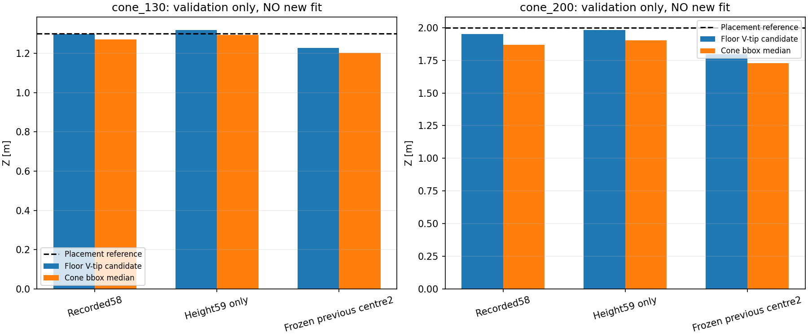
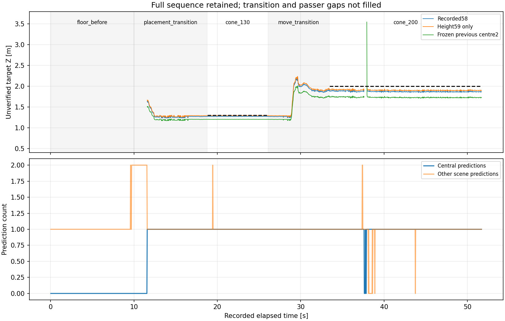

# 同一動画内の床V字・コーン距離比較（2026-10-15）

## 結論

**録画は正常で、撮り直さず今回の比較に使用できる。**
同一動画では床V先端と目視の台座下端の差が約0～1px、YOLO bbox下端中央値との差が約1.3～2.0pxだった。
以前の別session比較で残った差を、YOLO枠だけの問題や単一のカメラ補正値で説明しきったとは言えない。

**前回のcentre2候補は今回の床点でも短めに推定するため、本番採用しない。** 新しい2点へ合わせ直すfitはしていない。
高さだけ59cmとした別比較では、コーン1.30mが約1.293m、2.00mが約1.902m。遠方には約10cmの差が残る。
さらに通行人の遮蔽中に欠測・不正な床面投影があり、**検出枠が出たことだけではFFB用距離として有効にできない**。
本番config・カメラ取付・FFB安全機構は変更していない。

## 1. 受入れ・参照情報

- 原本：`/home/robo25/Downloads/floor_cone_same_pose_r01_20261015_160621_378.tar.xz`（約104MB）。
- 安全展開先：`recordings/2026-10-15_floor_cone_same_pose_intake_r01/`。
- session：`floor_cone_same_pose_r01_20261015_160621_378`。
- 1280×720、1,547frame、最終記録時刻51.690秒、記録間隔から約29.93fps。全rawをデコードし、CSV連番・時刻・枚数を照合。
- 全frameでODOMあり、linear/angular絶対最大はともに0。metadataのcamera geometryは収録用設定と一致。AI・FFB publish・relayは無効。
- ユーザー確認：**床Vは1.30m/2.00mの2点。末尾の床のみ区間は未撮影**。7点を再取得した、床へ戻した後も正常だった、とは扱わない。
- コーンの位置は[依頼した手順](../cone_geometry_candidates_r01/next_capture.md)の中央1.30/2.00m、車体側の台座辺の中央をV先端へ合わせる条件として比較。精密な配置誤差の測定値は提供されていない。
- 高さ59cmは先ほどの床→レンズ中心のユーザー実測を再利用。今回の録画で高さを独立再測定したわけではない。

原画像は[代表frame141・床](raw_samples/same_pose_f000141.png)、[frame563・中央1.30m](raw_samples/same_pose_f000563.png)、[frame1265・中央2.00m](raw_samples/same_pose_f001265.png)。
合計17枚（等間隔12枚・区間確認3枚・遮蔽例2枚）を元解像度・全画角・無加工PNGで保存し、元デコード画素との一致を検査した。

## 2. 固定推論と区間

自作36枚版YOLOv8n・confidence0.50・imgsz960・FP32・batch1・NMS0.7・maxdet300を変更せず、RTX3070で全1,547frameを解析。
weights SHA256：`3a6e124adb15c16efd7d22c853406066371f48873c82f1d3cfc445b22ae5997b`。
前回の[固定推論script](../cone_static_distance_r01/infer.py)を、新しい入力/出力パスへ向けて再利用した。学習、重み更新、閾値探索、外部送信なし。

左奥に実物の黄色コーン、冒頭右端付近に待機中の赤コーンが見える。全画角の予測2,784件は全て保存。
距離比較に限り**bbox中央Xが270～350pxの中央対象**を範囲とした。画像の配置から選んだ実験対象の範囲であり、未知対象を認識するruntimeの複数物体選択仕様ではない。
黄色コーンの正しい予測を「誤検出」と数えていない。全画角GTがないのでPrecision/Recall100%とも呼ばない。

| 区間 | frame | 経過時刻の目安 | 取扱い |
|---|---|---|---|
| 冒頭・中央にコーンなし | 1～300 | 0.03～9.99秒 | 中央ROIの枠0/300。画面全体がコーンなしではない |
| 1.30mへ設置中 | 301～562 | 約10～18.8秒 | 全frame保持、距離の正解を付けない |
| 1.30m静止 | 563～780 | 18.83～26.06秒 | 218frameで中央枠継続 |
| 2.00mへ移動中 | 781～999 | 約26～33.4秒 | 全frame保持、距離の正解を付けない |
| 2.00m静止 | 1000～1547 | 33.46～51.69秒 | 548frame。途中の通行人遮蔽も残す |

frame480はまだ手を掛けていたため、目視で手が離れているframe563を静止区間の開始にした。推定誤差の良さで区間を選んでいない。
移動・手の接触・遮蔽を削除した動画や、都合のよい検出だけを残した全体集計は作っていない。
根拠：[区間と前提](scope.json)、[全frame・3モデルの仮説](analysis_r01/observations.csv)、[元推論](inference_r01/predictions.csv)。

## 3. 未調整設定・実測高さ・凍結候補の比較

| モデル | 床1.30mの候補 | コーン1.30m中央値 | 床2.00mの候補 | コーン2.00m中央値 |
|---|---:|---:|---:|---:|
| 記録設定：高さ58cm | 1.297m | 1.271m | 1.949m | 1.870m |
| 高さだけ実測59cm | 1.319m | 1.293m | 1.983m | 1.902m |
| 前回のcentre2凍結候補 | 1.227m | 1.203m | 1.798m | 1.730m |

58cmは元metadata。59cm列はオフライン計算だけで高さを変更したもの。centre2は前回求めたh=0.59m、centre≒(307.030,334.485)等を**そのまま**使用。
今回の床2点・コーン2配置を使ってpixelや中心/角度/半径をfitし直していない。

新しい録画でcentre2の前後差は拡大したため、前回の床点で改善した値を共通校正として採用する裏付けは得られなかった。
高さだけ59cmの列でZが近く見えても、それだけで採用しない。Xは中央1.30/2.00mでも約-9.1/-12.5cm残り、横位置が校正済みとは言えない。
良いモデルのXと別モデルのZを根拠なく寄せ集めた補正も作っていない。

2.00m区間の使用frameは58/59cmモデルが539/548、centre2が540/548。遮蔽時の範囲外判定が異なるため、使用数は同一ではない。
共通有効539frameだけの**副次集計**でもcentre2の中央値は約1.730mで、上の結論は変わらない。
ただし元の主集計から遮蔽・外れを削除していない。[共通frame集計](occlusion_diagnosis_r01/common_valid_summary.csv)を別保存した。

## 4. 同じ動画の床先端と台座下端

| 参照距離 | 床Vの目視候補pixel | 台座下端の目視候補pixel | 台座候補−床のy差 | bbox下端中央値−床のy差 |
|---|---|---|---:|---:|
| 1.30m | (310,416)、frame141 | (310,417)、frame563 | +1px | +1.32px |
| 2.00m | (311,393)、frame141 | (310,393)、frame1265 | 0px | +2.03px |

目視点はassistantの非盲検候補。画像から選び、正解距離からpixelを逆算していない。数画素なので厳密な接地点GTではない。
目視の台座点を59cmモデルへ通すと1.299/1.984mになるが、同じ配置に対する点選びの結果であり「精度が完成した」とは扱わない。
床点・台座点とも仮にx/y±2pxを動かした感度を併記。特に遠方の2pxは距離へ無視できない影響を持つ。
今回の59cmモデルでは、床2.00m候補1.983mに対してbbox下端から1.902mとなり、差は約8cm。小さな枠下端差が前後差へつながる例となった。
これを根拠に全bboxを一律2px上げる補正は作らない。台座の向き・距離・遮蔽で対応が変わりうるためである。

根拠：[候補点](contact_candidates.csv)、[相対pixel](analysis_r01/relative_contact_pixels.csv)、[投影・仮定感度](analysis_r01/contact_projections.csv)。

## 5. 同一動画内の見え方

以前の固定車体特徴の照合方法・5領域・採用条件を変更せず、冒頭frame141に対し等間隔/区間確認の15枚を比較した。
75照合中45が採用条件を満たし、前方左の穴、前方右機器、後方右下テープの3領域で、全て局所dx=dy=0だった。
少なくともこの動画内の比較点では大きな写り方の変化は見られない。物理的な高さ/姿勢が完全に同一と測量したわけではない。
末尾に床だけを撮っていないので、空の床マーカーが元の位置へ戻ったことや、コーン撤去後の正常復帰を直接確認したとも扱わない。
根拠：[75照合CSV](analysis_r01/within_video_vehicle_features.csv)。

## 6. 遮蔽時の注意点

2.00m静止中に通行人が台座付近を隠す場面がある。
中央枠なしは7frame。frame1133/1134では上側に残ったコーンの枠が出るが、その下端は台座接地ではない。
凍結centre2ではframe1134が床面の単純な距離範囲を通り、**約3.55m**へ飛んだ。元58/59cmモデルではこの2frameが範囲外として落ちた。
全て`physical_contact_verified=False`、`usable_for_ffb=False`の仮説であり、実際のFFBへ送っていない。

[frame1134の無加工原画像](occlusion_diagnosis_r01/occlusion_raw_f001134.png)と[全欠測/範囲外/飛び行](occlusion_diagnosis_r01/all_failure_rows.csv)を保存。
検出confidenceと下向き床光線だけでは接地の確認にならない。欠測/部分遮蔽・急なbbox変化・観測整合性を扱うコーン側の品質ゲートが、実機接続前に必要になる。

## 7. 現在地・次

1. 中央静止コーンの枠出力と、床Vからの相対位置を同じ動画で確認できた。末尾の床だけを撮り直すことは現時点で要求しない。
2. 前回centre2を本番へ採用しない。異なる撮影状態へ共通の補正を移せるかは未検証で、幾何・取付の再現性と物体接地点の対応を分けて管理する必要がある。
3. 追加録画を増やす前に、この動画を使ってコーンの距離品質・欠測/遮蔽ゲートをオフラインで検討できる。今回そのruntime実装は行っていない。
4. 動的TTC→ROS dry_run→制限付き実機FFBの順へ進む前に、単なる検出枠とFFBに使える観測を分離する。今回の中央ROIをそのまま汎用の対象選択へ使わない。

## 検証・再現

- [検証結果](verification.json)：元録画/モデル/source/config/PNG hash、全1,547frame・2,784予測・4,641行の保持、投影の別経路再計算、統計の独立再計算を確認。
- 無加工PNG17枚の画素hashを確認。グラフ2枚だけを数値CSVから生成して目視。
- 新規6テスト成功：区間の網羅、手の接触の扱い、他コーンの保持、複数枠を単純最大値選択しないこと、欠測/飛びを残すこと、新fit/末尾区間を捏造しないこと。
- 既存のモデル推論・幾何・品質関連の変更されていない実装の成功済検証は再利用。本体コード、重み、環境を変更していない。
- 既存のMatplotlib Axes3D警告は出たが、使用している2D図は生成・確認できた。

再現scriptは`intake.py`→`infer.py`（GPU、前回固定実装の再利用）→`export_boundaries.py`→`analyze.py`→`diagnose_occlusion.py`→`verify.py`。
いずれも既存結果への上書きを拒否するため、現在のr01へそのまま再実行しない。
テストは`/home/robo25/theta-env/bin/python3 -m unittest discover -s Experimental_results/2026-10-15/floor_cone_same_pose_analysis_r01 -p test_sequence_analysis.py -v`。
整合性検証の成功は、測距精度・TTC・実機FFBの合格ではない。
新規学習、ROS/実機出力、Git commit/pushは実施していない。
