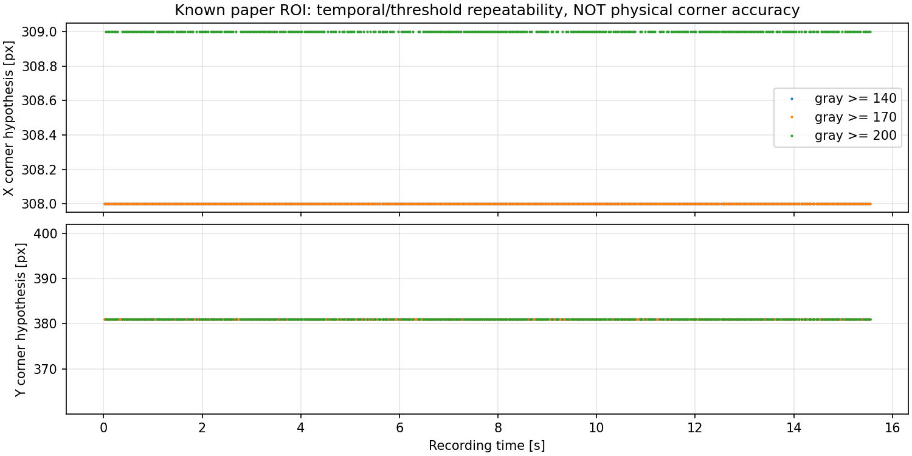

# A3白紙2枚・2m角の視認性確認

2026-10-15。**今回の白紙はV字より明確に見え、次の基準点取得に使える見込みがある。**
左/前方レンズの紙の車体側・左角を、代表原画像から区別できた。
ただし今回は単一位置の視認性試験であり、距離校正・レンズ内部校正・コーン距離・FFBの合格ではない。

## 1. 受入れと基準点

- 原本：`/home/robo25/Downloads/itikakunin_20261015_181034_492.tar.xz`（約35MB）。
- 展開先：`recordings/2026-10-15_white_paper_visibility_intake_r01/`。
- 467frame、1280×720、最終時刻15.544秒、記録間隔から約30.01fps。
- raw/BEV/detection各動画とCSVは467frameで一致。全rawをデコードして確認。
- ODOMは467frame全てあり、linear/angularの絶対最大とも0。
- enable_ai=0、FFB publish=0、relay=0。撮影パラメータは既存の
  `Experimental_results/2026-10-08/floor_reference_preparation/floor_reference_capture_config.json` と全項目一致。
- ユーザー報告：A3用紙2枚を合わせて左端を2mへ配置。車体中央も問題ないと思う、とのこと。
- 前段の依頼どおり「車体に近い辺の左端の角」を測距点とする想定で確認した。
  紙の厳密なサイズ/向き/平面性や、中央X・距離の測定不確かさは提供されていない。
  A3寸法から距離や姿勢を逆算していない。

基準点として確認したのは、白紙全体の中心や奥の角ではなく、**手前側の左角**。
代表元画像：[frame200](raw_samples/paper_f000200.png)、[frame134](raw_samples/paper_f000134.png)。
全8PNGを元解像度・全画角・無編集で保存し、デコードrawとの画素一致を確認。

## 2. 閾値・時間に対する角候補の安定性

実験用紙の場所を原画像から特定して、既知ROI内で3つのgray閾値を比較した。
新しい汎用マーカー認識器ではない。ROI/輪郭条件は [method.md](method.md) に固定。
参照距離へ近づく閾値を選ぶ処理はしていない。

| gray閾値 | 角候補/全frame | 候補pixel中央値(X,Y) | 時間内X/Y範囲 | 紙のbbox中央値(W,H) |
|---|---:|---:|---:|---:|
| 140 | 467/467 | (308,381) | X=308、Y=381 | 39×14px |
| 170 | 467/467 | (308,381) | X=308、Y=381 | 39×13px |
| 200 | 400/467 | (309,381) | X=309、Y=381 | 37×13px |

閾値200の残り67frameは、四角形の輪郭条件を満たさず保留として記録した。
失敗を削除したり、直前の候補で埋めたりしていない。

整数pixelの輪郭候補としては、低/中閾値で時間変動がなく、閾値間の差もXの1pxだった。
これは**繰返し性の結果で、物理的な角位置を1px精度で測れたという保証ではない**。
紙端・ぼけ・MJPG・閾値境界・輪郭近似による偏りはあり得る。
V字より大きな紙面と床の境目が得られたので、少なくとも「先端が丸く潰れて読めない」という
前段の視認上の問題を減らす手段として使える見込みがある。



根拠：[候補1401行](analysis_r01/corner_candidates.csv)、[閾値別集計](analysis_r01/threshold_summary.csv)。

## 3. 視認性と距離校正は別

角候補を既存モデルへ固定投影した参考値。新fitはしていない。

| 投影条件 | 閾値140/170のZ中央値 | 閾値200のZ中央値 |
|---|---:|---:|
| 記録設定・高さ58cm | 2.591m | 2.590m |
| 高さのみ実測59cm | 2.636m | 2.634m |

配置申告2.00mとの差は依然大きい。Xも58cm条件で約−0.202m、59cm条件で約−0.206m
（閾値140/170）となる。中央配置はユーザーの概ねの確認で、測量したXの誤差量を確定した表ではない。
それでも、角候補を安定して見つけることと、現在の幾何が正しいことを同一視してはいけない。
不確かなV字だけを原因と断定せず、より見やすい基準を複数配置して投影モデルを評価する段階。

この1点に合わせてpitch/中心/半径を変更すると、他の距離・左右で成立するか確認できない。
前回のcentre2へ戻す、Zだけ比例補正する、本番へ適用することは行っていない。
角候補・投影参考値の全行で physical_corner_verified=False、usable_for_ffb=False。
根拠：[固定投影2802行](analysis_r01/fixed_projection_reference.csv)。

## 4. 次の取得

**同じ白紙・同じ角を使い、車体とカメラを動かさず、紙だけを移動して複数位置を撮る。**
画面中心へ紙の中心を合わせ直すのではなく、距離・左右とも常に同じ手前左角を基準にする。
次の7点を1本の連続録画で取る手順は [next_capture.md](next_capture.md)。
既存の不鮮明なV字の録画を削除する必要はない。
今ある2mの1点だけで校正を完了したことにせず、新しい可視基準で調整点/確認点を分ける。

## 5. 検証・保存・再現

- 新規12テスト成功。既知向きの角、FFB不可、欠測非補完、複数/ROI境界/小領域拒否、
  ROI外非検出、入力形状/閾値/ROI検証、元画像非改変、距離正解を使わない処理を確認。
- [独立検証](verification.json)：全raw467frameを再読込し1401候補と一致、
  無編集PNG8枚のhash/画素一致、2802投影の光線式再計算、以前の元データ/本番設定hash不変を確認。
- 既存幾何・runtime・FFB処理に変更はなく、成功済み関連テストを再利用。
  全体テストスイート、実機、ROS、YOLO推論は実行していない。
- 新しい画像は元解像度の無編集PNG8枚とCSV由来のグラフ1枚。
  Matplotlibの未使用Axes3D警告は出たが、2D図の保存・目視確認は成功。
- 受入れ：[intake_summary.json](intake_summary.json)、[元画像manifest](raw_sample_manifest.csv)、
  [分析来歴](analysis_r01/provenance.json)。生録画はGit対象外のrecordingsに保持。

再現順は `intake.py`→`analyze.py`→`verify.py`。いずれも保存済みr01への上書きは拒否する。
CPU環境 `/home/robo25/theta-env/bin/python3` を利用。テストは次で再実行できる。

```bash
/home/robo25/theta-env/bin/python3 -m unittest discover \
  -s Experimental_results/2026-10-15/white_paper_visibility_r01 \
  -p test_paper_visibility.py -v
```

Git commit/pushと日報更新は今回依頼されていないため実施していない。
