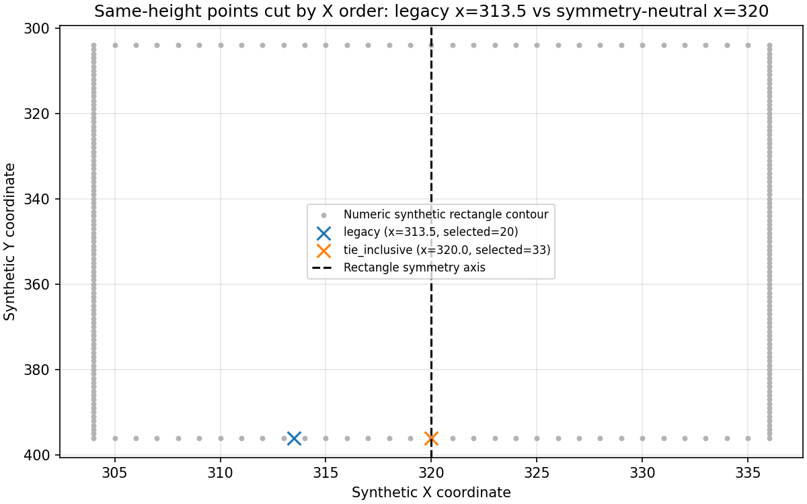
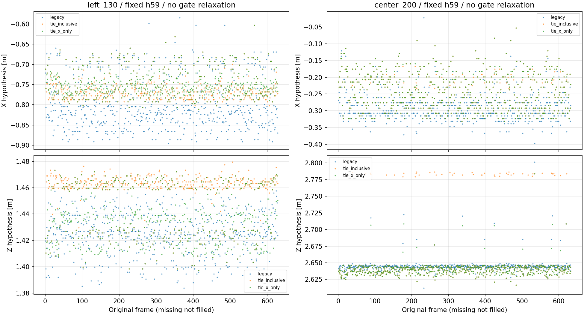
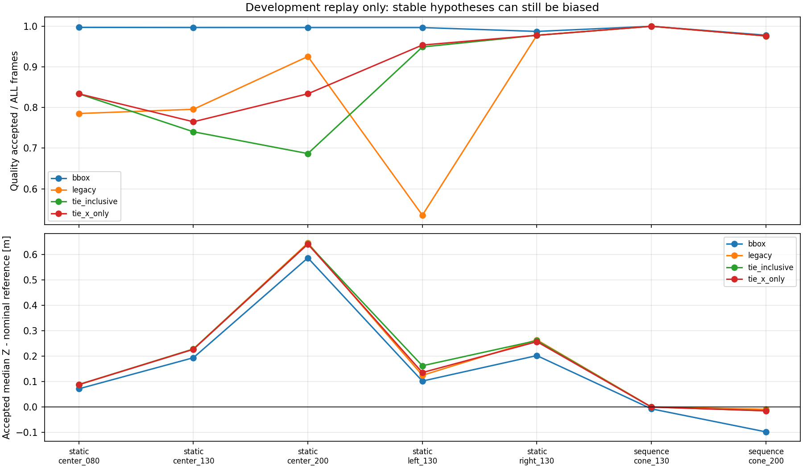

# 色輪郭の下端が左右に跳ねる原因と修正候補（2026-10-19）

後続：[下辺/支持範囲を一点と分ける画像診断](../cone_support_extent_r01/README.md)。
全frameで下包絡と観測区間を保持し、一本線に収まらないケースも比較した。
幾何転用とは分離し、距離推定や本番FFB出力へは接続していない。

## 結論

**診断用の下端選択に、同じ高さの点を左から打ち切る偏りを確認した。**
合成図形で再現し、既存7録画・全5,143frameで影響を比較した。
最初の修正案の悪化も保存し、Yを維持してXだけ直す追加候補まで検証した。

- Xだけの修正では、静止左1.30mの品質採用が **336→599/628frame**。
  投影Xの隣接frame差の絶対値p95は約 **17.4→9.0cm**。
- 既知の遮蔽1125..1134では採用せず、1135/1136の確認後、1137で採用再開。
- 一方、中央1.30/2.00mは旧色方式より品質採用が少ない。
  静止2.00mの推定も約2.64mのままで、距離転用問題は解決していない。

したがって、**左右の不安定さの一因は特定したが、この候補を本番へ採用する判断は保留**。
今回の改善は既に見た開発録画上の回帰で、独立した汎化検証ではない。
追加録画なし。本番src/config、元画像/録画、モデル、FFB安全機構・出力は無変更。
全行 `floor_contact_verified=False, usable_for_ffb=False` を維持した。

## 1. 確認できた実装上の偏り

旧方式は輪郭点を「Y降順→同じYならX昇順」に並べ、下側8%だけを取ってXY中央値にしていた。
水平な下辺に同じYの点が多数あっても、採る点数の途中で切るため、左側の点だけ残る。
`CHAIN_APPROX_NONE`で水平辺の境界点も保持されるため、この条件は実際に起きる。

幅33pixelの対称な赤い長方形を使った数値テストでは、
下辺33点のうち左側20点だけが選ばれ、代表X=313.5となった。
対称軸はX=320なので **6.5pixelの左偏り**。同点を全て含めるとX=320になった。
旧方式は左右反転への整合を満たさず、修正案は点列の並べ替え・平行移動・左右反転に整合した。



仕様は [NumPy lexsort](https://numpy.org/doc/stable/reference/generated/numpy.lexsort.html) と
[OpenCV輪郭](https://docs.opencv.org/4.13.0/d4/d73/tutorial_py_contours_begin.html) を確認した。
本用途の距離精度がこれらの仕様で保証されるわけではない。
旧方式は[前段の診断用helper](../cone_contact_reuse_r01/contact_pixels.py)に残し、上書きしていない。

## 2. 最初の案：同点を全て含めるXY中央値

[検証前固定の方法](method.md) に沿って、k番目のY以上の輪郭点を同点ごと全て採り、XY中央値とした。
色閾値、ROI、輪郭の選択/拒否、8%、geometry、品質判定は変えなかった。

- V30で色候補があった4,354frameのうち、4,131frameで旧方式が同じYの点を打ち切っていた。
  全frameの旧pixel/拒否理由は前回の凍結CSVと完全一致した。
- 左の品質採用は336→596に増えたが、静止中央2.00mでは585→434へ減った。
- 原因の一つは、点集合を広げたことで**Y中央値も変わる**こと。
  静止中央2mでは632frame中45frameで新旧Yが異なった。

具体例：同じ中央2m録画のframe37→38。

| 値 | frame37 | frame38 |
|---|---:|---:|
| 旧Y [px] | 381 | 381 |
| 同点を含めたXY中央値のY [px] | 381 | 379 |
| 同候補のZ、高さ59cm [m] | 2.637 | 2.786 |
| 同候補の品質判定 | 採用 | NISで保留 |

Xだけの問題を直すつもりでも、Yを一緒に変えると床交点が変わる。
この失敗結果を隠さず [r01のpixel](results_r01/pixels.csv)、[同一frame比較](results_r01/frame_pairs.csv) に保存した。
台座の本当の接地点が判明したわけではない。

## 3. 追加案：従来Yを維持しXだけ同点偏りを直す

上の結果を見てから [追加比較の方法](method_x_only.md) を固定した。
`tie_x_only` は、Xだけ同点を全て含めた集合の中央値、Yは旧方式の下側k点の中央値とした。
旧YはY順だけで決まり、同じY内のX順序には依存しない。
前段pixel台帳を再利用できるため、新しいraw再デコード・推論は不要だった。

ただし、XとYの周辺代表値の組は必ずしも輪郭の実在点や台座の中心ではない。
この定義の修正だけで、物理接地・距離の正しさを保証しない。

### 高さ59cm・全区間frameを分母にした品質採用数

| 配置 | 全frame | 旧色下端 | XY同点込み | Xだけ修正 | Xだけ修正の採用Z中央値 [m] |
|---|---:|---:|---:|---:|---:|
| 静止0.80m | 722 | 567 | 602 | 602 | 0.888 |
| 静止1.30m | 651 | 518 | 482 | 498 | 1.527 |
| 静止2.00m | 632 | 585 | 434 | 527 | 2.640 |
| 静止左1.30m | 628 | 336 | 596 | 599 | 1.435 |
| 静止右1.30m | 631 | 617 | 617 | 617 | 1.557 |
| コーンなし | 332 | 0 | 0 | 0 | 欠測 |
| 連続録画1.30m | 218 | 218 | 218 | 218 | 1.300 |
| 連続録画2.00m | 548 | 535 | 535 | 535 | 1.985 |

床300frame、設置262frame、移動219frameも全て保存。
各方式の採用frame集合が違うため、この中央値の差だけを改善量と解釈しない。
同一frameの生投影比較は [frame_pairs.csv](x_only_r01/frame_pairs.csv) に残した。

### 隣接frameの投影候補の差（欠測を飛び越さない）

| 条件・指標 | 旧色下端 | XY同点込み | Xだけ修正 |
|---|---:|---:|---:|
| 静止左：X差絶対値p95 [m] | 0.174 | 0.099 | 0.090 |
| 静止左：XY差>0.15mの組数 | 81 | 3 | 2 |
| 静止中央2m：Z差絶対値p95 [m] | 0.0168 | 0.1467 | 0.0180 |
| 静止中央2m：XY差>0.15mの組数 | 11 | 79 | 18 |
| 連続2m：X差絶対値p95 [m] | 0.0476 | 0.0294 | 0.0295 |

Xだけの案は初回案の大きなZ跳躍を抑えたが、中央でのX揺れやNIS拒否は残った。
左の保留理由はROI端7、連続確認待ち20、NIS2frame。
中央2mでは確認待ち71、NIS34frameで、旧方式より悪い。
採用数は時間的整合の結果であり、検出recall・接地正解率・距離精度ではない。





## 4. 遮蔽・復帰と残る限界

3geometryとも、Xだけの案は既知の遮蔽1125..1134で採用なし。
1135/1136の確認後に1137で復帰し、高さ59cmでは元の復帰候補1135から約66.7ms。
旧色方式の1138より1frame早いが、これはこの記録上のtimestamp差であって実時間処理遅延ではない。
欠測を内部予測やbbox値で埋めていない。

共通geometryの転用問題は残る。静止2mでは新候補も2.64m付近を安定して採用する。
既知距離でgeometryを切り替える処理、NIS/確認距離を緩めて通す処理は作らなかった。
反射・色境界・下辺の傾き・遮蔽等の個々の残存寄与は未確定。
カメラ固定不良や物理姿勢変化を原因と断定していない。

## 5. 検証と成果物

- 新規30件（点選択12、全録画回帰10、Xだけの追加案8）成功。
- 前段品質回帰27件、既存床接点9/コーン投影17/品質15/追跡12件も再実行し成功。
  **計110件成功**。全リポジトリ・ROS・実機は未実施。
- 旧pixel全5,143frameと、旧品質結果30,858行を完全再現。
  各新候補の15,429行を再計算し、保存結果と完全一致。
- 既存41枚の無加工PNGもnative1280x720/ファイル・decoded BGR hashを照合し、
  同frameの両pixel抽出とraw由来台帳の一致を確認。
- 左右反転・点列順・平行移動への整合、全frame保持、旧Y不変、GTラベル非依存、
  prefix不変、欠測非補完、元raw/画像/設定/コード/出力hash不変を検証。
- 数値グラフ5点を生成・目視。Matplotlib未使用Axes3Dの既存警告のみ。
  合成長方形もカメラ画像として保存せず、数値の輪郭CSVとグラフだけを保存した。

[検証記録](verification.json)。

| 結果 | 保存先 |
|---|---|
| 全frameの旧/同点込みpixel・同点数 | [pixels.csv](results_r01/pixels.csv) |
| 初回案の新規15,429品質行 | [observations.csv](results_r01/observations.csv) |
| 初回案の同一frame比較・共通frame集計 | [frame_pairs.csv](results_r01/frame_pairs.csv)、[common_frame_summary.csv](results_r01/common_frame_summary.csv) |
| Xだけの案の新規15,429品質行 | [observations.csv](x_only_r01/observations.csv) |
| 最終4方式の集計・揺れ・遮蔽 | [summary.csv](x_only_r01/summary.csv)、[jitter_summary.csv](x_only_r01/jitter_summary.csv)、[occlusion_rows.csv](x_only_r01/occlusion_rows.csv) |
| 入力/出力hash・実行条件 | [初回provenance](results_r01/provenance.json)、[Xだけのprovenance](x_only_r01/provenance.json) |

```bash
cd ~/theta_ws/RICHO-theta
/home/robo25/theta-env/bin/python3 -m unittest discover \
  -s Experimental_results/2026-10-19/cone_bottom_ties_r01 -p 'test_*.py' -v
# 再生成は必ず未使用の出力先を指定。r01は上書き拒否。
/home/robo25/theta-env/bin/python3 Experimental_results/2026-10-19/cone_bottom_ties_r01/analyze.py \
  --output-dir Experimental_results/2026-10-19/cone_bottom_ties_r01/results_r02
/home/robo25/theta-env/bin/python3 Experimental_results/2026-10-19/cone_bottom_ties_r01/x_only_replay.py \
  --output-dir Experimental_results/2026-10-19/cone_bottom_ties_r01/x_only_r02
```

## 次の判断

Xだけの案は開発候補として残すが、配置ごとに方式を切り替えて成績を良くすることはしない。
下側の点集合が物理的に同じ台座位置を表すとは限らないため、
次は既存画像で「台座の下辺/支持範囲」を点とは別に扱えるかを検討する。
録画間の幾何転用とは分けて検証し、追加撮影が本当に必要な物理情報が残ったときだけ相談する。
日報・commit/pushは今回依頼されていないため実施していない。
