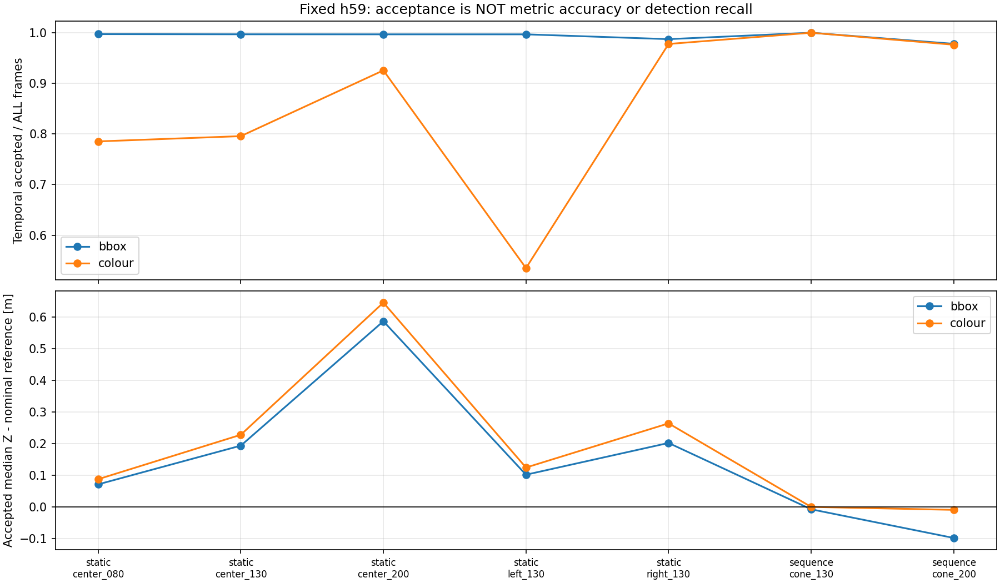
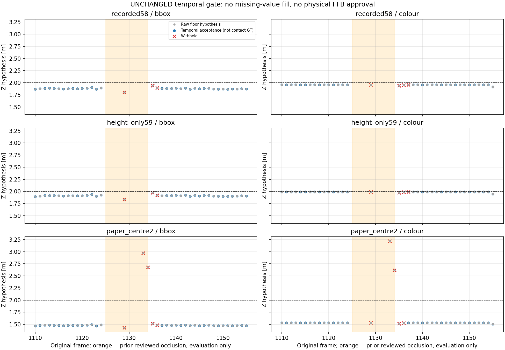
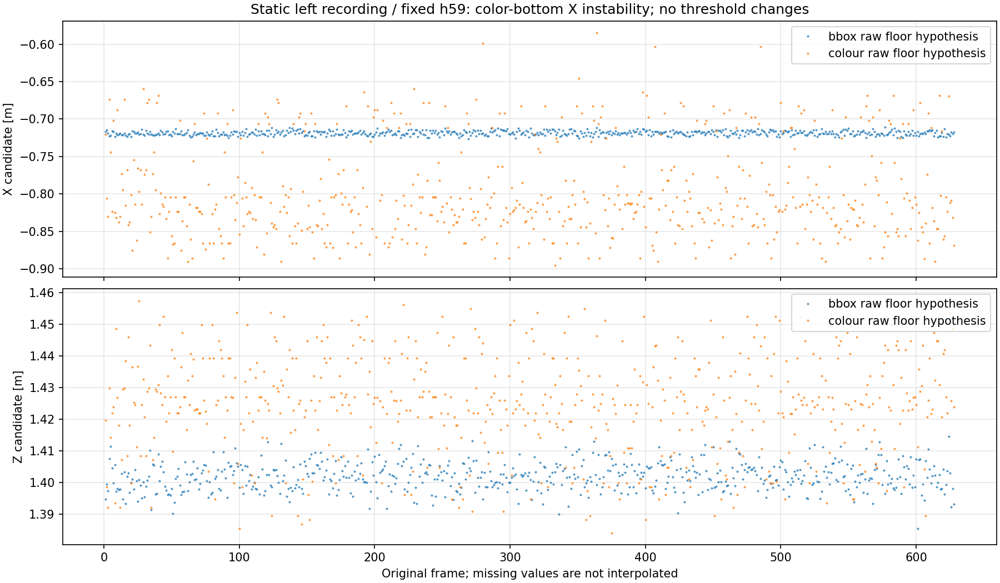

# 色下端候補に既存品質ゲートを適用した結果（2026-10-19）

追試：[左右の揺れの原因と同点打切り修正候補](../cone_bottom_ties_r01/README.md)。
下端選択の左偏りを再現し、Xだけ修正する案まで比較した。中央条件の悪化と距離偏りも残しており、
本番組込み・FFB接続は保留。本ページの凍結済み結果・コードは変更していない。

## 結論

**既存7録画・全5,143frameで、色下端候補の欠測・遮蔽時の保留と復帰まで検証した。追加録画は不要のまま。**
既存コードの連続3frame確認/NIS/形状判定を無変更で再利用し、
全frame×3geometry×2方式の30,858行を保存した。

- 既知の遮蔽1125..1134では、3geometry・両方式とも距離を採用しなかった。
- 高さ59cmの色下端方式は1138で復帰。復帰候補1135から約104ms。
  3frame固定待ちだけではなく、XYが0.15mを超えて動いたため確認をやり直していた。
- **色下端は奥行Zが良くても、左右Xが揺れる。** 静止左配置では採用336/628frame。
  生の候補621frameからかなり減った。判定を緩めず、失敗も全て記録した。
- **安定した距離の偏りは、時間品質判定では直らない。**
  静止2.00m録画は585frameが採用されてもZ中央値は2.645mのまま。

したがって、色下端の距離推定を本番へ組み込む段階ではない。
校正の録画間転用と、下端点の横位置の安定性を分けて検証する。
`floor_contact_verified=False, usable_for_ffb=False` を全行で維持。
本番設定・モデル・既存src・ROS/FFB安全機構・元画像/録画は変更していない。

## 1. 実行した内容

[実行前固定の方法](method.md) に従った。V30だけを使い、V20/50の成績を見て選び直していない。
色pixelは前回全rawから取得した [凍結済みCSV](../cone_contact_reuse_r01/full_replay_r01/pixels.csv) を再利用した。
新しい推論や画像の編集・保存はしていない。

- `ConeObservationQualityGate` と `ConeQualitySettings` は無変更。
  連続3frame、距離0.15m、NIS9.21、幅/高さ/縦横比2倍、track memory0.5s等の既存値。
- 実験フォルダ内の [adapterとreplay](replay.py) だけで、入力pixelを色下端へ差し替えた。
  class/confidence/解像度/前レンズ/切れ等の拒否は既存projectorを通す。
  bboxの床ray/距離範囲判定は、色pixelから独立に既存の床交点式で再計算した。
- 無対象/複数候補は保留。内部予測を観測値にしない。欠測時にbbox方式へ自動切替もしない。
- session単位で初期化。同一連続録画内の配置・移動・遮蔽の区間境界では初期化しない。
  前回と同じ対象関連付けを使い、正解距離・遮蔽ラベル・frame番号はゲート入力に渡さない。
- 比較用bbox方式15,429行は、前回の採否/理由/観測X・Zと完全一致した。

3geometryは記録58cm/実測高さ59cm/白紙候補。
白紙候補は転用失敗済みのストレス比較であり、今回も本番採用しない。

## 2. 全録画の採用数：高さ59cm・同じ固定条件

採用Zは**採用された生観測の中央値**で、KF平滑化後の値で精度を良く見せたものではない。
各方式の採用frame集合は異なるため、以下の中央値の差だけで改善量を比較しない。

| 録画・配置 | 全frame | bbox投影可能→品質採用 | 色下端投影可能→品質採用 | 色下端の採用Z中央値 [m] |
|---|---:|---:|---:|---:|
| 静止0.80m | 722 | 722→720 | 682→567 | 0.888 |
| 静止1.30m | 651 | 651→649 | 651→518 | 1.528 |
| 静止2.00m | 632 | 632→630 | 632→585 | 2.645 |
| 静止左1.30m | 628 | 628→626 | 621→336 | 1.424 |
| 静止右1.30m | 631 | 628→623 | 626→617 | 1.564 |
| コーンなし | 332 | 0→0 | 0→0 | 欠測 |
| 連続録画1.30m | 218 | 218→218 | 218→218 | 1.300 |
| 連続録画2.00m | 548 | 539→536 | 539→535 | 1.991 |

上表以外の床だけ300frame、設置262frame、移動219frameも全て処理・保存した。
連続2mの値は前段の改善を維持したが、別静止録画での大きな偏りは消えなかった。
採用率は「時間的に一貫した仮説」の率で、距離精度、接地判定精度、検出recallではない。
無対象332frameの欠測は「安全」「障害物なし」の証明でもない。



## 3. 遮蔽・復帰の内訳

高さ59cmの主条件。どの処理が拒否したかを区別する。

| frame | bbox | 色下端 |
|---|---|---|
| 1124 | 採用 | 採用 |
| 1125..1128 | 検出なし | 検出なし |
| 1129 | 一瞬復帰しても連続確認待ち | 同左 |
| 1130..1132 | 再欠測 | 再欠測 |
| 1133..1134 | 既存床交点の距離範囲で拒否 | 色pixelの床交点が無効で拒否 |
| 1135 | 確認1frame目 | 確認1frame目 |
| 1136 | 確認2frame目 | XY差が0.15m超で確認1frame目に戻る |
| 1137 | 採用再開 | 確認2frame目 |
| 1138 | 採用 | 採用再開 |

色下端の1135→1136はX=-0.039→-0.203m（約16.4cm差）、Z=1.975→1.988m（約1.3cm差）。
確認はZだけではなくXY距離で行うため、Zが近くてもやり直す。これはNIS拒否ではない。
色方式は候補復帰1135から約104.1ms、最後の採用1124から約461.5msで復帰した。
bbox方式はそれぞれ約66.7ms/424.1ms。
これらは元frameのtimestamp差であり、実時間の処理遅延・通信遅延・停止時間ではない。

白紙geometryでは1133/1134にも有限の誤った床交点が出るが、連続確認待ちで採用されなかった。
「全てNISで遮蔽検出できた」「色輪郭が接地を見分けた」とは解釈しない。
安定した誤仮説が続けば、再初期化後に採用されるという既存の限界は残る。



## 4. 新たに分かった課題：色下端の左右位置

[隣接frame診断](audit_jitter.py) は、同じ区間で連続する元frameのうち、
両frameで投影候補がある組だけを比較した。欠測を飛び越して差を計算していない。
実際のゲート判定を変更する入力ではなく、処理後の診断値。

| 静止左1.30m・高さ59cm | bbox | 色下端 |
|---|---:|---:|
| 比較できる隣接frame組 | 627 | 613 |
| 隣接X差の絶対値p95 | 0.0086m | 0.1736m |
| 隣接Z差の絶対値p95 | 0.0117m | 0.0427m |
| XY差が0.15m超の組 | 0 | 81 |
| そのうちX差>0.15mかつZ差<0.03m | 0 | 69 |

左の色方式の保留内訳はROI端7、NIS78、連続確認待ち207frame。
中央1.30mの静止録画でも色方式の隣接X差p95は約0.207mで、左だけの現象ではない。
これらのframe数やpair数は独立した設置試行数ではない。



色輪郭の最下部を1点にする処理が台座の同じ位置を安定して表しているか、次に検証する必要がある。
色境界の揺れ、下側8%の選び方、左右非対称、影等の**個々の寄与は今回未確定**。
カメラの固定不良や物理姿勢変化を原因と断定していない。
NIS/確認距離を緩めて通す、左右を既知の配置へ固定する、未来frameで補完する対処はしない。

## 5. 検証・再現

- 新規27件＋既存コーン投影17/品質15/追跡12/床接点9件、**計80件成功**。
- 因果性（prefix不変）、再現性、session状態分離、GTラベル非依存、cache全frame整合、
  不正pixel/低confidence拒否、無対象/複数/欠測非補完、遮蔽・復帰、集計・hash不変を確認。
- 30,858行を再計算して保存CSVと完全一致。bbox方式15,429行は前回と完全一致。
- 初回テストで「色方式も1137復帰」と置いた期待値が実測と異なった。
  XY跳躍による正しい再確認を確認し、テストを1138/確認countの検証へ修正した。
  **ゲート・候補点・設定・アルゴリズムは変更せず**r02へ再実行。
  r01/r02の全CSV4点・PNG2点はbyte一致。r01のprovenanceは初回テスト版のhashを記録した履歴として残す。
- 床接点テストは最初の呼出しで `PYTHONPATH=src` がなくimport失敗。
  環境指定付きで再実行し9件成功。コード変更で隠していない。
- 全リポジトリテスト、ROS、実機、コーン実走行の新規評価はしていない。
  Matplotlibの未使用Axes3D警告はあるが2Dグラフ3点の生成と目視は成功。

[verification.json](verification.json) に検証範囲を記録した。

```bash
cd ~/theta_ws/RICHO-theta
/home/robo25/theta-env/bin/python3 -m unittest discover \
  -s Experimental_results/2026-10-19/cone_contact_quality_r01 -p 'test_*.py' -v
# 元の結果を上書きしない場合だけ。r03が既存なら新しい名前を選ぶ。
/home/robo25/theta-env/bin/python3 Experimental_results/2026-10-19/cone_contact_quality_r01/replay.py \
  --output-dir Experimental_results/2026-10-19/cone_contact_quality_r01/results_r03
```

- 主成果物：[全30,858行](results_r02/observations.csv)、[区間集計](results_r02/summary.csv)、
  [保留区間](results_r02/withheld_runs.csv)、[遮蔽周辺](results_r02/occlusion_rows.csv)、[provenance](results_r02/provenance.json)。
- 揺れ診断：[隣接差](jitter_r01/consecutive_steps.csv)、[集計](jitter_r01/jitter_summary.csv)、[provenance](jitter_r01/provenance.json)。

## 次に進められること

追加録画を求める前に、同じ画像から下端点のXが変わる理由を検証する。
最下部の点選択の左右偏り等を、正解距離に合わせず合成図形・既存画像で調べる。
距離転用問題とは別課題として扱い、両者を解決したことにせず開発を続ける。
単純bbox占有率方式の保留判断も維持する。日報・commit/pushは今回依頼されていないため行っていない。
