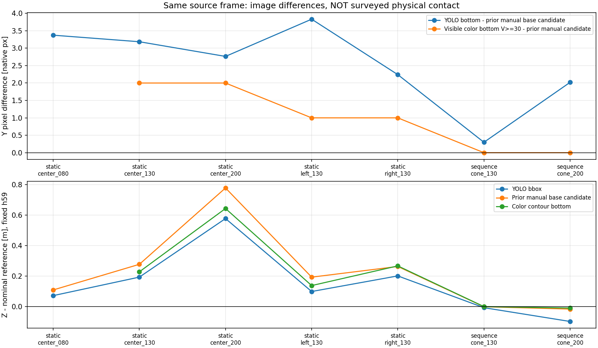
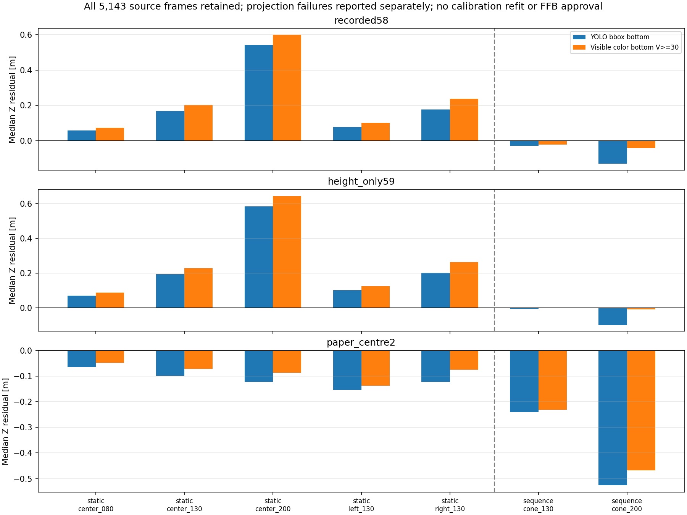
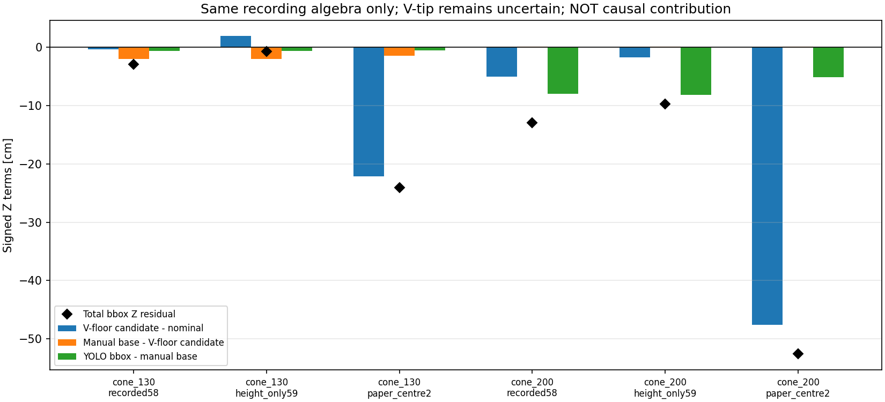
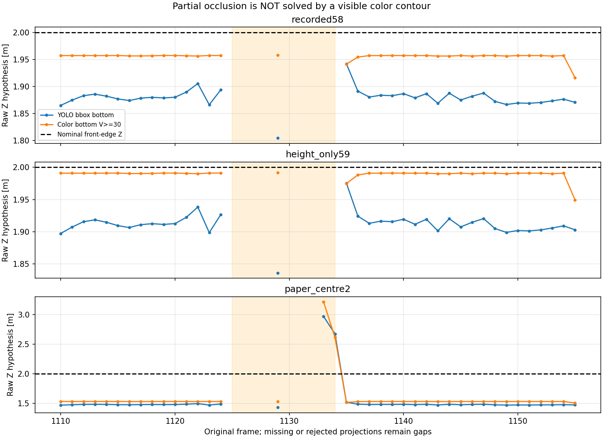

# 既存録画だけで行う接地点・投影の切り分け（2026-10-19）

追試：[色下端候補へ既存品質ゲートを適用した結果](../cone_contact_quality_r01/README.md)。
遮蔽時の保留・復帰は確認したが、色下端の左右の揺れと録画間の距離偏りが残った。
本ページの凍結済み計測結果は変更せず、追加録画も引き続き保留している。

## 結論

**追加録画は保留したまま、既存の41無加工PNGの同一frame比較と、7録画全5,143frameの画像診断まで進めた。**
既存YOLOの対象検出は維持し、枠内の色輪郭を「見える下端」の補助計測に使った。
色輪郭の面積から距離を推定する方式ではなく、得たpixelを従来の床交点式へ入力する試験。
前段の単純占有率方式の見送り判断は変えていない。

分かったことは次の2点。

1. **YOLO枠下端と、見えるコーン下端の差は測距に影響する。**
   同一連続録画では、未調整geometry・実測高さ59cmで、1.30mは1.293→1.300m、2.00mは1.902→1.991mとなった。
   2.00mの比較は両方式とも同じ539frameで成立し、成功frameだけを選び替えた改善ではなかった。
2. **下端の取り方を変えるだけでは、録画間の投影不一致は直らない。**
   別の静止2.00m録画は同じ高さ59cm・色輪郭で2.645mとなった。
   白紙候補ならこの静止録画は1.913mに近づくが、連続録画の2.00mは1.533mとなる。
   正解距離に応じてgeometryを選ぶ処理や、共通補正の本番採用はしていない。

これらは画像診断・条件ラベルとの対応で、厳密な原因寄与率や物理的接地点GTではない。
**「距離精度1cmで完成」「実機FFBへ接続可」とは判断しない。**
runtime、本番config、元画像/録画、モデル、ROS/FFB安全機構は変更していない。

## 1. 今回行ったこと

- 前回保存したbboxと目視台座候補を同じframeで比較。新しい正解pixelへ動かしていない。
- 既存PNG24枚（静止6本各4枚）＋17枚（連続録画の等間隔/境界/遮蔽）を全て検査。
  123画像計測行、3geometryへの369投影行、7台座候補×3geometryの21対応を保存した。
- 主条件V30、感度V20/50の固定HSV範囲で、YOLO枠付近の色輪郭下側8%の中央値を計測。
  距離・目視候補・geometry・frame番号を色pixel選定に使っていない。
  mask/crop/overlayなどの加工画像は保存していない。
- sampleでは色候補32/41、候補なし8、ROI端での保留1。失敗もそのまま残した。
- sampleの後、同じ設定を一切変えず全7録画のrawを逐次デコード。
  全5,143frame×3閾値=15,429画像計測行、×3geometry=46,287投影行を保存した。
  新しいYOLO推論や学習は行っていない。

手法は[method.md](method.md)、sample後に固定した全録画の検証は[full_replay_method.md](full_replay_method.md)。
色範囲の固定値を都合よく調整して正解距離へ合わせる処理ではない。
HSV色抽出の根拠は[OpenCV公式](https://docs.opencv.org/4.13.0/da/d97/tutorial_threshold_inRange.html)。
対象検出器を全画角HSVへ戻す実装でも、接地判定器の完成でもない。

## 2. 同じframeで見た下端の差

10/15の目視台座候補との画像Y差。正は画像下側。目視点は非盲検assistant候補で、物理GT未確認。

| 配置 | YOLO下端−目視候補 [px] | 主色輪郭−目視候補 [px] |
|---|---:|---:|
| 静止0.80m | +3.37 | ROI端のため保留 |
| 静止1.30m | +3.19 | +2.00 |
| 静止2.00m | +2.76 | +2.00 |
| 静止左1.30m | +3.83 | +1.00 |
| 静止右1.30m | +2.24 | +1.00 |
| 連続録画1.30m | +0.30 | 0.00 |
| 連続録画2.00m | +2.02 | 0.00 |

色下端も目視点と完全一致するとは限らず、暗い台座・影・反射・閾値等の影響が残る。
どの点が真の接地かを参照距離から逆算して決めていない。
全bbox一律に2px上げる等の補正も行っていない。



## 3. 全5,143frameの主条件結果

以下は高さだけユーザー実測59cm、その他は未調整の同じgeometry。
区間内のraw投影中央値。色輪郭点へ時間品質ゲートは今回接続していない。

| 録画・配置 | 参照Z [m] | 区間frame数 | 色下端の投影可能数 | bbox下端Z [m] | 色下端Z [m] |
|---|---:|---:|---:|---:|---:|
| 静止0.80 | 0.80 | 722 | 682 | 0.871 | 0.888 |
| 静止1.30 | 1.30 | 651 | 651 | 1.494 | 1.528 |
| 静止2.00 | 2.00 | 632 | 632 | 2.586 | 2.645 |
| 静止左1.30 | 1.30 | 628 | 621 | 1.402 | 1.425 |
| 静止右1.30 | 1.30 | 631 | 626 | 1.502 | 1.564 |
| 連続録画1.30 | 1.30 | 218 | 218 | 1.293 | 1.300 |
| 連続録画2.00 | 2.00 | 548 | 539 | 1.902 | 1.991 |

静止0.80m等で色輪郭がROI端に触れるframeも保留した。V50に変えれば通る例があっても、主条件を後から差し替えていない。
同じframe集合だけの[副次比較](full_replay_r01/common_frames.csv)でも、連続1.30/2.00mの値は同じだった。
2.00mでは539frameが両方式共通。欠測7frameと範囲外2frameも元の台帳に残した。

連続録画の主条件では、Z中央値の参照との差は1.30mで約+0.0002m、2.00mで約-0.0091m。
絶対Z差p95は約0.00044/0.01069mだったが、**設置誤差幅や接地点GTを測定した値ではないため、mm精度の保証には使わない**。
同じ固定配置を繰返し観測したframeであり、539回の独立設置試験でもない。
V20/30/50で連続録画の中央値は同じだった一方、静止録画では閾値によるpixel・投影差が残った。

記録58cm/高さ59cm/白紙候補の全てを比較し、条件に応じて採用geometryを変えていない。



## 4. 床のずれと枠のずれをどこまで分けられたか

同一frameで、以下の2項分解は常に計算できる。

`bboxZ−参照 = (目視台座Z−参照) + (bboxZ−目視台座Z)`

同じ連続録画で冒頭床候補がある1.30/2.00mだけは、前者をさらに
`(床Z−参照) + (目視台座Z−床Z)`へ分けた。
新しい白紙候補の大きな過小推定は、この床候補側でも残り、bbox下端だけの問題とは説明できなかった。
一方、高さ59cm・未調整geometryでは床/目視台座候補のZが近く、bbox下端の差が残るという整理になった。

ただし床V先端は遠方で人も特定困難と確認済み。床と台座は同じ録画でも別時刻であり、
精密な原因寄与率や「校正が正しい」の証明とはしない。
静止別録画については同一撮影内の確かな床参照がないため、床項を数値化せず欠測として残した。
不鮮明な他sessionのVを無理にGTへ格上げしていない。



## 5. 遮蔽・欠測を解決したわけではない

frame1133/1134では見える赤い上部の輪郭は抽出できたが、台座ではない。
高さ59cmの投影範囲チェックでは距離を拒否した一方、白紙geometryだと不自然な床交点が出る例が残る。
「色が抽出できたから接地している」「大きな距離でも範囲に入れば採用」としてはいけない。
全行の `floor_contact_verified=False, usable_for_ffb=False` を維持する。



## 6. 現在の判断・追加録画について

- **追加録画は保留。** 前段の撮影手順書は将来必要になった場合の案として残すが、現時点の必須作業にしない。
- 次に進められるソフト作業は、今回得た色輪郭の床交点候補へ既存の連続確認/NIS等を適用し、
  欠測/遮蔽/複数対象の保留と復帰を同じ録画で確認すること。
- 録画ごとに正解を見てgeometryを切り替える処理は作らない。異なる撮影状態への共通校正の適用は引き続き未検証。
- 台座の取り方と投影転用を分けて扱う材料は増えたが、カメラ固定不良・物理姿勢変化を原因と決めつけていない。
- 現行方式を継続する。占有率を復活させる、本番offsetを変更する、実機FFBへ送る、といった変更は行っていない。
- 既存データで確認できない物理基準が最後に残った場合だけ、その不足に限定した実測/撮影を相談する。

## 成果物・検証

- [sampleのpixel観測](results_r01/pixel_observations.csv)、[同一frameの対応/分解21行](results_r01/paired_anchors.csv)。
- [全frameの画像計測15,429行](full_replay_r01/pixels.csv)、[全投影46,287行](full_replay_r01/positions.csv)。
- [全条件集計](full_replay_r01/summary.csv)、[共通frame集計](full_replay_r01/common_frames.csv)、[遮蔽周辺](full_replay_r01/occlusion_rows.csv)。
- 入力・元画像・元raw・metadata・旧推論・本番config・使用コード・成果物hashは各`provenance.json`。
- 新規24テスト＋既存ground-contact9/コーン投影17/品質15テスト、計65件成功。
  sampleと全rawの計測一致、15,429件の従来bbox投影との一致、全frame保持、
  既存目視点の非改変、参照値非依存、欠測非補完、全投影再計算、raw/PNG/設定hash不変を確認。
- 全体テストスイート・実機・ROS・新規推論は未実施。Matplotlibの未使用Axes3D警告はあるが、数値図4枚の生成と目視は成功。
- 画像は既存native PNGを読むだけ。切抜き・描画・マスク画像・リサイズ画像は保存していない。
  グラフは数値CSVから生成した図であり、元カメラ画像の加工ではない。

```bash
cd ~/theta_ws/RICHO-theta
/home/robo25/theta-env/bin/python3 -m unittest discover \
  -s Experimental_results/2026-10-19/cone_contact_reuse_r01 -p 'test_contact_reuse.py' -v
```

生成順は`analyze.py`→`full_replay.py`→`plot_full_replay.py`。保存済みr01の上書きは拒否する。
再生成時は新しいrun名/出力先を使い、既存データや前回結果を上書きしない。
日報・Git commit/pushは今回依頼されていないため実施していない。
