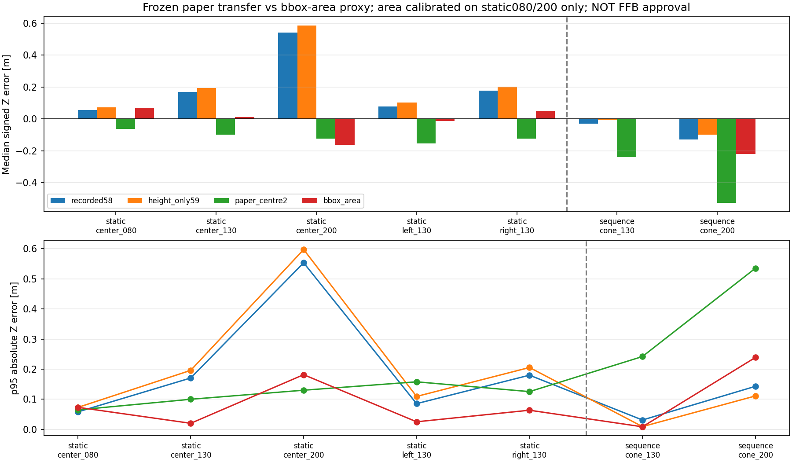
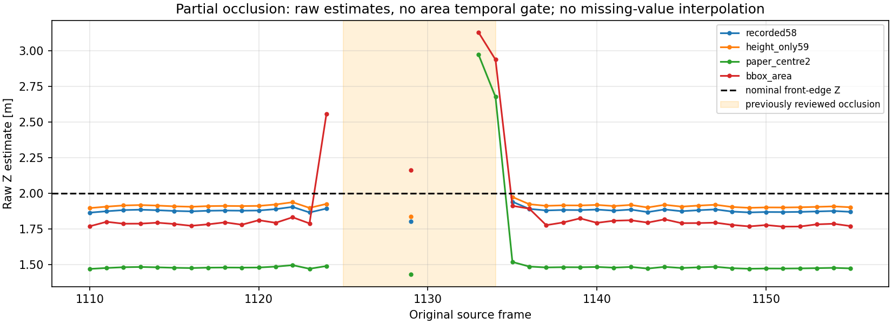

# 現行方式の継続検証・枠占有率の試験（2026-10-19）

**後続更新：追加撮影はいったん保留。** ユーザー方針に従い、[既存録画の接地点診断](../cone_contact_reuse_r01/README.md)を続行し、
無加工PNG41枚と全5,143raw frameを固定条件で比較した。下記の撮影案は現時点の必須作業ではない。
占有率見送り・白紙候補の本番不採用は維持する。以下は初回比較時点の結果として保持する。

## 結論

中断後、保存済みmethodと占有率helperから再開し、比較・検算まで完了した。

1. **現行の床交点方式は継続するが、10/15最後の白紙centre2候補を、そのまま過去コーン録画へ本番採用しない。**
   元の静止録画では前後差が約-6～-15cm、別の連続録画では1.30mで-24cm、2.00mで-53cmとなった。
2. **今回の単純な枠占有率方式は、距離推定の採用候補からいったん見送る。**
   調整に使わない中央1.30m・左右では良好だったが、別録画の2.00mを約1.78mと推定。
   5つの確認配置のうち1つが、計算前に固定した暫定足切りを超えた。遮蔽時の過大推定も残る。
3. 現行方式があらゆる条件で占有率方式より高精度という結果ではない。元の静止録画では
   占有率のほうが小さい誤差の条件もある。両者とも今回の結果だけで実機FFBへ接続しない。

新規撮影・再学習・再推論・ROS・車体/ハンコン駆動・本番config変更・Git操作は行っていない。
今回の追加は実験用script/CSV/JSON/グラフ/テストで、`src/`や前回結果は変更していない。

## 1. 入力・基準・公平性

入力は10/15の静止6本（3,596frame）と床→コーン連続1本（1,547frame）。
固定済みの同一36枚版/conf0.50/imgsz960の保存bboxを使い、全5,143frame×4方式=20,572行を残した。
予測のないframeや複数frameを補完・最大score選択で消していない。
比較するgeometryは記録値58cm、高さのみ59cm、最後の白紙7点centre2。初期V字候補は使っていない。

コーンの参照Zは台座の車体側辺。左右Xは台座一辺37.5cm・内側辺±0.40mの説明から
辺中央±0.5875m（台座が車体軸と平行という未測定の仮定）。元の録画名やmetadataは変えていない。
枠占有率は前後Zの経験的代理推定であり、物体中心までの斜距離を物理計測した値ではない。

全方式の対象関連付けは元のgeometry/中央ROIへ固定。候補geometryで範囲を変えていない。
主表はraw投影/占有率推定同士の比較。現行方式の時間品質ゲート結果は別列に残した。
共通有効frameのみの副次比較も保存したが、主表から失敗や遮蔽を削っていない。
方法：[method.md](method.md)。

## 2. 占有率方式の定義とsplit

コーン本体のマスクはなく、`q=YOLO枠面積/(1280*720)`を使った。
背景込みの枠であり、正規化だけで魚眼の位置依存性が消えるわけではない。
`Z=k/sqrt(q)`の1変数だけを試し、0.80m/2.00m各録画のq中央値から等重みで倍率を調整した。
係数は`k=0.09524360165879661`。指数・切片・左右別係数を後から追加していない。

| 役割 | 配置 | q中央値 | 参照Z [m] |
|---|---|---:|---:|
| 調整 | static center_080 | 0.01197740 | 0.80 |
| 調整 | static center_200 | 0.00268374 | 2.00 |
| fit未使用 | static center_130/left_130/right_130 | fitへ渡さない | 各1.30 |
| 別録画・fit未使用 | sequence cone_130/cone_200 | fitへ渡さない | 1.30/2.00 |

1係数では両調整点を完全一致させること自体できなかった。ここで高次モデルを追加して辻褄を合わせていない。
全frameを独立した校正点数として水増しせず、2配置の中央値を使用した。
別録画も同日の既存開発データで、純粋なblind test/未知環境汎化試験ではない。

## 3. 中央・左右・別録画のZ比較

単位m。各方式の有効推定中央値であり、物理的な真値保証ではない。
占有率は範囲外になった場合も未制限Zを誤差集計へ残す実装。

| 録画・配置 | 参照Z | 記録58cm | 高さのみ59cm | 白紙候補 | 枠占有率 | 占有率の用途 |
|---|---:|---:|---:|---:|---:|---|
| 静止・中央0.80 | 0.80 | 0.857 | 0.871 | 0.736 | 0.870 | 調整 |
| 静止・中央1.30 | 1.30 | 1.468 | 1.494 | 1.202 | 1.311 | 確認 |
| 静止・中央2.00 | 2.00 | 2.542 | 2.586 | 1.877 | 1.839 | 調整 |
| 静止・左1.30 | 1.30 | 1.378 | 1.402 | 1.147 | 1.287 | 確認 |
| 静止・右1.30 | 1.30 | 1.477 | 1.502 | 1.177 | 1.350 | 確認 |
| 別録画・中央1.30 | 1.30 | 1.271 | 1.293 | 1.060 | 1.299 | 確認 |
| 別録画・中央2.00 | 2.00 | 1.870 | 1.902 | 1.474 | 1.779 | 確認 |

白紙候補のX中央値は静止中央で+1.5～+2.5cm、左/右では-0.510/+0.517mとなり、
参照-0.5875/+0.5875mから内側へ約7～8cmの差も残った。Zだけを見て採用しない。

### 占有率のfit未使用5配置

| 配置 | Z中央値差 [cm] | 絶対Z差p95 [cm] | 暫定足切り |
|---|---:|---:|---|
| 静止中央1.30 | +1.10 | 2.03 | 内側 |
| 静止左1.30 | -1.30 | 2.53 | 内側 |
| 静止右1.30 | +4.97 | 6.37 | 内側 |
| 別録画1.30 | -0.06 | 0.87 | 内側 |
| 別録画2.00 | -22.15 | 23.88 | 超過→見送り |

精度要件がユーザーから数値指定されていないため、実行前に開発上の暫定基準として
各確認配置の中央値差10cm以内・絶対差p95が20cm以内を設定した。これはTTC/FFBの正式な合格基準ではない。
結果を見て基準やモデルを変更していない。単純な今回の式の不採用であり、
マスク・実物サイズ・魚眼補正等を別途扱う全ての面積方式が不可能と証明したわけではない。
ただし今回はユーザー方針に従い、占有率方式を深追いせず比較資料として保持する。

共通frameでは別録画1.30mは218、2.00mは539frame。
白紙候補のZ中央値差は-24.04/-52.65cm、占有率は-0.06/-22.15cmで、主結論は変わらない。
成功frame数が違うだけで白紙候補が悪く見えている、という説明ではなかった。



## 4. 遮蔽と品質ゲート

別録画で以前から確認済みの、実際の参照Z=2.00mの部分遮蔽。

| frame | 白紙候補raw Z | 白紙候補の品質ゲート | 枠占有率Z |
|---|---:|---|---:|
| 1133 | 2.973m | 連続確認待ちで保留 | 3.129m |
| 1134 | 2.677m | 連続確認待ちで保留 | 2.939m |

占有率の枠が小さくなると遠いという推定になり、今回も過大推定を生じた。
現行58/59cmはこの2frameを従来の投影範囲チェックで拒否している。
占有率に時間品質ゲートは今回実装しておらず、処理が同じ条件だったという比較はしない。
raw同士ではどちらにも不自然な推定があり、幾何または面積だけで遮蔽を解決できたとはいえない。

白紙候補では、過去静止6本の投影可能3,261frame→品質採用3,248frame。
別録画2m区間の投影可能541/548→品質採用536/548だった。
品質ゲートを通した中央値も約1.474mで、時間的な整合性確認は-53cmの偏りを直さない。
元の「コーンなし」332frame、右の複数枠54/56/57、欠測・移動も全方式の台帳に残した。



## 5. 枠下端と校正転用の切り分け

10/15に保存済みの目視台座候補を移動せず、新候補で再投影した。
静止中央2.00mの参考pixel(312,379)は1.980mとなり、同条件のbbox中央値1.877mとの差がある。
一方、別録画2.00mの参考pixel(310,393)も1.525mとなり、bbox下端の置換だけでは解消しなかった。
目視候補は非盲検のassistant候補で、人が確認した物理接地点GTではない。
「このpixelへ枠を動かせば正しい」という補正は作っていない。

さらに既存の5固定車体領域・±20px探索を再利用し、白紙7点frame1481と14画像を比較した。
70領域のうち参照の後方1領域はテクスチャ不足のため14行とも数値欠測として保持し、別領域へ選び替えていない。

- 白紙録画内の4対照は、信頼条件を満たした前方3領域で全てdx=dy=0。
- 直前の白紙2m画像も集約上は局所一致（最大2px）。
- 静止コーン5配置と別録画の3画像は、いずれも局所変化を観測した。
  例：白紙→静止コーン2mの前方右機器は(-17,+8)px。
  白紙→別録画の床画像では、前方中央(+1,+12)、左穴(-3,+14)、右機器(+4,+10)px。

**これは局所的な写り方の差で、カメラが物理的に動いた、ユーザーが取付を変えた、という原因の確定ではない。**
機器・車体・撮影経路・基準点等の要因は未分離。画像全体の平行移動とも呼ばず、距離補正へ使わない。
ユーザーの「高さ/傾き/固定/原点等は問題ない」という申告を維持し、固定不良を前提にしない。
ただし、同じmetadataだけで白紙候補を別録画へ無条件に流用する根拠は得られなかった。

根拠：[目視点比較](results_r01/manual_base_comparison.csv)、[局所照合](view_audit_r01/local_matches.csv)、
[全14組の判定](view_audit_r01/summary.csv)、[追加照合の方法](transfer_view_method.md)。

## 6. 次に進める最小確認

現行の床交点方式を維持し、**同じ連続録画の中で、見えやすい白紙とコーンの台座を同じ基準位置へ交互に置いて対比する**。
新しい7点一式や再学習ではなく、中央1.30/2.00mだけでよい。
白紙の前後再確認を入れて、録画内での参照の再現性と、物体の接地点の違いを分離する。
この2点へ再fitして左右を含む校正が完成したとはしない。
[次の最小撮影手順](next_capture.md)を用意した。ハンコン・走行・FFBは不要。

## 成果物・検証・再現

- 全5,143frame：[frame_ledger.csv](results_r01/frame_ledger.csv)。
- 全20,572行：[observations.csv](results_r01/observations.csv)。
- 条件別主集計：[summary.csv](results_r01/summary.csv)、[共通frame集計](results_r01/common_frame_summary.csv)。
- 面積の2調整点/係数：[area_calibration.json](results_r01/area_calibration.json)、[足切り判定](results_r01/area_screen.json)。
- 入力/候補/本番config/実装・成果物hash：[主解析provenance](results_r01/provenance.json)、[画像照合provenance](view_audit_r01/provenance.json)。
- 新規22件＋既存コーン投影17/品質15/局所状態16件、計70件PASS。
  全frame保持、式、調整点固定、holdout混入拒否、未来/参照値非依存、独立再投影、
  全70局所照合再現、元PNG・設定hash不変を確認した。
- 初回のテスト用bboxが実際には円内にあり拒否期待だけが誤っていたため、テストfixtureを修正。推定処理・結果は変更していない。
- 初回の画像照合は低テクスチャで出力作成前に停止。数値を捏造せず欠測行へ保存する処理を追加し、再実行/テスト成功。
- Matplotlibの未使用Axes3D警告は出たが、2Dグラフ2枚の保存・表示確認は成功。
- 今回全体テストスイート・GPU・実機・ROSは実行していない。runtime接続は未実施。

```bash
cd ~/theta_ws/RICHO-theta
/home/robo25/theta-env/bin/python3 -m unittest discover \
  -s Experimental_results/2026-10-19/cone_distance_methods_r01 -p 'test_*.py' -v
```

生成scriptは `analyze.py` と `audit_transfer_views.py`。既存r01出力への上書きは拒否する。
再解析時は新しいrun名と出力先を用意し、元データ・前回結果を上書きしない。
代表グラフと無加工原画像は[当日report_assets](../report_assets/README.md)へ保存する。
