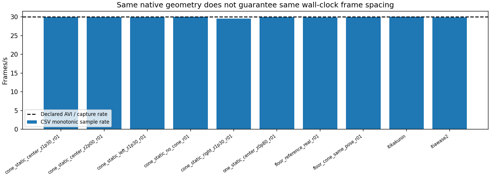
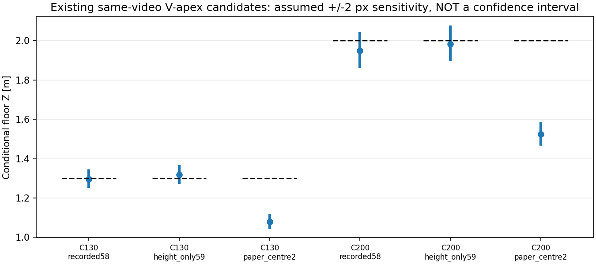

# 保存経路・録画設定・画像座標・床基準の監査（2026-10-19）

## 結論

**監査した保存/解析経路では、rawとBEVの取り違え、画像サイズ・座標の拡縮・ROI原点復元の不整合は見つからなかった。距離差の原因をソフトウェアの座標変換ミスと特定する結果ではない。**

- 10sessionのraw全13,727frameを再デコードし、元CSVと連番・寸法・時刻対応を確認。
- 元PNG106枚が対応するrawの同じframeと画素一致。元archive5本も取込時hashと一致。
- 取得設定・記録されたカメラ幾何・全parametersは10sessionでそれぞれ完全一致。
- YOLOの960pxモデル入力と1280×720原画像座標の混同は確認されない。
- 同一動画内の床と台座の相対位置は比較できるが、床V先端が小さく、正確な物理点のpixel確定はできない。
  **別動画の明瞭な白紙7点で、この同一動画内の不確かなV先端を正解へ昇格しない。**

残る不足は、高さ・原点・台座寸法ではなく、**同じ撮影状態の中で、明瞭な実測床基準と台座の車体側の辺を対応付ける記録**。
既存データを捨てる必要はない。検出・遮蔽・観測範囲・品質ゲートの試験には引き続き使える。
本番設定・FFB安全機構・出力は変更していない。

## 1. 対象と保存経路

[監査方法](method.md)を固定し、取込時のhashと現物を照合してから再読込した。

| 対象 | session数 | raw frame数 | 入力archive |
|---|---:|---:|---|
| コーン静止・なし/中央/左右 | 6 | 3,596 | 10151400.tar.xz |
| 実床V字7点 | 1 | 467 | floor_reference_real_r01_20261015_144248_636.tar.xz |
| 床→コーン1.30/2.00m連続 | 1 | 1,547 | floor_cone_same_pose_r01_20261015_160621_378.tar.xz |
| 白紙2m視認 | 1 | 467 | itikakunin_20261015_181034_492.tar.xz |
| 白紙7配置 | 1 | 7,650 | itiawase2_20261015_183552_599.tar.xz |
| 合計 | 10 | 13,727 | 5archive |

archiveは`/home/robo25/Downloads/`、展開済み原本はrepo内`recordings/2026-10-15_*_intake_r01/`。
[sessions.csv](results_r01/sessions.csv)に全パス、[archives.csv](results_r01/archives.csv)に照合hashを保存。
今回再展開・圧縮・移動・削除はしていない。

**hash一致が示すのは、保存済み原本/取込済みコピーが変化していないこと**。
撮影PC上の保存前メモリや、センサからの未加工信号との画素一致を証明したわけではない。

## 2. 録画処理と3種類の映像

| ファイル/段階 | 座標・内容 | 今回のコーン距離解析との関係 |
|---|---|---|
| `cap.read()` | カメラ入力BGR、1280×720、左右2魚眼 | raw保存へ渡される元frame |
| `raw.avi` | 1280×720、MJPG、宣言30fps | YOLO/白紙/下包絡の入力 |
| `bev.avi` | 500×600、MJPG、宣言30fps | 床変換と表示overlay後。距離用pixelへ流用していない |
| `detection.avi` | 500×600、MJPG、宣言30fps | マスク等の処理表示。距離用pixelへ流用していない |
| UI上の拡縮表示 | Qt表示サイズへ拡縮 | 原画像座標として読んでいない |

根拠：

- [bird_eye.py](../../../src/bird_eye.py) `start_capture`（2022行付近）：MJPG/1280×720/30fpsを要求。
- 同 `update_frame`（2078行付近）：`ret, frame = self.cap.read()`。
  `cv2.remap`の結果は別の`bev_img`。末尾2527行で`record_frames(frame, bev_img, lane_mask_visual)`。
- 同 `record_frames`（1613行付近）：raw writerへ`raw_frame`を渡す。
  生入力を`bev_img`へ置換する代入、raw保存経路でのflip/rotate/resize/校正円描画の呼出しはない。
- 同 `display_image`（3236行付近）：BGR→RGBとQt拡縮は表示用の別バッファ/画像。

`draw_fisheye_calibration_circles`という描画関数自体はあるが、今回確認した更新/保存経路からは呼ばれていない。
青箱のground contact処理は色変換した別maskを使い、入力frameへ描画しないことも読取確認した。

rawは**アプリ入力をMJPGで再符号化した動画**であり、無圧縮sensor rawではない。
圧縮で境界の明度/画素は変わり得るが、今回それを距離差の主因と測定したわけではない。
原PNGとの一致検査は、その保存動画をデコードした画素との一致。

録画前のGit版`a77483c`（10/12）と現行の録画関連5methodはAST一致。
[code_route_audit.json](results_r01/code_route_audit.json)に証拠を残した。
ただし撮影metadataにGit識別子がなく、**実際にその版で収録したという完全な実行来歴は復元できない**。
現行ソース/保存形式との整合を確認したもので、当時の全処理の実行traceではない。

## 3. 録画設定と記録されていないこと

10sessionで、`parameters`全体・`camera_capture_properties`全体・幾何9項目のfingerprintがそれぞれ一種類だった。
deviceは全て`0`、取得backendはV4L2、実際の報告寸法1280×720、MJPG30fps。
幾何はh=0.58m、pitch=1°、roll=2°、yaw=0°、radius_scale=0.86、前中心offset=(-80,-21)。
**実測高さ59cmとの1cm差は既知で、今回新しく発見した設定変更ではない。**
59cmモデルは既存のオフライン比較でこの差だけ変更したもので、本番へ適用していない。

一方、次は記録がない/確定できない。

- カメラserial/firmware/内部補正状態：device番号やOpenCVプロパティだけでは復元できない。
- exposure等：-1の取得不能値が多い。同じ値だから露光等の物理状態が同じとは保証しない。
- 録画中の幾何設定履歴：metadataは開始時snapshot、CSVに幾何9項目の毎frame履歴はない。
- 当時の完全なソース/依存版：録画metadataにはGit識別子なし。旧推論来歴も全依存版を網羅していない。

これらの欠落を「実際に変化があった」証拠として扱わない。
取付/高さ/傾きを変更していないというユーザー回答を覆す結論も出していない。

CSV由来の実収録間隔は約29.497～30.013fps。AVI宣言fps=30とは別物。
raw/CSVのframe数一致はあるが、カメラから未取得のframeが一切なかったことまでは示さない。
既存の再解析では`detections.csv`の単調時刻を使い、frame番号/30だけに置き換えていない。
ODOMは全13,727frameで取得され、記録された並進/回転速度は0。疑似ODOMを含むため、物理不動の測量証拠ではない。



## 4. YOLO・ROI・床座標の監査

1. [run_cone_video.py](../../../src/run_cone_video.py)はrawをCSV順にdecodeし、そのframeを`model.predict(source=frame, ...)`へ渡す。
2. [cone_detection_diagnostics.py](../../../src/cone_detection_diagnostics.py)96行付近で`orig_shape==(720,1280)`を要求し、
   `result.boxes.xyxy`をそのまま保存。モデル入力960pxへの再縮小・二重拡大はない。
3. ローカルのUltralytics `models/yolo/detect/predict.py`131行付近でも、返却前に`scale_boxes(..., orig_img.shape)`。
   当時の全library版は確定できないため、現行API/保存処理との整合証拠として扱う。
4. 保存bbox6,051件は全て1280×720の有効範囲内。原サイズと異なる結果を拒否し、
   元のx=1001pxを二重拡縮せず返すテストでもexportの座標契約を確認した。
5. [白紙角reader](../../2026-10-15/white_paper_visibility_r01/analyze.py)はROI内cornerへ`[roi_x,roi_y]`を足す。
   synthetic画像で原座標(315,405)への復元と入力不変を検証。
6. [支持範囲reader](../cone_support_extent_r01/support.py)68行付近も輪郭へ`[left,top]`を足し、native列を返す。
7. [ground_contact.py](../../../src/ground_contact.py)はnative画素→ray→床交点。
   pixel原点は左上、画像X右/Y下。車体座標はX右/Y上/Z前、原点はカメラ直下。

`car_offset_x/z`はUIの車体描画/BEV用で、コーンraw床交点に足していない。
青箱専用の経験補正もコーンへ混入していない。
`bowl_curve`やstretchは表示側BEVの変形であり、raw上の床交点へその表示座標を流用していない。
**録画の`detections.csv`の検出値は青箱系のlive記録で、後日のコーンYOLO予測CSVとは別物**。
今回のコーン比較は`inference_r01/predictions.csv`を使い、原CSVはframe/時刻等の照合に使っている。

測定基準も別途監査した。[reference_mapping.csv](reference_mapping_r01/reference_mapping.csv)参照。
旧`session_conditions.csv`には左右X=±0.40の初期名目値が残るが、最新の点/範囲比較は
後続のユーザー確認を反映した±0.5875mを使っており、古い値への逆戻りはなかった。
この換算は台座の軸平行という未実測の前提付き。
白紙の左右±0.40mは手前左角の座標であり、コーン台座中心の±0.5875mと同一視していない。
前後距離を台座中心へ置換して18.75cm加える処理もない。

## 5. 同一録画の床基準で分かること・分からないこと

`floor_cone_same_pose`は、床のみframe1～300、コーン1.30m区間563～780、2.00m区間1000～1547。
床Vは1.30m/2.00mの2か所。最後の空床区間は撮り忘れとユーザー確認済み。

既存候補をそのまま使った場合、frame141の床候補と台座候補のY差は1.30mで1px、2.00mで0px。
これは**以前のassistant非盲検候補の相対比較**であり、床先端/真の台座接地を画素単位で認定した値ではない。

| 床候補 | 59cmモデルのZ | 仮にx/y±2pxとしたZ幅 |
|---|---:|---:|
| 1.30m：(310,416) | 1.319m | 1.279～1.361m |
| 2.00m：(311,393) | 1.983m | 1.901～2.071m |

±2pxは過去から同じ仮定感度。実測annotation誤差・信頼区間ではない。
2mのV先端は「潰れてほとんど丸」と[ユーザー確認済み](../../2026-10-15/floor_visibility_confirmation_r01/confirmation.json)。
1.30mもかろうじて分かる程度で、正確なpixelと不確かさの確定はない。
繰返し同じ位置に写っていても、「その点がVの実測先端」という絶対対応の証明にはならない。



白紙7配置は近側左角を読め、同一動画内の校正候補は作れている。
しかし別録画であり、その紙の角と実測位置に対応付けたコーン台座辺との**確認済み同一動画ペアは資料中にない**。
`floor_correspondence.json`の`paper7_contains_cone_reference_pair=False`はこの「確認済み物理対応セットなし」の意味であり、
7,650frameのどこにも偶然コーンが一切写らないことを全frame GTで保証した値ではない。

過去の局所車体特徴照合でも白紙→連続コーンで10～14px程度の局所差が残るが、
物理pose/光学中心/カメラ内部処理/機器移動の原因は一意に分離できない。
[既存の見え方監査](../cone_distance_methods_r01/view_audit_r01/summary.csv)を再利用し、
その局所差を画像全体の平行移動補正へ変換していない。

## 6. 残る不足だけに限定した相談

既存映像から確定できないのは、**コーンと同じ撮影状態における、明瞭な実測床点と近側台座辺の対応**。
高さ59cm、原点、台座37.5cm、左右の測定基準の再確認や、白紙7点の一式再撮影は不要。

最小の追加候補は、問題の大きい**中央2.00mの1か所だけ**で、次を一つの短い連続raw録画へ入れること。

1. 既に見えると確認できた白紙の手前左角をX=0/Z=2.00mへ合わせ、読める状態を記録。
2. 車体/カメラを動かさず、その実測点へコーンの車体側台座辺の中央を合わせて記録。
3. コーンをどけ、白紙の同じ角を同じ実測点へ戻して記録。

これは任意に7点を増やす要求ではなく、V先端の読取りと別録画への転用が混ざる問題を切り分けるための相談。
この一組だけで全距離/左右の精度やTTCが完成するという意味でもない。
カメラ設定・取付・録画中の幾何sliderは変更せず、FFBを無効のまま行う。
この監査では撮影やhardware起動を実行しておらず、具体的な収録コマンド/秒数は次にこの一点の条件へ絞って案内できる。

## 成果物・検証・再現

- [sessions.csv](results_r01/sessions.csv)、[video_headers.csv](results_r01/video_headers.csv)、
  [archives.csv](results_r01/archives.csv)、[native_samples.csv](results_r01/native_samples.csv)。
- [ソース経路監査](results_r01/code_route_audit.json)、[bbox座標監査](results_r01/bbox_coordinate_audit.csv)。
- [同一動画床点の仮定感度](results_r01/same_video_floor_sensitivity.csv)、[物理対応の制限](results_r01/floor_correspondence.json)。
- [測定基準の追跡](reference_mapping_r01/reference_mapping.csv)。
- [入力/出力hash](results_r01/provenance.json)、[測定基準監査のhash](reference_mapping_r01/provenance.json)、[検証範囲](verification.json)。

新規監査15テスト＋測定基準追跡3テスト、計18件成功。
raw全frame再decode・106原PNG・5archiveを再照合し、数値図2枚を目視。
既存の投影/時間品質は未変更なので、直前の49件成功を再利用し、全repo suiteは再実行していない。
Matplotlib未使用Axes3Dの既存警告はあるが2D図の保存は成功。

```bash
cd ~/theta_ws/RICHO-theta
/home/robo25/theta-env/bin/python3 -m unittest discover \
  -s Experimental_results/2026-10-19/cone_recording_coordinate_audit_r01 -p 'test_*.py' -v
# 保存済み出力は上書き拒否。再監査する場合は未使用の出力先へ。
/home/robo25/theta-env/bin/python3 Experimental_results/2026-10-19/cone_recording_coordinate_audit_r01/audit.py \
  --output-dir Experimental_results/2026-10-19/cone_recording_coordinate_audit_r01/results_r02
/home/robo25/theta-env/bin/python3 Experimental_results/2026-10-19/cone_recording_coordinate_audit_r01/audit_reference_mapping.py \
  --output-dir Experimental_results/2026-10-19/cone_recording_coordinate_audit_r01/reference_mapping_r02
```

元コード/設定/画像/動画/旧解析は変更していない。新しい学習・推論・校正fit・ROS通信・FFB出力なし。
日報、commit/pushは依頼されていないため未実施。
