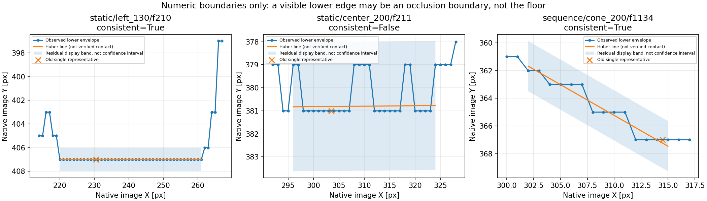
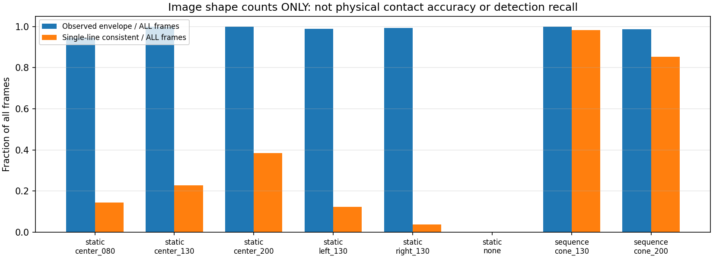
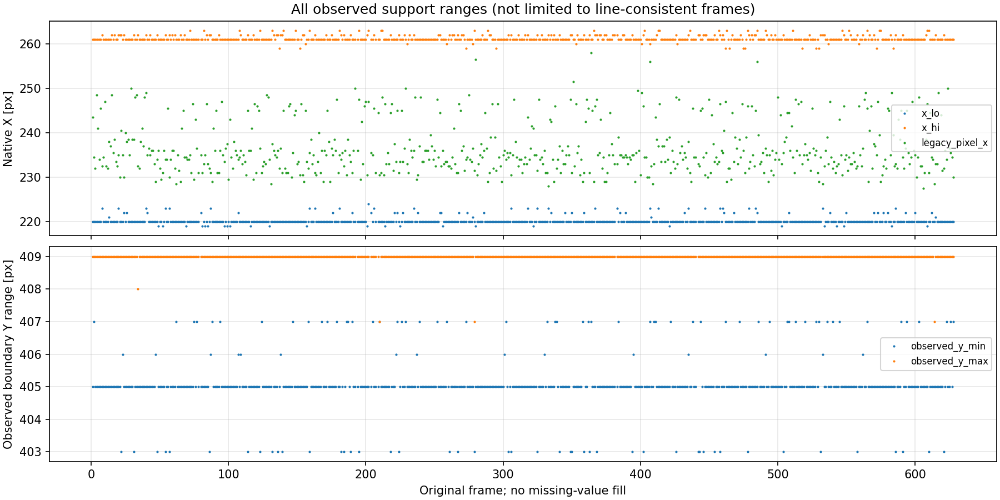
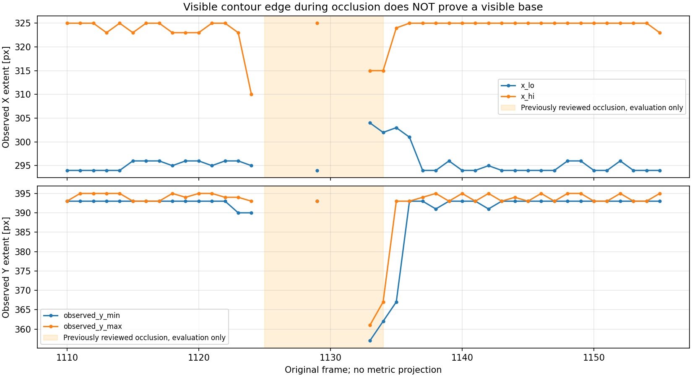

# 台座下辺・支持範囲の画像表現を一点と分ける検証（2026-10-19）

後続：[観測支持範囲の急変/欠測保留・復帰の実装と全録画回帰](../cone_support_quality_r01/README.md)。
一本線への整合を条件にせず、範囲と共通観測列の時間品質を検証した。
画像観測としての採用であり、接地・距離・本番FFBの承認ではない。

## 結論

**既存7録画・全5,143frameで、下側境界を「列ごとの境界点＋観測範囲」として保持できた。**
元の色成分が取れた4,354frameについて、計231,362個の下包絡点を保存した。
ここでいう「支持範囲」は**画像上で観測している区間**であり、
実物の床接触範囲・台座全体の占有範囲・正しい接地線を検証済みという意味ではない。

- 静止左配置613組の隣接frameで、旧代表点Xの変化p95は16px。
  観測区間の左右端は3px/2px、観測列の共通度IoU中央値は約0.977だった。
  一点の選択の揺れと、見える対象の広がりを分けて記録できた。
- **一本線への固定は適さない。** 固定した画像形状screenに収まるのは1,572frame。
  左は77/628、右は24/631にとどまり、折れや色境界の段差を無理に直線化すべきではない。
- **線が出ても接地とは限らない。** 既知の遮蔽frame1133/1134でも線分は得られた。
  見えている上部の遮蔽境界を床接触と誤解しないため、全結果はFFB不許可のまま。

距離の録画間幾何転用とは分けた検証で、今回m単位の射影・校正fit・TTC評価は行っていない。
本番src/config、YOLOモデル、既存の品質ゲート/FFB安全機構、元画像/録画は無変更。
追加撮影は依頼していない。**現時点では既存データで次のソフト検証へ進められる。**

## 1. 方法と保存形式

[事前固定の方法](method.md) に従い、前段の色成分抽出/拒否を再利用した。
V30、赤/黄の固定範囲、bbox±4px、競合成分/ROI端の拒否は変えていない。
対象は既存YOLO予測へ関連付けた単一コーンに限る。全視野HSVへ戻した処理ではない。

表現は次の3層に分けた。

| 層 | 保存するもの | 意味と制限 |
|---|---|---|
| 下包絡 | 各整数X列の最大Y。全列を保存 | 見えている色成分の下側境界。床接触とは未確認 |
| 観測支持範囲 | 色成分のX幅の中央80%にある実観測列 | 端・側面を一律に接地としないための開発用区間。全下包絡も残す |
| 補助線分 | 下包絡の支持列へHuber直線fit、残差/傾き | 一本線で表せるかの診断。合わない場合は下包絡へ戻る |

凸包・穴埋め・欠測補間、正解距離によるpixel選択を行わない。
補助線分は観測区間の外へ延長しない。
描写用の残差幅も保存したが、物理接地点の信頼区間や統計的coverage保証ではない。

`cv2.fitLine` の既存実装を利用し、新規依存関係は追加していない。
Huberの仕様は[OpenCV公式](https://docs.opencv.org/4.13.0/d3/dc0/group__imgproc__shape.html)を参照。
支持範囲やscreenの設計は本検証独自で、公式文書が物理接地の認識精度を保証するものではない。



この図の右端は**台座が見えていると判定した成功例ではない**。
遮蔽中の輪郭でも線が出ることを示す反例として固定frame1134を使っている。
左は既存無加工PNGのframe210、中央はframe211に対応。

## 2. 全5,143frameの保持状況

line整合screenは事前固定（8列以上、X span>=6px、coverage>=80%、列gap<=2px、
|slope|<=0.75、垂線残差p90<=1.5px）。結果を見てしきい値を緩めていない。
**画像形状の診断値であり、検出精度・接地精度・距離精度の合格基準ではない。**

| 録画・配置 | 全frame | 下包絡を保持 | 単一直線screenに整合 | 観測支持幅中央値 [px] |
|---|---:|---:|---:|---:|
| 静止0.80m | 722 | 682 | 104 | 63 |
| 静止1.30m | 651 | 651 | 149 | 39 |
| 静止2.00m | 632 | 632 | 243 | 27 |
| 静止左1.30m | 628 | 621 | 77 | 41 |
| 静止右1.30m | 631 | 626 | 24 | 41 |
| コーンなし | 332 | 0 | 0 | 欠測 |
| 連続1.30m区間 | 218 | 218 | 214 | 41 |
| 連続2.00m区間 | 548 | 541 | 467 | 31 |
| 床のみ | 300 | 0 | 0 | 欠測 |
| 設置区間 | 262 | 188 | 130 | 43 |
| 移動区間 | 219 | 195 | 164 | 31 |
| 合計 | 5,143 | 4,354 | 1,572 | — |

配置名にある距離は過去の区間ラベルで、今回のfit/範囲選択へ参照距離を渡していない。
前レンズ/中央ROIの既存対象関連付けに必要な凍結情報は再利用したが、距離の転用評価はしていない。
連続2mで前段の距離投影候補539より下包絡541が多いのは、
今回は床交点による範囲拒否をしていないため。精度向上と取り違えない。



最初に保存した `results_r01/support_coverage.png` は長いY軸ラベルの表示が窮屈だったため、
元結果を上書きせず、同じ数値から上図を別フォルダへ再描画した。計算結果/しきい値は不変。

## 3. 直線に収まらないframeも含めた範囲の安定性

直線整合frameだけで比較すると、左配置で使える隣接frameは11組しか残らない。
そのため、**直線整合の有無で間引かず、下包絡を観測できた隣接frame全組**も別集計した。
列対応は両frameで実際に観測できた同じ整数Xだけ。欠測・区間境界を飛び越さない。

| 配置 | 隣接下包絡の組数 | 観測列IoU中央値 | 左端変化p95 [px] | 右端変化p95 [px] | 旧代表点X変化p95 [px] |
|---|---:|---:|---:|---:|---:|
| 静止0.80m | 643 | 0.969 | 2 | 2 | 19.5 |
| 静止1.30m | 650 | 0.976 | 2 | 0 | 22.5 |
| 静止2.00m | 631 | 0.966 | 2 | 1 | 7.0 |
| 静止左1.30m | 613 | 0.977 | 3 | 2 | 16.0 |
| 静止右1.30m | 621 | 1.000 | 2 | 2 | 3.0 |
| 連続1.30m区間 | 217 | 1.000 | 2 | 2 | 2.0 |
| 連続2.00m区間 | 538 | 0.939 | 2 | 2 | 4.0 |

端の移動と代表点の移動は異なる量。**端の方が正しい接地点だと証明した比較ではない。**
見えている広がりが比較的安定なのに、一点の選択は大きく変わる状況を示している。
同じ固定配置の繰返し観測であり、613回の独立設置試験でもない。

同じXで見た下包絡Y差の「列内中央値」に対する隣接frame間p95は、
静止左を含む多くの静止区間で2pxだった。列間にある曲がり/段差も残したままの値で、
Y誤差2pxという正解精度ではない。細部は[範囲の安定性集計](extent_audit_r01/range_stability_summary.csv)。



## 4. 遮蔽で何が分かり、何が分からないか

- 1125..1128、1130..1132は対象候補なし。範囲も線分も作らない。
- 1129は一瞬色成分が復帰し、下包絡が得られる。これを持続した台座復帰とは解釈しない。
- 1133/1134は上部の可視領域から下包絡/線分が作られる。
  1134の観測Xは302..315px、Yは362..367px。
  通常の2m区間に多い下側の393px付近とは大きく異なる。
- 1135は急な折れ/傾斜を持ち、直線screenでは保留。下包絡自体は残す。
- 1136以降に範囲が戻るが、今回時間ゲートやFFB通知へは接続していない。



範囲の縮小・上下変化は次の品質検証に使える材料。
ただし、実走行による見え方の変化と遮蔽をこの数値だけで完全に分離できるとは限らない。
**線分があること、平坦であること、画面下側にあることだけでは、物理接地を証明しない。**

## 5. 幾何転用との分離・残る物理情報

今回新たに計算したのはpixelの下包絡、範囲、直線、残差、隣接frameの列対応だけ。
geometryを変えたm単位比較、台座実寸37.5cmを用いたfit、既知距離への合わせ込みはしていない。
録画間の距離偏りが直ったとは結論しない。

既存画像だけで保証できない点は次の通り。

1. 色境界のどの列が実際の床接触か。暗い台座/縁/反射/影とのpixel対応の物理GT。
2. 遮蔽された部分の真の台座下辺。見えている部分からの延長を正解として埋められない。
3. 画像上の区間幅から、校正検証抜きに実物の床占有範囲を決めること。

これらの不足は記録するが、今すぐ追加撮影を求める理由にはしない。
まず既存データで、範囲の急変/欠けを保留する因果的な品質判定を検証できる。
実距離精度や接地の物理的正しさを確定する段階で既存資料が尽きた場合だけ、
必要な基準点に限定した実測/撮影を相談する。全条件の撮り直しは現在不要。

## 6. 実装・検証・成果物

- [support.py](support.py)：下包絡、観測範囲、Huber補助線、観測区間内だけの評価。
- [analyze_support.py](analyze_support.py)：全raw逐次読取り、旧色抽出/旧pixelとの一致、全frame保存。
- [extent_audit.py](extent_audit.py)：直線不適合も含む範囲・同じ観測列の隣接比較。
- [method.md](method.md)：実行前の条件・制約。

新規30件＋既存床接点9/コーン投影17/品質15/追跡12件、**計83件成功**。
全4,354下包絡から範囲/補助線を再計算し、全集計・隣接比較・保存CSVと一致。
旧pixel/色抽出guardは全5,143frameで前回と一致。
既存41枚native PNGとの出典・ファイル/decoded BGR hash照合と計測一致も確認した。
合成の水平/傾斜/折れ/欠け/左右反転/並び順、欠測非補完、遮蔽の誤解防止も検証。
元raw・画像・本番設定・凍結済みコード・出力hashは不変。

実機、ROS、TTC、新規推論、全リポジトリテスト、実時間処理速度は未検証。
既存のMatplotlib未使用Axes3D警告はあるが、2D図の生成・目視は成功。
カメラ画像のcrop/overlay/色変更/リサイズは保存していない。新規画像は数値グラフのみ。
[verification.json](verification.json) に検証範囲を記録した。

| 成果物 | 保存先 |
|---|---|
| 全5,143frameの画像診断 | [observations.csv](results_r01/observations.csv) |
| 全231,362個の下包絡点 | [lower_envelopes.csv](results_r01/lower_envelopes.csv) |
| 区間別の保持/直線整合数 | [summary.csv](results_r01/summary.csv) |
| 直線整合frame同士だけの副次比較 | [adjacent_support.csv](results_r01/adjacent_support.csv) |
| 直線不適合も含む観測範囲 | [observed_ranges.csv](extent_audit_r01/observed_ranges.csv) |
| 実観測列同士の全隣接比較・集計 | [adjacent_envelopes.csv](extent_audit_r01/adjacent_envelopes.csv)、[range_stability_summary.csv](extent_audit_r01/range_stability_summary.csv) |
| 出典/コード/元raw/設定/output hash | [全raw解析](results_r01/provenance.json)、[範囲追加集計](extent_audit_r01/provenance.json) |

```bash
cd ~/theta_ws/RICHO-theta
/home/robo25/theta-env/bin/python3 -m unittest discover \
  -s Experimental_results/2026-10-19/cone_support_extent_r01 -p 'test_*.py' -v
# 再解析時は必ず未使用の出力先。保存済みr01は上書き拒否。
/home/robo25/theta-env/bin/python3 Experimental_results/2026-10-19/cone_support_extent_r01/analyze_support.py \
  --output-dir Experimental_results/2026-10-19/cone_support_extent_r01/results_r02
```

現時点の推奨は「一点や一本線へ早期に縮約せず、下包絡と観測範囲を保持する」開発方針。
本番採用・コーンTTC/FFB接続の承認ではない。日報・commit/pushは今回依頼されていないため実施していない。
