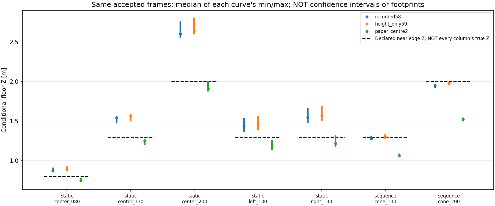
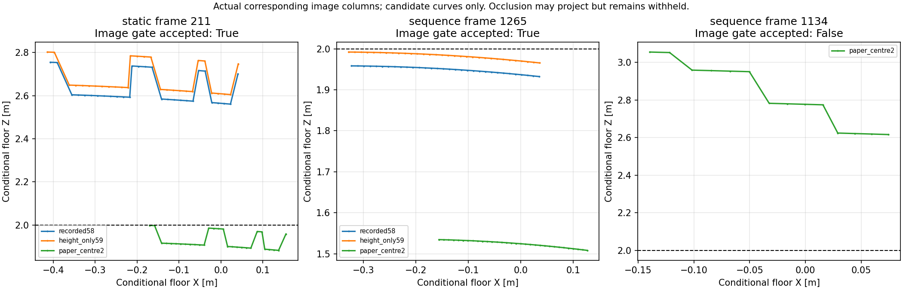

# 下辺を範囲のまま床へ投影した診断（2026-10-19）

## 結論

**既存7録画の下辺を一点にせず床へ投影し、下辺自体の広がりと校正候補の差を分離した。範囲化しても録画間の距離差は残った。**

- 全5,143frame、実観測180,980列を3つの固定校正で処理した。新規推論・撮影・fitなし。
- 時間品質で採用した4,216frameは全3候補で全列投影できた。欠測・拒否の927frameは距離観測へ昇格しない。
- 2m配置の連続録画では、59cmモデルの下辺Z幅の中央値は約2.7cm。
  同じ画素列を白紙候補へ変える差は約-45.8cmで、下辺の範囲化では吸収できない。
- 遮蔽境界は床へ投影できても物理接地とは限らない。frame1134は白紙候補で投影可能だが画像品質で拒否されたまま。

全出力`floor_contact_verified=False, usable_for_ffb=False`。
**画像下辺の保持・条件付き投影を実装した結果であり、距離校正の採用・TTC/FFB接続の完了ではない。**

## 1. 比較方法

[実行前に固定した方法](method.md)どおり、前段の[観測下辺](../cone_support_extent_r01/README.md)と
[時間品質r02](../cone_support_quality_r01/README.md)を変更せず使用した。
元1280×720の支持範囲内の各整数X列について、実際に観測したYだけを投影。
点への集約・直線fit・補間・端の延長はしていない。

既存[ground_contact.py](../../../src/ground_contact.py)の魚眼ray変換と同じ床交点式を使う。
前レンズ、下向きray、正のZ、水平距離0.2～4mという既存診断条件を維持した。
この診断だけのために閾値を緩和していない。

固定候補は[以前の距離方式比較](../cone_distance_methods_r01/README.md)のまま。

| 候補 | 意味 |
|---|---|
| recorded58 | 録画に残った従来幾何。高さ58cm |
| height_only59 | 従来幾何の高さだけユーザー実測59cmへ変更 |
| paper_centre2 | 既存の白紙7点から作ったオフライン候補。録画間転用は未成立 |

設置値に合わせて候補を選び直したり、前後/左右の補正をfitしたりしていない。
3候補へ同じ画素列を与え、下辺選択差と校正差が混ざらない比較にした。

## 2. 前後範囲の比較

次表は時間品質採用かつ3校正共通で投影できたframeの集計。
表の区間は「各frameの最小Zの中央値～各frameの最大Zの中央値」。
**一つのframeの区間でも、信頼区間でも、真の台座占有範囲でもない。**
各列の投影座標・範囲はあくまで「その可視境界が床上にあると仮定した交点」。
近側台座辺までの設置Zが、下辺全列の正解Zであるとは仮定しない。

| 録画/配置 | 設置Z | frame数 | height_only59のZ区間 [m] | paper_centre2のZ区間 [m] |
|---|---:|---:|---:|---:|
| static中央0.80 | 0.80 | 608 | 0.879～0.919 | 0.739～0.770 |
| static中央1.30 | 1.30 | 649 | 1.508～1.582 | 1.206～1.267 |
| static中央2.00 | 2.00 | 630 | 2.610～2.799 | 1.886～1.996 |
| static左1.30 | 1.30 | 605 | 1.397～1.556 | 1.143～1.253 |
| static右1.30 | 1.30 | 617 | 1.515～1.683 | 1.188～1.311 |
| sequence中央1.30 | 1.30 | 218 | 1.288～1.329 | 1.053～1.081 |
| sequence中央2.00 | 2.00 | 533 | 1.966～1.992 | 1.508～1.534 |

根拠：[summary.csv](results_r01/summary.csv)の`population=common_time_accepted`。
`all_input`は時間品質採用前も含み、`time_accepted`は画像時間品質採用後。
今回は全採用frameが3校正で完全投影できたので、後二者の母集団は一致した。
全frame数・欠測数は各集計に残し、投影成功分だけで全frame分母を置き換えていない。



## 3. 下辺の広がりと校正差を分ける

| 2m配置 | 59cmモデルのframe内Z幅の中央値 | 白紙候補−59cmの同一列Z差の中央値 |
|---|---:|---:|
| static | 18.35cm | -73.34cm |
| sequence | 2.66cm | -45.84cm |

右列は、**各frame内の対応列の差の中央値を求め、そのframe間中央値を取った値**。
異なるモデルの区間端どうしを対応点と見なして引いた値ではない。
したがって「下端の一点が揺れる」問題と、既存の校正を変えた影響を別々に確認できた。
この差が大きいから白紙候補が常に悪い、59cmモデルが常に正しい、という選択はしていない。

同じ59cmモデルでもstatic/sequenceの2m配置で、区間端の中央値に約64.4～80.7cmの差が残る。
白紙候補でも約37.8～46.1cm残った。
これは[別録画の観測範囲分布の比較](results_r01/unpaired_session_comparison.csv)であり、
同一の物理接地点を追跡した対応差でも、カメラ姿勢ずれの測定でもない。
高さ/傾き/測定原点を変更していないというユーザー説明を否定する根拠にはしない。

左右についても、59cmモデルの可視下辺X幅の中央値は左約41.4cm、右約39.4cmだった。
中央80%の画像範囲・斜めに見える台座境界を投影した値であり、台座の実測一辺37.5cmと
そのまま等置してスケール補正することはできない。
横位置換算に残る台座角度の前提も今回推定していない。

根拠：[同一列の校正差集計](results_r01/geometry_difference_summary.csv)、
[全frameの校正差](results_r01/same_column_geometry_differences.csv)。

## 4. 遮蔽・範囲外の扱い

元5,143frameを3モデルで保持し、15,429行を保存。
3組のモデルペアも15,429行を保存した。

- 入力下辺あり：4,354frame。時間品質採用：4,216frame。
- 投影不適合は計6frame/model行。いずれも元の画像時間品質でも保留だった。
- recorded58/height_only59のframe1133：12列すべて距離4m超。
- 同frame1134：14列すべて距離4m超。
- 同frame1135：22列中1列が距離4m超。**残り21列だけで範囲を作らず全範囲を保留**。

frame1134の水平距離は、recorded58で約4.08～5.25m、59cmで4.15～5.34m。
白紙候補では約2.62～3.06mで既存の投影範囲内に入るが、
元の画像時間品質は拒否なので、`observed_*`は全て欠測のまま。
つまり「床投影が計算できた」だけでは上部の遮蔽境界を接地点として認定しない。



上図右でrecorded58/height_only59を描いていないのは、全列投影が診断範囲外になったため。
それらの不適合列・切り捨て前の交点は[代表列CSV](results_r01/representative_columns.csv)に残す。
この数値図はカメラ画像の加工ではない。

## 5. 成果物・再現・検証

- [全frameの条件付き範囲](results_r01/projected_ranges.csv)：candidateとobservedを分離。不適合理由/列数も保持。
- [集計](results_r01/summary.csv)：11区間×3校正×3母集団の99行。
- [同一列のモデル差](results_r01/same_column_geometry_differences.csv)と[集計](results_r01/geometry_difference_summary.csv)。
- [録画間比較](results_r01/unpaired_session_comparison.csv)：同一物理点の対応とは呼ばない。
- [代表frameの全投影列](results_r01/representative_columns.csv)：以前から使っている8代表frame。
- [来歴とhash](results_r01/provenance.json)、[検証範囲](verification.json)。

全列の大きな重複CSVは増やさず、元の[下包絡CSV](../cone_support_extent_r01/results_r01/lower_envelopes.csv)と
固定パラメータ、再現scriptから計算を再現する。全frameの範囲・校正差は省略せず保存した。

```bash
cd ~/theta_ws/RICHO-theta
/home/robo25/theta-env/bin/python3 -m unittest discover \
  -s Experimental_results/2026-10-19/cone_support_projection_r01 -p test_projection.py -v
# 再生成する場合は未使用の出力先。保存済みr01は上書き拒否。
/home/robo25/theta-env/bin/python3 Experimental_results/2026-10-19/cone_support_projection_r01/run_projection.py \
  --output-dir Experimental_results/2026-10-19/cone_support_projection_r01/results_r02
```

新規16テストが成功。代表列の投影を既存の一点投影と照合し、全15,429行・集計の完全再現、
参照ラベル変更で投影が変わらないこと、欠測/遮蔽の非補完、一部不適合時の全範囲保留、
元入力・校正・本番設定のhash不変を確認した。
既存の支持範囲品質24件と床投影9件も再実行し成功。**今回計49件成功**。
数値図2枚を目視確認した。以前の他テストはソース不変の成功結果を再利用し、全repo suiteは未実行。
Matplotlibの未使用Axes3Dに関する既存警告あり。2D図の保存に問題はなかった。
実時間性能・実走行・ROS・hardwareは今回実行していない。

## 6. 次の課題

下辺の画像表現と条件付き投影は一通りつながった。
一方、どの可視列が計測した「近側の台座辺」を表すか、既存の床校正が別録画の座標系へそのまま
使えるかは未確定。範囲を広げて設置Zを含ませる方法で解決したことにはしない。

次は、まず既存の保存経路・録画時設定・画像座標系、および同一録画内の床基準との対応可能性を監査する。
不足する物理情報が既存映像から得られないと分かった時だけ、その不足に限定して相談する。
現時点で追加録画・校正の本番適用・ハンコン接続は依頼しない。
元カメラ画像、録画、runtime/config/FFB安全機構は変更なし。日報・commit/pushは依頼されていないため未実施。
