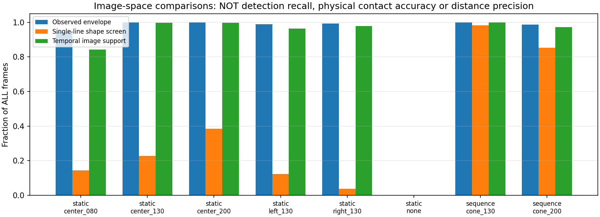
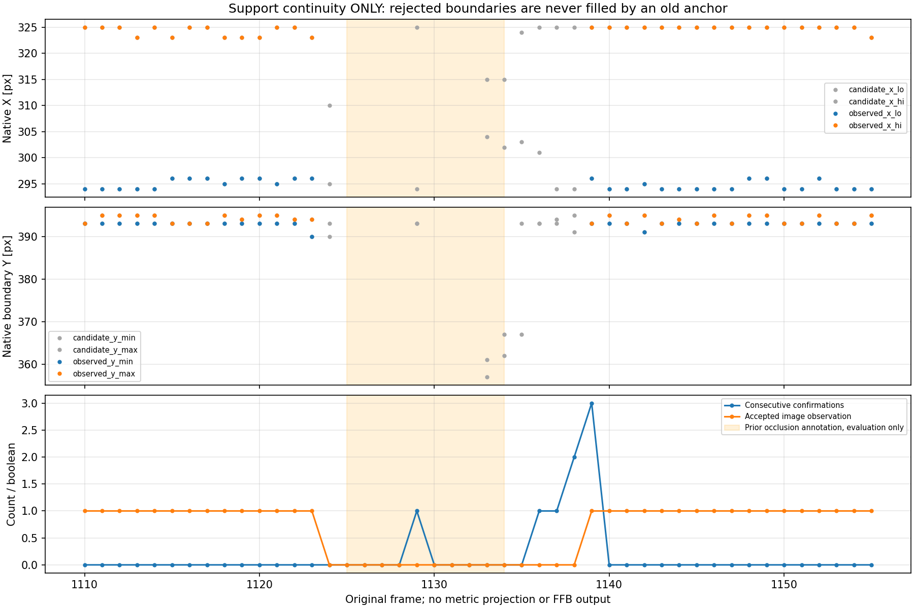

# 観測支持範囲の急変・欠測保留と復帰（2026-10-19）

## 結論

**一点や一本線へまとめず、観測している境界範囲の時間的な一貫性を判定するオフライン処理を実装した。**
既存7録画・全5,143frameを、追加撮影/推論なしで処理した。

- 静止左配置は605/628frameを採用。前段の単一直線screenは77/628だった。
  折れた境界でも範囲が連続していれば観測として保持できた。
- 中央1.30mは649/651、中央2.00mは630/632frameを採用。
  この2録画では最初の連続確認2frame以外の追加拒否はなかった。
- 既知の遮蔽1125..1134は全て不採用。1133/1134に出た上部の境界も拒否した。
  1139で再採用。1135からの元timestamp差は約133.8ms。
- 既存データ全体で4,216frameを採用し、そのうち2,674frameは一本線screenに不適合だった。

**採用とは画像上の連続性だけ。物理台座の接地、正しい距離、TTC/FFB接続の承認ではない。**
全行 `floor_contact_verified=False, usable_for_ffb=False`。
本番カメラ処理・設定・既存距離品質ゲート・FFB安全機構/出力へは接続していない。
録画間の幾何転用とは分け、今回m単位の射影や距離校正は行っていない。

## 1. 新しい独立モジュール

[src/cone_support_quality.py](../../../src/cone_support_quality.py) に
`ConeSupportQualityGate` / `SupportQualitySettings` を追加した。
既存の `cone_observation_quality.py` や青箱/FFBコードは変更していない。
新モジュール自身はカメラ・YOLO・ROS・hardwareを起動せず、観測列だけを入力に取る。

判定は [再生前に固定した条件](method.md) のまま。

| 判定 | 条件 |
|---|---|
| 観測列 | native1280x720、整数・X昇順・重複なし。8列以上、span6px以上、coverage>=0.8、gap<=2px |
| 幅の急変 | 最後の採用範囲に対して0.7..1.4倍 |
| 左右端の急変 | max(4px, 前の採用幅の20%)以内 |
| 列対応 | 実際に共通するX列が8以上、短い側の50%以上 |
| 上下変化 | 同じX列でのY差絶対値：中央値<=4px、p90<=6px |
| 初回・欠測・拒否からの復帰 | 連続3frame確認。前回採用範囲と、確認中の直前候補の両方に整合すること |
| frame gap・記憶 | 0.2s超gapは再確認。採用範囲の記憶は1sで失効 |

判定に区間名、遮蔽frame番号、既知距離、`line_consistent`、未来frameを渡していない。
しきい値を配置別に変えたり、結果を見て緩めたりしていない。
pixel閾値は開発用で、物理精度から導出した保証値ではない。

### 観測の欠測と、比較用の記憶は別

拒否・欠測中も最後の採用範囲を比較基準として短時間保持するが、**観測として再出力しない**。
拒否した境界でその基準を更新しない。内部予測、欠測補間、bbox一点へのfallbackも行わない。
新しい範囲を採用するまでは `observed_*` が欠測、`observed_columns=0`。
比較は実観測で共通する列だけで、欠けた列を延長して合わせない。

## 2. 全frameの結果

| 録画・配置 | 全frame | 入力下包絡 | 前段の一本線screen | 今回の時間品質採用 |
|---|---:|---:|---:|---:|
| 静止0.80m | 722 | 682 | 104 | 608 |
| 静止1.30m | 651 | 651 | 149 | 649 |
| 静止2.00m | 632 | 632 | 243 | 630 |
| 静止左1.30m | 628 | 621 | 77 | 605 |
| 静止右1.30m | 631 | 626 | 24 | 617 |
| コーンなし | 332 | 0 | 0 | 0 |
| 連続1.30m区間 | 218 | 218 | 214 | 218 |
| 連続2.00m区間 | 548 | 541 | 467 | 533 |
| 床のみ | 300 | 0 | 0 | 0 |
| 設置区間 | 262 | 188 | 130 | 168 |
| 移動区間 | 219 | 195 | 164 | 188 |
| 合計 | 5,143 | 4,354 | 1,572 | 4,216 |

前段の一本線screenと今回の時間品質は**違う意味の指標**。
605/628等を検出recall、接地精度、距離精度と解釈しない。
主に静止カメラの開発録画であり、実走行コーンの汎化検証ではない。

0.80mはROI端の入力欠測40frameに加え、初期化・再確認待ち74frameが残った。
左は入力欠測7frame、確認待ち16frame。右は入力欠測2、複数候補3、確認待ち9frame。
欠測332frameのコーンなし録画も「安全確認済み」や距離0には変換していない。



## 3. 遮蔽と復帰の実際の理由

既知の遮蔽評価windowは1125..1134のまま。処理後集計だけに使用。

| frame | 結果・理由 |
|---|---|
| 1123 | 最後の採用 |
| 1124 | 直前採用に対し幅が約0.57倍、端が13px移動。急変として保留 |
| 1125..1128 | 検出なし |
| 1129 | 一瞬通常に近い範囲が出ても、確認1frame目として保留 |
| 1130..1132 | 再欠測。確認をやり直す |
| 1133 | 幅約0.43倍、Y差中央値34px/p90=36px等で拒否 |
| 1134 | 幅0.50倍、Y差中央値28px/p90約31.4px等で拒否 |
| 1135 | anchorとの端差7px（上限5.6px）、Y差p90=24pxで拒否 |
| 1136 | anchorには整合。確認1frame目 |
| 1137 | anchorには整合するが、確認中の1136から端が7px移動（上限5px）。確認1frame目へ戻る |
| 1138 | 確認2frame目 |
| 1139 | 確認3frame目、採用再開 |

`comparison_failures` は最後の**採用**anchorとの不整合、
`pending_comparison_failures` は確認中の**直前候補**との不整合を分けて記録する。
1137では前者は空でも後者が端の急変を示し、確認countが戻る理由を追跡できる。

1135から復帰1139まで約133.8ms、最後の採用1123からは約533.3ms。
いずれも記録されたframe時刻の差であり、通信遅延・実時間処理遅延・停止反応時間ではない。
また1124を「人が確認済みの遮蔽開始」と認定したのではなく、観測幅の急変として保留した結果。



初回r01を保存後、確認やり直しの診断列だけを追加してr02へ再実行した。
しきい値/判定ロジックは変更していない。
全5,143行のr01既存列はr02と完全一致し、summary/保留区間/PNG2点もbyte一致。
r01のprovenanceは診断追加前のmodule/script/test版のhashを持つ履歴として残している。
現在の完全再現対象はr02。

## 4. 限界もテストで確認

この処理が判断するのは、見える境界の時間的な連続性だけ。
次は**採用され得ることを確認する限界テスト**を追加した。

- 最初から上部の誤境界が3frame安定している場合。
- 採用済みanchorが1s超失効した後、別の誤境界が安定する場合。
- 遮蔽がゆっくり進み、幅とYが毎frame少しずつ変わる場合。

これらは初期化/局所連続性だけでは物理台座と区別できない。
急速な実移動も急変として拒否される可能性があり、実走行/複数コーンの対象選択は未検証。
合成の緩やかな画像移動テストを、0.25m/s実走行の保証に読み替えていない。
物理接地を認識する別の根拠や、実距離への校正が必要という主課題は残る。

**今回の結果をそのままTTC/FFBへ接続しない。**
現在はオフラインで、画像側の「抽出→範囲保持→急変/欠測保留→再確認」が一通り検証できた段階。
追加撮影はまだ依頼していない。既存画像で確認できない物理基準が本当に必要になった時点で、
その不足だけを限定して相談する。

## 5. 検証と再現

- 新規module単体22件＋限界2件＋全録画replay9件成功。
- 既存床接点9/コーン投影17/品質15/追跡12件も再実行し成功。**合計86件成功**。
- 因果性/prefix不変、再現性、旧入力不変、anchor非汚染、実観測列だけの比較、
  timestamp/gap/失効、欠測非補完、元解像度、不正列/複数候補、復帰を確認。
- 全5,143行・全集計・保留区間を再計算して保存CSVと一致。
  採用した観測の範囲は現在の入力列から返したもので、過去のanchorや平滑化値ではないことを確認。
- 元raw・画像・前段結果・本番config・既存src・新module/出力hashを照合。
- 数値図2点を目視。原カメラ画像は読み直しておらず、編集・新規保存なし。
- 全リポジトリ、ROS/実機、実時間速度は未実施。Matplotlib未使用Axes3Dの既存警告のみ。

[verification.json](verification.json) に検証範囲を記録。

```bash
cd ~/theta_ws/RICHO-theta
/home/robo25/theta-env/bin/python3 -m unittest discover -s tests -p 'test_cone_support_quality*.py' -v
/home/robo25/theta-env/bin/python3 -m unittest discover \
  -s Experimental_results/2026-10-19/cone_support_quality_r01 -p test_replay.py -v
# 再生成は未使用の出力先。保存済みr01/r02は上書き拒否。
/home/robo25/theta-env/bin/python3 Experimental_results/2026-10-19/cone_support_quality_r01/replay.py \
  --output-dir Experimental_results/2026-10-19/cone_support_quality_r01/results_r03
```

結果は [全frame](results_r02/observations.csv)、[集計](results_r02/summary.csv)、
[保留区間](results_r02/withheld_runs.csv)、[遮蔽周辺](results_r02/occlusion_rows.csv)、
[provenance](results_r02/provenance.json)。
元の下包絡は [前段CSV](../cone_support_extent_r01/results_r01/lower_envelopes.csv) を保持したまま参照する。
日報・commit/pushは今回依頼されていないため行っていない。
