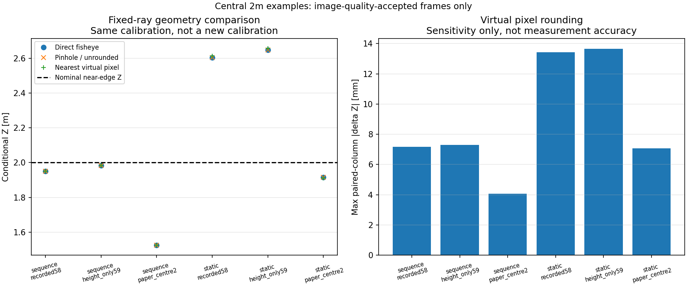

# 現行魚眼経路と仮想ピンホール経路の比較（2026-10-19）

## 結論

**提案の幾何経路をオフライン実装し、同じ下辺・同じ校正なら現行経路と数値一致することを確認した。**
透視画像化/TF相当変換は成立するが、それだけで既存の距離の偏りは消えない。
これは提案を不採用にする結果ではなく、画像の投影形式変更と実測校正の改善を分けるための比較である。

- 既存7録画の全5,143frame、実観測180,980列を、同じ3校正候補で処理。
- 同一画素に対応する床交点542,940組を比較し、最大差はX約1.22×10⁻¹⁵m、Z約1.42×10⁻¹⁴m。
  事前指定の数値確認許容1e-9m以内。物理測距精度の保証値ではない。
- 画角外列0、元の床投影可否判定との不一致0。
- 実原画像3枚×3幾何の9ケースで、960×960の透視画像をメモリ内生成。
  元画像は不変、変換後画像のファイル保存はしていない。
- 新規19テストと既存床投影9テスト、計28件成功。

**ROS TF配信、変換後画像でのYOLO再推論、実機FFBは今回未実施。**
全出力は `floor_contact_verified=False, usable_for_ffb=False`。

## 1. 実装した比較経路

[実行前に固定した方法](method.md)に従い、以前の[観測下辺の床投影](../cone_support_projection_r01/README.md)を再利用した。
元の候補を距離に合わせて選び直したり、白紙7点へ再fitしたりしていない。

| 経路 | 計算内容 |
|---|---|
| direct | 既存`ground_contact.py`の等距離魚眼→ray→床 |
| pinhole_float | OpenCV魚眼補正→仮想透視画素→K⁻¹のray→剛体変換→床 |
| pinhole_rounded | 同じ仮想透視画素を整数へ丸めた副次感度。再検出結果ではない |

仮想カメラは960×960、水平/垂直FOV90°、fx=fy=480px、cx=cy=479.5px。
透視カメラなので前方向だけを扱い、360度パノラマやBEVをピンホール画像と見なしていない。
視線変換中は浮動小数画素を保持し、主比較に丸めを入れていない。

魚眼側のKは、既存の有効中心と`f=radius/(π/2)`で表現し、OpenCV魚眼Dを4要素0にした。
**これは既存の理想等距離仮定の別表現であって、レンズの実測K/Dを新しく得たわけではない。**
魚眼モデルD=0を、通常の透視画像に歪みがないという意味と混同しない。

元の下辺/時間品質/校正が同じなので、得られる視線・床交点も同じになるのが理論上の期待。
今回、既存のray関数を呼んで同じ値をコピーするのではなく、別のOpenCV逆投影＋K逆行列＋剛体変換で照合した。
この一致試験を独立した物理精度試験と呼ばない。

## 2. TFと同じ剛体変換を使うための軸整理

[virtual_pinhole.py](virtual_pinhole.py)で、次の2座標系の4×4変換を組み、回転の直交性・det=+1を検証した。

- `virtual_front_optical`：X右/Y下/Z前。
- `camera_ground_reference_ROS_axes`：X前/Y左/Z上。原点はカメラ直下の床。

既存内部のX右/Y上/Z前という表現を、名前だけ変えてROS TFとして流していない。
光学系・内部系・ROS系の変換を合成して、正規の右手回転にした。
比較CSVに出すX右/Z前は、最後に既存の数値と照合するために戻した値。

モデルごとの変換は[virtual_camera_and_transforms.json](results_r01/virtual_camera_and_transforms.json)。
高さは各既存モデルの58/59cm、姿勢も既存値を維持。
**実機の`base_link`との外部校正を測り直した結果ではなく、TF broadcasterや時刻lookupも起動していない。**
TF配信前に必要な軸/数学の単体検証までを、実機と切り離して行った段階。

## 3. 同じ校正では距離の偏りも維持される

以下は画像時間品質で採用され、3経路共通で投影できたframeの、下辺内Z中央値のframe間中央値。
下辺全列が台座の近側辺という仮定は置かず、これ自体を正解接地点にはしない。

| 中央2m配置・校正 | frame数 | 現行 [m] | ピンホール浮動小数 [m] | 仮想整数画素 [m] |
|---|---:|---:|---:|---:|
| sequence・58cm | 533 | 1.9499 | 1.9499 | 1.9503 |
| sequence・59cm | 533 | 1.9835 | 1.9835 | 1.9840 |
| sequence・白紙候補 | 533 | 1.5248 | 1.5248 | 1.5238 |
| static・58cm | 630 | 2.6041 | 2.6041 | 2.6126 |
| static・59cm | 630 | 2.6490 | 2.6490 | 2.6576 |
| static・白紙候補 | 630 | 1.9156 | 1.9156 | 1.9121 |

出典：[summary.csv](results_r01/summary.csv)の`population=time_accepted`。
変換だけでstatic/sequenceの差を合わせる補正は行っていない。



初回r01図は長い見出しが一部見切れたので、[表示用script](present_results.py)で同じCSVから図だけ作り直した。
元r01のCSV・図・来歴は上書きせず保持。表示用図の[来歴](presentation_r01/provenance.json)を別保存した。

## 4. 整数画素への丸めは別の誤差源

| 比較対象 | 最大X差 | 最大Z差 |
|---|---:|---:|
| 全入力候補。画像品質拒否/距離範囲外の交点も含む | 8.13mm | 60.48mm |
| 画像時間品質採用frame内 | 3.43mm | 13.65mm |

これは**同じ元画素を仮想画像で最近傍整数へ丸めたときの差**。
実際のYOLO誤差、補間後の台座境界誤差、物理測距の誤差上限ではない。
単純な整数化だけでも差が追加されるので、座標計算は浮動小数で維持する。
仮想FOV/画素数を変えた場合の実画像認識性能は別評価が必要。

全15,429frame/model行を3経路で保持。
投影完全行は各13,056、画像時間品質採用後の観測行は各12,648（4,216frame×3モデル）で一致。
既存の遮蔽/欠測をピンホール変換で観測へ戻していない。
今回の画角内では、整数化による床投影可否の判定反転も0だったが、一般保証ではない。

## 5. 透視画像の生成確認と未実施のこと

OpenCV `fisheye.initUndistortRectifyMap`と`remap`で、次の原PNGをメモリ内変換した。

- static中央2m frame211。
- sequence中央1.30m frame563。
- sequence中央2m frame1265。

3画像×3幾何、計9ケース。各960×960の921,600画素の参照mapは全て有効だった。
原画像ファイルhashとメモリ画素hashの不変を確認し、出力の寸法/hashを
[memory_rectification.csv](results_r01/memory_rectification.csv)へ記録した。
変換後のカメラ画像は保存・目視表示していない。数値図だけを保存し目視した。
mapの順逆対応は別の合成座標テストで確認した。

今回のYOLO bbox/下辺は元画像から既に得たものを使う。
**透視画像上でYOLOを走らせ直して、検出や接地境界が改善するかはまだ評価していない。**
その場合、見え方とモデルの学習分布が変わるため、同じ重みでも改めて評価する必要がある。
今回の一致を「ピンホール画像なら検出精度が同じ/良くなる」という結論へ広げない。

## 成果物・検証・再現

- [全frame比較](results_r01/frame_comparison.csv)、[集計](results_r01/summary.csv)、[代表列](results_r01/representative_columns.csv)。
- [仮想K/剛体変換](results_r01/virtual_camera_and_transforms.json)、[メモリ内変換](results_r01/memory_rectification.csv)。
- [来歴](results_r01/provenance.json)、[検証範囲](verification.json)。

新規19テスト：仮想K、等距離モデル、ROS軸/det、一般姿勢、三角比、焦点距離変更時の不変性、
画角外の全範囲保留、丸めの明示、逆map、入力不変、全frame/CSV完全再現、旧直接投影との一致、
既存品質拒否の維持、参照ラベル非使用、全hash、メモリ内変換再現を確認。
既存床投影9件も再実行し、**計28件成功**。
未変更のその他のテストは直前の成功結果を再利用し、全repo suiteは未実行。
Matplotlib未使用Axes3Dの既存警告があるが、2D図の保存は成功した。

```bash
cd ~/theta_ws/RICHO-theta
/home/robo25/theta-env/bin/python3 -m unittest discover \
  -s Experimental_results/2026-10-19/cone_virtual_pinhole_r01 -p test_pinhole.py -v
# 再生成は未使用の出力先。保存済みr01は上書き拒否。
/home/robo25/theta-env/bin/python3 Experimental_results/2026-10-19/cone_virtual_pinhole_r01/compare_pinhole.py \
  --output-dir Experimental_results/2026-10-19/cone_virtual_pinhole_r01/results_r02
/home/robo25/theta-env/bin/python3 Experimental_results/2026-10-19/cone_virtual_pinhole_r01/present_results.py \
  --output-dir Experimental_results/2026-10-19/cone_virtual_pinhole_r01/presentation_r02
```

次は依頼済みの[中央2m白紙→コーン→白紙](../cone_recording_coordinate_audit_r01/central_2m_paper_cone_capture.md)を使い、
明瞭な床点と台座辺の対応を同一動画内で確認する。
今回の処理はその録画をどちらの表現でも比較するために再利用できる。
元カメラ画像・動画・既存src/config・FFB安全機構は不変。学習・ROS配信・実機出力・Git commit/pushは未実施。
