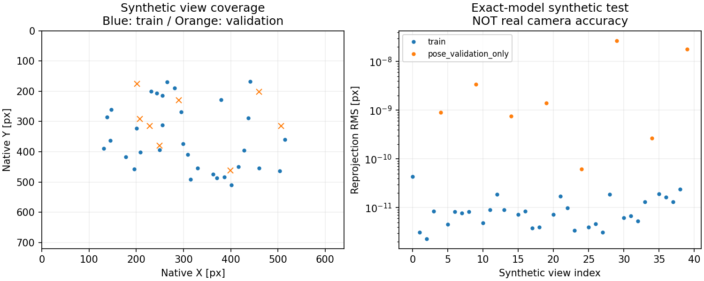

# 前方魚眼の独立内部校正：準備とツール検証

## 今回できたこと

**床の距離と姿勢の有効パラメータを調整する代わりに、レンズ内部K/Dを独立に取得するための準備を実装した。**
実カメラの内部校正完了ではない。実録画・印刷寸法が必要な段階へ進めた。

- [印刷用A3 PDF](target_a3/checkerboard.pdf) / [SVG](target_a3/checkerboard.svg) / [寸法spec](target_a3/board_spec.json)。
- [撮影・提出・解析コマンド](capture_procedure.md)。連続1本、格子30～40姿勢、2～4分程度が目安。
- [校正処理](../../../src/fisheye_intrinsic_calibration.py)、[CLI](../../../src/prepare_fisheye_calibration.py)。
  追加のGPU/ドライバー/ROS依存なし。既存OpenCV4.5.5で動作確認。
- `board`→`extract`→`fit`を分離。本番へ自動適用せず、出力先の上書きも拒否する。

## この手段を選んだ理由

前段で、同じ2m位置の紙角と台座下辺は画素一致したが、既存幾何の距離は合わなかった。
1点の床座標から、内部モデルと取付姿勢を同時に特定できないことも[前段のSVD診断](../fisheye_tf_preparation_r01/README.md)で確認した。
確認した既存実装・候補・metadataでは、独立測定した実レンズのK/Dを確認できていない。
過去の白紙7点は、当該sessionの有効モデルを説明できても、レンズ内部校正の独立測定と同一ではない。

今回はOpenCVの既存fisheye校正を使い、焦点距離・主点・4歪み係数と、各ボード姿勢を求める。
通常のピンホールdistCoeffsと互換にはしない。
GPU学習は不要で、新しい校正solverやChArUco等の追加依存を導入せずに済む。
一方、全格子が読める大きさ・白い余白・十分な位置/傾きの変化が必要という制約がある。
原画像を透視化してから通常のcalibrateCameraへ渡し、元レンズのK/Dと混同する方法は採らない。

方法/APIは[OpenCV 4.5.5 fisheye公式資料](https://docs.opencv.org/4.5.5/db/d58/group__calib3d__fisheye.html)、
角検出は[calib3d公式資料](https://docs.opencv.org/4.5.5/d9/d0c/group__calib3d.html)を確認。
OpenCV本体を変更せず既存のPython APIを利用する範囲。

## ツールの誤用防止

- 原画像1280×720、前方左レンズのROIを固定。ROI内検出座標を原画像へ戻す。
- 再投影/補正画像は保存しない。採用frame保存は元decode全画素のPNGのみ。
- 未検出・小さ過ぎ・ROI端・近重複も全試行に残す。180°角順反転を別姿勢として数えない。
- 同じ姿勢の大量frameを独立点へ水増ししない。20視点未満・画像内範囲不足ではfitしない。
- 採用順5枚に1枚は内部K/Dのfitから除外し、固定K/Dでボード姿勢だけを求めて再投影誤差を調べる。
- 位置分布、ボード法線の変化、観測角度域の歪み単調性、再投影誤差の暫定screenを保存する。
- screenに通っても`CANDIDATE_ONLY`、`usable_for_ffb=False`。
  floor距離、取付TF、未観測の周辺画角、未知環境の精度は保証しない。
- ボードの設計マス寸法と、印刷後の実測寸法を分けて保存。入力/出力hashを追跡する。

閾値・split・用途の制限は[実装前に固定した方法](method.md)を参照。
印刷・格子の材質や反りはソフトウェアで自動検証できないので、撮影者が確認する。
機械検出の角の正しさも確認が必要で、`board_detected_not_human_verified`として保持する。

## 検証結果

[再現script](verify_tools.py)、[全テストログ](verification_r01/test_log.txt)、[数値・来歴](verification_r01/summary.json)。

| 項目 | 結果 |
|---|---:|
| 校正/CLIの新規テスト | 15件成功 |
| 直前の魚眼＋TFコア | 15件成功 |
| 既存ground contact回帰 | 9件成功 |
| 合計 | 39件成功 |
| 合成40姿勢のsplit | 内部校正32 / 固定K/Dでの姿勢検証8 |
| 合成Kの最大絶対差 | 約2.79×10⁻⁹ |
| 合成Dの最大絶対差 | 約1.71×10⁻¹² |
| 合成train再投影RMS | 約1.30×10⁻¹¹ px |
| 合成姿勢検証RMS | 約1.15×10⁻⁸ px |

**上記は同じ数式で生成したノイズなし合成データの整合性であり、実カメラの精度ではない。**
検証用の観測角を変えても内部校正K/Dが不変なこと、印刷PDF/SVG、CLIのschema/hash、
native座標復元、原PNGのdecode画素一致、重複排除、情報不足時の拒否をテストした。

初回グラフは長い見出しが一部見切れたため、凍結結果と同じ合成fixtureから
[表示用script](present_results.py)で短い見出しの図を別保存した。元の候補JSON・初回図は上書きしていない。

`SYNTHETIC_intrinsics_NOT_FOR_CAMERA.json`はテストfixtureの結果であり、本番へ使わない。
元2m動画も全1,733frameを読み込み、指定間隔の3frame（1/601/1201）では格子未検出0採用だった。
[負例抽出結果](negative_real_video_r01/observations.json)に保持し、架空の角やK/Dを作っていない。
これは既存の全動画に格子がないと証明した結果ではなく、今回の紙/コーン動画の3frameだけの負例試験。

PDFは`pdfinfo`でA3横1ページ（1190.55×841.89pt）と確認し、ラスタライズした一時previewを目視した。
プレビューは印刷サイズ確認用で、camera画像の加工ではない。原ファイルも維持。
ローカルMatplotlibの未使用Axes3D警告のみで、PDF/2D図の生成は成功。

撮影用`run_field_experiment.py`のCLIは`--dry-run`で展開確認。
実カメラ・実ボード・ROS起動・実TF・FFBは今回行っていない。実校正は録画後に評価する。
既存の測距コア、本番設定・モデル・原録画のhashは不変。Git commit/pushは未実施。

## まず撮影者に必要な作業

1. PDFを印刷して平板へ貼り、マス寸法をメモする。
2. [手順書](capture_procedure.md)のとおり、静止カメラの前で格子を動かす連続録画を1本撮る。
3. 録画sessionと実測マス寸法を提出する。

追加のコーン配置・距離7点・学習・ハンコン試験は、この撮影には不要。
取得後にK/D候補を検証し、その次に既存の床基準から取付姿勢と距離の整合性を確認する。
それが済むまで`bird_eye.py`や実機TF/FFBへ採用しない。
