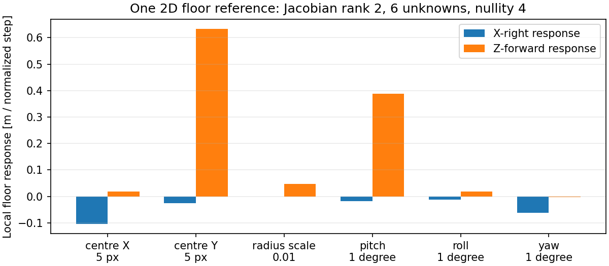

# 魚眼直接測距＋TF：計算コアの分離と校正識別性

## 実装したこと

**画像を透視化せずに、魚眼画素→光学視線→明示的な剛体変換→床交点を計算するコアを追加した。**
新規本体は[src/fisheye_floor_geometry.py](../../../src/fisheye_floor_geometry.py)。
ROSを起動せずにTFと同じ形式の変換を検証できる。
既存`bird_eye.py`・`ground_contact.py`・FFBの呼出し/設定は変更していない。

| 分担 | 入力 | 実装・制約 |
|---|---|---|
| 内部モデル | 原画像の幅/高さ・中心・等距離半径 | `EquidistantCamera`。理想等距離仮定。実測歪み係数ではない |
| 光学視線 | 原画像の小数画素 | `optical_rays`。X右/Y下/Z前。入力順・重複・欠測を維持 |
| 外部変換 | `T_target_from_optical` | 右手系回転と並進を検証。rayへは回転、光学原点へは並進を適用 |
| 床面 | target座標系の単位法線・offset [m] | `intersect_floor`。平面との交点。水平床以外も数学的に扱える |
| 旧設定の読込み | 既存の中心/半径/高さ/角度 | 互換診断adapterのみ。実測base_link外部校正ではない |

剛体変換は`p_target = R_target_from_optical * p_optical + t_target_from_optical`。
TF2で将来lookupするならtarget/sourceと撮影時刻を明示する必要があるが、今回buffer/lookup/broadcastは未実装。
時刻不明・古いTF・変換欠落時に最新値やidentityへ黙って切り替える設計にはしない。
画像寸法不一致、不正回転、反転、尺度変更、画角外、ほぼ平行な視線、カメラが床の反対側という入力は拒否する。
元画像の補間・再サンプリング・保存は不要。

床との交点は「その境界が床上にある」という仮定による位置。
有効な交点が求まっても、検出の正しさ・接地の確認・安全な距離精度が保証されるわけではない。
全出力は`floor_contact_verified=False, usable_for_ffb=False`。

## 軸とTFを混同しない

- 光学座標系：X右/Y下/Z前。
- 診断target：X前/Y左/Z上、原点はカメラ直下の床。
- 既存内部：X右/Y上/Z前。値の順番を変えただけでTF回転として扱わない。
- 旧`pitch_deg/roll_deg/yaw_deg`は旧実装の独自規約。ROSのRPY引数へそのまま渡さない。
- `car_offset_*`は表示設定であり、測定したカメラの並進とはみなさない。
- 今回の診断targetを、実機で確認せず`base_link`や既存の`odom`として配信しない。

軸と右手系は[ROS REP-103原文](https://raw.githubusercontent.com/ros-infrastructure/rep/master/rep-0103.rst)、
source/target・変換方向・時刻の扱いは[ROS 2 Humble TF2原文](https://raw.githubusercontent.com/ros2/ros2_documentation/humble/source/Concepts/Intermediate/About-Tf2.rst)を確認した。
通常のROSドキュメントURLはアクセス拒否だったため、公式リポジトリ原文を参照。
理想等距離仮定と実測歪み校正の区別は[OpenCV fisheye](https://docs.opencv.org/4.13.0/db/d58/group__calib3d__fisheye.html)に対応。
新しいライブラリやROS依存を追加していない。

## 既存実データでの一致確認

直前の[同一2m録画解析](../paper_cone_2m_validation_r01/README.md)に保存した、採用済みの実観測下辺列を使った。
閾値やゲートを変更して取り直さず、欠測・時間窓外を含む全frameを保持した。

| 確認項目 | 結果 |
|---|---:|
| 元frame数 | 1,733 |
| 3幾何を含む全frame/model行 | 5,199 |
| 旧投影と照合した実観測列数（3幾何合計） | 43,614 |
| 最大座標差 | 3.56×10⁻¹⁵ m未満 |
| 床投影・範囲判定の不一致 | 0 |

この一致は計算の移行互換性であって、物理距離精度ではない。
今回の2mが3.51mになる旧設定の偏りも維持されている。
汎用コアは半径距離0.2–4mや前方限定という実験固有の規則を内包しない。
比較adapter側で旧規則を同じように適用し、全範囲・可否が再現することを確認した。
光学中心での汎用コアのrayは数学的極限[0,0,1]を返す。
旧処理の光学中心除外を変更したわけではなく、今回の実観測列にその差はない。

## 今回1点から校正を確定しない理由

白紙前後631frameと台座299frameの同じ列は、いずれも(313,371)pxだった。
繰り返しの安定性は示せるが、独立した空間対応としては**1点**である。

高さ59cmを固定し、中心X/Y・半径尺度・pitch/roll/yawの6変数に対する床X/Zの
局所Jacobianを計算した。1点の2座標ではrank=2、nullity=4。
SVDの非ゼロ特異値は約0.74491/0.12078（[固定スケールと差分方法](method.md)）。
複数の変数変更が相殺できるため、今回の一点を2mへ合わせても、どの値を直すべきか一意に決まらない。
これは局所一次の識別性診断であり、観測ノイズの共分散や全領域の非線形解の個数ではない。



前回白紙7点内の2m角は(309,378)px、今回は(313,371)pxで、差は(+4,-7)px。
撮影sessionと検出条件が異なるので、これをカメラ移動の証明・画像全体の並進・補正量として使っていない。
ユーザー申告の高さ・取付不変を否定せず、物理的原因は未確定として残す。
別sessionの7点を今回1点と無条件に混ぜて校正したり、同じ点の大量frameで独立点数を水増ししていない。

## 次に必要なこと

1. 今回作ったコアは保持し、実TF配信・本番接続より先に内部モデルと床姿勢の根拠を分離する。
2. 現在のコード・収録metadata・過去候補は理想等距離の中心/半径と有効姿勢値であり、
   実レンズを独立測定したK/Dを確認できていない。今回は内部校正を生成したことにしない。
3. 既存の別session7点は、当該録画内の有効校正候補として使えるが、今回への転用はまだ保証できない。
   追加物理情報が必要なら、内部校正値または同一状態の複数の独立床基準という不足に限定する。
   現時点で新しい撮影指示は出していない。
4. 校正の検証後、実測済みカメラ外部変換をTFとして扱うadapterを追加し、
   撮影時刻でlookup・欠落/古い変換時の保留を試験する。その後にコーンのTTC/FFBを接続する。

**今回、距離の偏りを修正した、ROS TFで測距できた、FFBへ接続できたという状態ではない。**
できたのは、そのための独立した計算コアと、誤った校正をそのまま採用しないための検証である。

## 成果物と検証

- [新規コア](../../../src/fisheye_floor_geometry.py)、[単体テスト15件](../../../tests/test_fisheye_floor_geometry.py)。
- [再解析script](analyze.py)、[結果監査テスト5件](test_audit.py)、[集計・SVD・来歴](results_r01/summary.json)。
- [全frame比較CSV](results_r01/all_frame_comparison.csv)、[診断用変換](results_r01/diagnostic_transforms.json)。
- 新規20件＋既存ground contact 9件、計29件成功。
- 初回の新規単体テストは`PYTHONPATH=src`指定漏れでimport失敗。
  リポジトリと同じ設定で再実行し15件成功。計算本体を変更して対処したものではない。
- 2Dグラフを保存・目視確認。未使用Axes3Dの非致命的警告のみ。
- 元動画/画像/CSV/metadata・前回成果物・本番幾何のhash不変。Git操作は未実施。

```bash
env PYTHONPATH=src /home/robo25/theta-env/bin/python3 -m unittest discover \
  -s tests -p test_fisheye_floor_geometry.py -v
/home/robo25/theta-env/bin/python3 -m unittest discover \
  -s Experimental_results/2026-10-19/fisheye_tf_preparation_r01 -p test_audit.py -v
env PYTHONPATH=src /home/robo25/theta-env/bin/python3 -m unittest discover \
  -s tests -p test_ground_contact.py -v
```

生成scriptは既存の`results_r01`への上書きを拒否する。再生成する場合は別の結果先を用意する。
