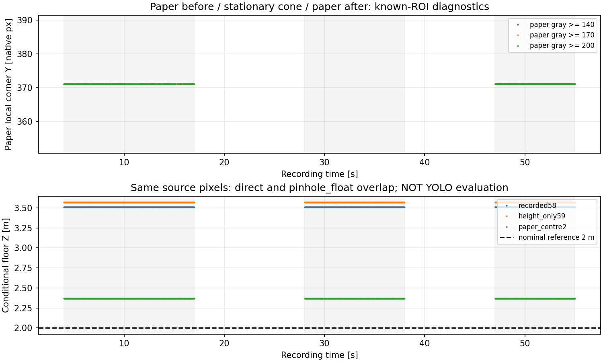

# 白紙・コーン同一2m録画と方式選定（2026-10-19）

## 結論

**現時点では「原魚眼画像の画素→視線→床交点」を主測距経路に維持する。
ピンホール画像化は認識・表示の候補として別評価し、環境に応じた自動切替はまだ導入しない。**

ただし、これは**現行パラメータの距離が正しいという判断ではない**。
今回の名目2.00m地点は、録画時の既存幾何では3.5087mとなり、ピンホール経路も同じ値になった。
原画像の同じ観測点を使う限り、投影形式を替えるだけではこの偏りは解決しない。
コーンのFFB接続を先行せず、レンズモデル・カメラ姿勢・床基準の校正整合性を解決することが次の優先事項。

## 録画の受入確認

入力：`paper_cone_center_z2p00_r01_20261019_180411_245.tar.xz`。
[受入script](intake.py)、[記録とhash](intake_summary.json)。

- raw/BEV/detectionとも1,733frame、CSVも1,733行、時刻単調、連番・動画数整合PASS。
- 記録時間約58.01秒、実収録率29.86fps、原画像1280×720。
- 模擬ODOMは全frame受信、速度・角速度の絶対最大は0。
- 録画内FFB publish/relayとAI推論は無効。元ファイル・設定を変更していない。
- 記録された9幾何項目は以前の床基準収録設定と一致。記録高さ58cmと実測申告59cmは区別して比較。
- 18枚をネイティブ画素のままPNG保存し、decode後の全画素hash一致を検証。
  [原画像一覧](raw_sample_manifest.csv)。切出し・リサイズ・枠・色調補正は保存していない。

## 同一映像内で分かったこと

[固定した方法](method.md)に従い、距離誤差ではなく原画像の作業状態から次の窓を選んだ。

| 区間 | 録画内時刻 | frame数 | 主閾値170の読取り |
|---|---:|---:|---|
| コーン設置前の白紙 | 4–17秒 | 391 | 左下角(313,371)px、全frame同一 |
| 手を離したコーン | 28–38秒 | 299 | 観測下辺のX=313列はY=371px、全frame同一 |
| コーン撤去後の白紙 | 47–55秒 | 240 | 左下角(313,371)px、全frame同一 |

白紙はコーン設置中も一部残っている。白紙そのものを撤去・再設置した再現試験ではない。
主閾値での前後の紙631frameと、コーン静置299frameの同じ列は、元画像の整数画素で一致した。
したがって今回の差を「コーン下辺と紙の角を異なる画素から読んだこと」だけでは説明できない。
この一致は画素単位の結果であり、紙と台座の接地面がミリ単位で同じことを証明するものではない。

- [白紙前の原画像](raw_samples/paper_cone_f000306.png)
- [コーン静置中の原画像](raw_samples/paper_cone_f001019.png)
- [白紙後の原画像](raw_samples/paper_cone_f001529.png)

紙と明るい測距テープがつながるため、既存の四角形全体読取りは拒否したまま保持した。
それを無理に四角形へ近似せず、目視で確認できる左辺の局所輪郭を別の仮説として読んだ。
閾値140でも前後631frameの角は(313,371)。閾値200では前242/391・後207/240frameに限って角を得られ、
Xは314、Yは371となった。閾値依存・失敗を隠さず保存している。
コーンがある時間の紙局所角は全閾値で欠測であり、部分的な白紙を勝手に角とみなしていない。

## 現行幾何とピンホールの比較

以前から固定した3幾何を使用し、今回の2mに合わせるfit・最良モデルの採用は行っていない。
以下は主閾値の紙角と、同じX列のコーン観測下辺の床交点。
上表の3区間とも同じ画素なので、各幾何では同じ値になる。

| 固定した幾何 | 現行ray経路 Z [m] | 仮想ピンホール Z [m] | 名目2.00mとの差 [m] |
|---|---:|---:|---:|
| 録画時設定、高さ58cm | 3.5087 | 3.5087 | +1.5087 |
| 高さだけ実測59cmへ変更 | 3.5692 | 3.5692 | +1.5692 |
| 過去の白紙中心校正候補 | 2.3677 | 2.3677 | +0.3677 |

高さ1cmの変更だけでは解決しない。過去の白紙候補も今回は一致せず、録画間転用の承認にはしない。
名目距離は今回の収録手順に基づく。独立した再測量・設置誤差の測定はしていないため、
この表を確定した計測器精度や「真の誤差上限」とは呼ばない。

全frameに時間品質ゲートを連続適用し、採用された実観測支持列43,614組（3幾何合計）と、
紙候補の床交点を独立した2経路で照合した。最大座標差は6.67×10⁻¹⁵m未満。
数学的な同値性の確認であって、物理距離精度がこの桁まであるという意味ではない。
支持範囲全列を「Z=2mの近側辺」や「台座の真の占有範囲」として扱っていない。



## 環境変化を考慮した選び方

| 変化・目的 | 原魚眼ray経路 | ピンホール画像経路 | 今回の判断 |
|---|---|---|---|
| 高さ・取付姿勢・床の傾斜 | 正しい外部校正・床面が必要 | 同じく必要。TFは変換を管理するだけ | 方式変更で代替せず校正を整合させる |
| 照明・背景・反射・遮蔽 | 認識と下辺読取りが影響を受ける | 同様。透視化だけで消えない | 認識・品質判定の評価が必要 |
| 通常の透視画像で学習した検出器を使う | 魚眼の見え方に対する評価が必要 | 学習画像に近づく可能性はある | 改善は未実証。YOLO比較で決める |
| 画角と処理経路 | 元の視線を直接使い追加remap不要 | remapと画角設計が必要。今回の90°視野は360°全体ではない | 主測距は直接経路を維持 |
| ROSの座標系・TFへ統一 | 魚眼のrayにも適用できる | 光学系から同じTFを適用できる | TF導入と透視化の採否は別々に決められる |

「現行は環境に弱く、ピンホールは環境に強い」という区別ではない。
同じ校正から同じ視線を復元する限り、両者の床交点は同じ。
透視化で認識が改善するなら、将来は**透視画像で検出→対応するrayを統一した測距・TF処理へ渡す**
併用構成も選べる。ただし補間・画角・境界位置・検出率・誤検出・処理時間を含めた比較が必要。

今回のピンホールは既存の理想等距離仮定を別表現にしたもの。
実レンズの内部パラメータ・歪みを新しく校正した結果ではない。
モデルの定義は[OpenCV fisheye公式資料](https://docs.opencv.org/4.5.0/db/d58/group__calib3d__fisheye.html)、
今回の実装・軸整理・既存7録画の照合は[仮想ピンホール比較](../cone_virtual_pinhole_r01/README.md)。

## 次の優先事項と限界

1. 今回の同一録画対応を固定し、過去の床基準との校正整合性を確認する。
   2m単一点へ距離係数を合わせて完了とはしない。取付ミス・姿勢変更を原因と断定もしない。
2. 内部校正と床姿勢のどの情報が不足しているかを既存映像で切り分ける。
   追加撮影は、その情報が既存映像から得られないと判明した場合だけ相談する。
3. GPU利用が戻った環境で、raw/透視画像のYOLO検出と下辺読取りを同じ評価条件で比較する。
   その結果まではピンホール化による認識改善を主張しない。

現在の接続環境ではtorchのCUDA利用不可、nvidia-smiもドライバーへ接続できない状態だった。
共有PCのドライバー・Python環境は変更していない。今回のコーンは**既知ROIでの赤色輪郭診断**であり、
YOLOの成功率・リアルタイム性・全画像の誤検出率は評価していない。
実TF配信・ROS通信試験・FFB出力も行っていない。全行`usable_for_ffb=False`。

## 成果物と検証

- [実行script](analyze.py)、[テスト](test_analysis.py)、[全設定・集計・hash](analysis_r01/summary.json)。
- [白紙全frame診断](analysis_r01/paper_corner_diagnostics.csv)、[連続時間品質](analysis_r01/support_quality.csv)。
- [紙の投影](analysis_r01/paper_projection.csv)、[同じX列のコーン投影](analysis_r01/cone_same_column_projection.csv)、
  [全観測支持範囲の条件付き投影](analysis_r01/cone_support_extent_projection.csv)。
- 新規7テスト（読取り・欠測・ROI端・ネイティブ座標・hash・物理出力禁止）成功。
- 既存ピンホール19テストと床投影16テストも再実行し、計42件成功。
  コマンドと結果は[verification.json](verification.json)へ記録。
- 原archive/動画/CSV/metadata・再利用module・校正候補hash不変。

再現はリポジトリ直下から以下。受入・解析は上書きを拒否するため、再生成には別の結果ディレクトリを用意する。

```bash
/home/robo25/theta-env/bin/python3 -m unittest discover \
  -s Experimental_results/2026-10-19/paper_cone_2m_validation_r01 \
  -p test_analysis.py -v
```
