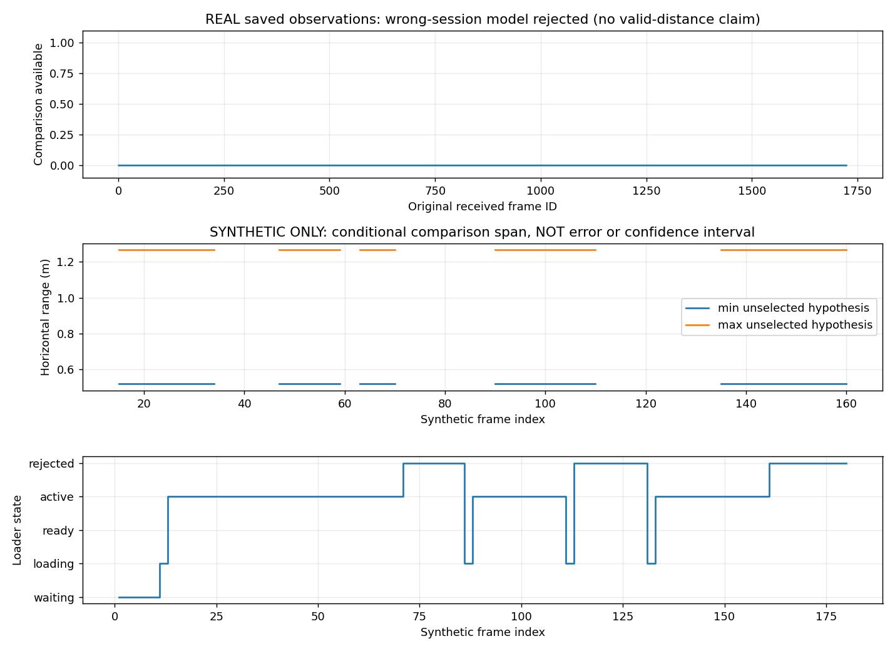

# 手順2：保存データでのモデル読込み・保留・失効の検証

2026-11-02。実機なし。**機能検証は成功したが、今回の実モデルを読み込んだ後の実画像による連続測距は未確認。手順2全体の完了とは扱わない。**

## 最初に分かったデータの制約

[手順1](../fixed_floor_derivation_r01/README.md)で16モデルを作った床画像はsession `15ae673c24484d119952ae391df611aa`のframe1259/1655。現在確認できた保存画像はこの2枚で、どちらもモデル生成の根拠画像。既知の録画保存ルート2か所の`distance_frames.jsonl`も調べたが、このsessionの後続行は見つからなかった（[一覧](results_r04/data_inventory.json)）。これはローカル保存データの調査であり、未接続のPCやDriveの全データを検索したという意味ではない。

したがって、このモデルについて「生成に使った画像より後の実画像」へ正しく適用できるかは確認できない。元の2枚を複製して連続3frameの品質確認を作る、別sessionの連続ログへモデルを転用する、といった扱いはしなかった。

代わりに、**実データの拒否試験**と、**合成入力の正の機能試験**を分離した。

## 結果

正式結果は`results_r04/`、正式検証は[verification_r02/verification.json](verification_r02/verification.json)。

| 試験 | 入力 | 結果 | 言えること |
| --- | --- | --- | --- |
| 実ログ・別session拒否 | 10/30 r02、1,689処理行、session `f860e50d...` | 3回の要求をすべてsession不一致で拒否。比較距離0、元の1,689行の項目に変更なし | 誤ったモデルで比較値を出さない |
| 合成入力・正常/異常遷移 | 合成180行、`synthetic_lifecycle_only` | 比較値88行。受入れ3回、入力断で失効2回、不正JSON拒否1回 | 読込み前後の機能と保留・失効経路が通る |
| 今回の実モデル・正の連続評価 | 根拠PNG2枚だけ、後続の同sessionログ0行 | 未実施 | 実カメラで連続して距離が出る、精度が正しいとは言えない |

**実ログの比較距離0は、この負例試験では期待結果。距離推定の成功ではない。** 実ログでは保存済みのbbox/支持点/時刻/元の距離判定を再利用した。新しいYOLO推論・画像の再デコード・マスク再抽出・床再推定は行っていない。

合成入力は既存写真のsessionを書き換えたものではない。新しい合成セッションで既知の投影矩形PNGを作り、実装済みの導出コマンドで8候補を生成し、**本物のモデル読込み検証関数**へ渡した。赤三角形と既知の仮想bboxを使った観測も合成であり、検出性能や距離精度の評価には数えない。

## 合成シナリオの確認箇所

| frame | 操作/入力 | 期待どおりの挙動 |
| --- | --- | --- |
| 1 | 合成床基準 | モデル作成の根拠。独立した距離評価ではない |
| 10の処理後 | 読込み要求 | frame12までは未適用、13で受入れ、3frame品質確認後の15で数値開始 |
| 35～44 | 対象なし | 前回値を残さない。復帰後も45/46は品質確認中、47で再開 |
| 60 | 処理完了まで600 msを仮定 | 全モデルの比較距離を保留 |
| 61以降 | 上記遅延後に明示した入力休止を反映 | 時刻を逆行させず、品質確認をやり直す |
| 70の処理後 | 入力断を注入 | 自動で旧モデルへ戻らない |
| 85の処理後 | 明示再要求 | 88で受入れ、90で数値再開 |
| 110の処理後 | 不正モデルを読込み要求 | 即座に旧モデルを失効し、失敗後も旧モデルへ戻らない |
| 130の処理後 | 正しいモデルを明示再要求 | 133で受入れ、135で数値再開 |
| 160の処理後 | 再度入力断 | 最後まで比較値を残さない |

論理読込み遅延は60 msと宣言した仮定。実測のネットワーク/GPU/ファイル性能ではない。600 msの処理遅延も合成条件であり、実機のスループットや最新frame間引きを再現したものではない。



上段は実ログの負例、中・下段は合成のみ。中段の最小/最大は未選択モデル間の値の範囲であり、真値・誤差・信頼区間ではない。グラフは数値から生成し、カメラ写真は加工していない。

## 検証と成果物

- 新規16テストPASS、failure/error/skipとも0。時刻逆行、元項目の改変、古い画像への適用、600 msの値の残留、EOF後のframe捏造も拒否する。
- 前段の関連360テストは、検証manifest・使用ソースのhash一致を確認して再利用。今回360件を再実行したとは扱わない。
- 実ログ/合成の出力とも標準`load_frames`の時系列・項目検査を通す。`audit_rows`で新規比較項目を除いた全項目が元の行と同一であることを確認する。
- 前段モデル、元PNG、実ログ、config、使用ソースのhashを照合。既存runtime、安全ゲート、校正、HSV、FFBに変更なし。

各caseには`distance_frames.jsonl`、`timeline.csv`、`fixed_floor_model_events.jsonl`、`summary.json`を保存する。`synthetic_inputs/`の画像/JSONLは合成である。実機の`live_summary.json`を捏造して標準reportを完了扱いにすることはしていない。

`results_r01`は合成観測の計測項目不足で中断。`r02`は600 ms遅延の後の完了時刻逆行を検証器が検出したため正式結果に使わない（初期の90行という数値もこちら）。`r03`で明示的な入力休止を加え、`r04`で標準検証器と同じ時刻条件へ監査を揃えた。正式な比較出力数は**88行**。`verification_r01`はr02の時刻逆行を検出、r02が最終検証。過去結果を上書きして通していない。

再現は未使用の出力先を指定する。

```bash
cd /home/robo25/theta_ws/RICHO-theta
env OPENBLAS_NUM_THREADS=1 /home/robo25/theta-env/bin/python3 \
  Experimental_results/2026-11-02/fixed_floor_lifecycle_replay_r01/run.py \
  --output-dir Experimental_results/2026-11-02/fixed_floor_lifecycle_replay_r01/recheck_new
env OPENBLAS_NUM_THREADS=1 /home/robo25/theta-env/bin/python3 \
  Experimental_results/2026-11-02/fixed_floor_lifecycle_replay_r01/verify.py \
  --results-dir Experimental_results/2026-11-02/fixed_floor_lifecycle_replay_r01/recheck_new \
  --output-dir Experimental_results/2026-11-02/fixed_floor_lifecycle_replay_r01/recheck_verification_new
```

## 未確認部分と次の判断

今回の実モデルを用いた正の時系列評価に不足しているのは、**床基準を保存した同じ接続で、モデル生成後に記録されたコーンの観測ログ/画像**。高さ等の追加値を推測すれば埋まる問題ではない。同じ接続の未共有データが見つかれば利用できるが、今日は撮影できないので再録画を依頼していない。

既存データで実施可能な機能・拒否検証と、この不足は切り分けた。実カメラでの数値継続出力、独立した実測距離との誤差、走行中の安定性は未確認。別sessionへの転用や本判定への昇格で埋めない。

次に撮影なしで進める場合は、比較専用のGUI表示（手順3）を合成/保存画像で実装できる。ただしそれも、実モデルの連続測距の成功を意味しない。

同日続報：[手順3の比較GUI](../fixed_floor_display_r01/README.md)を実装・検証した。新規17件を含む393テストPASS。実モデルの後続データ不足は解消しておらず、正の実機連続評価は未完了のまま。

今日はカメラ・GPU推論・ROS/FFB・Git commit/pushを実施していない。別作業中の赤のみ評価は未変更。
