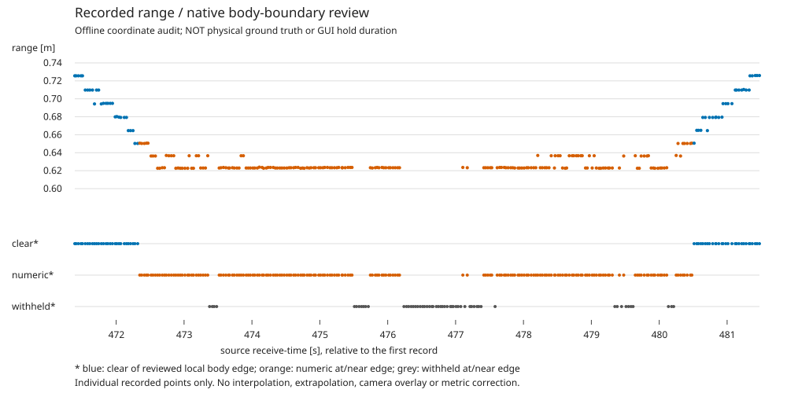

# 近距離の数値／保留の時系列と、測距子プロセス終了待ちの修正

2026-11-10。**天板境界付近の数値189件と同じ境界付近で保留した55件は、約8.13秒の1区間にまとまっていた。** 数値と保留が10回往復し、その後は境界から離れた数値へ戻る。通信断や推論停止と同一視する根拠はない。

別件として、模擬プロセスで終了待ちの不備を再現したため、測距子プロセスだけの終了処理を局所修正した。**距離の計算・保留条件・操縦・ROS通信は変更していない。GPU PCへ反映・実機起動・commit/pushは未実施。**

## 時系列の結果

入力は既存のsession `4c34c8c3d6d44949afb2e921e819e563` の16,929測距行と同数のbridge event、[前回の数値全行監査](../self_body_boundary_shadow_r01/README.md)。元ログ・参照・依存実装をSHAで照合し、全9,514数値行を前回CSVと対応付けた。

詳細は [正式時系列JSON](results_r01/timeline.json)、[前後1秒を含む303行CSV](results_r01/local_window.csv)、[グラフ](results_r01/distance_timeline.svg)。グラフは集計データから生成したものでカメラ画像ではない。元画像への注釈・リサイズ等は行っていない。



青は参照天板境界から離れた数値、橙は境界近傍の数値、灰は境界近傍で保留した行。clearは接地や精度の認定ではない。横軸は最初の受信記録からの相対source時刻であり、画面の表示・保留時間ではない。数値のない行を補間していない。

|項目|結果|
|---|---:|
|境界近傍の連続区間|frame 14172～14416|
|同区間の処理済み行|244件|
|うち現行で数値を出した行|189件|
|うち境界で保留した行|55件|
|source時刻の先頭末尾差|8.1333秒|
|計算完了時刻の先頭末尾差|8.1401秒|
|数値→保留／保留→数値の遷移|各10回|
|bridgeが採用した対応行|244／244件|
|同区間の元画像が保存されている行|5件（全て保留）|
|区間直前|frame 14171、0.6502924 m、境界から離れる|
|区間直後|frame 14417、0.6505932 m、境界から離れる|
|区間末尾→直後のsource時刻差|32.98 ms|

区間中の記録値は約0.6227～0.6506mで、図では0.623m付近の値が続く途中に保留が入る。台座手前側が天板に隠れた保存5画像の所見と整合する。ただし他の239行に元画像はなく、区間全体を実際の遮蔽／誤測距の正解ラベルとはしない。物理的に何cm動いたか、停止したか、GUIが何回点滅したかは測っていない。

### 78境界保留の分類

|ログからの分類|件数|意味|
|---|---:|---|
|閉じた輪郭の候補が天板境界付近にある|55|上記8.13秒区間の保留|
|閉じた輪郭の候補が天板境界から離れる|19|座標境界の丸め候補を別に比較できるが、接地・精度の認定ではない|
|閉じた輪郭の候補をこの監査で確認できない|4|手が横切る保存例1件、上＋左接触の例等。点を作って埋めない|

19件のうち提出画像で再計算した例は14922の1枚だけ。ログのcomponent SHA・観測列は追跡できるが、未保存18件の画像内容を再現したことにはしない。55件と19件を一括で保留緩和しない。

## 終了待ちの点検と局所修正

実行元のsummaryは `child_exitcode=null, child_stopped=false, io_thread_stopped=false` だった一方、画像writerは正常終了していた。**その実行の原因を断定できる記録はない。** コード上で同じ停止未確認状態になり得る経路を、所有する模擬子プロセスで点検した。

修正前はI/O threadが `read_message(stdout)` で応答を待ち、その`finally`にある終了timeoutへ進めないことがある。子がSIGTERMを無視／長い終了処理に入ると、`close()`は3秒待って未停止のまま戻った。

[修正前の模擬結果](shutdown_before_r01/summary.json)を保持。[修正後の模擬結果](shutdown_after_r01/summary.json)では、`close()`側にも独立した待ち期限を設けた。

1. 通常の停止要求を送り、I/O threadを最大2秒待つ。
2. まだ動いている場合、**このbridgeが起動した測距用Popen子だけ**へkillを送り、I/O threadを最大1秒待つ。
3. 停止が確認できなければ未完了を記録する。プロセス名探索・process group・ROS・他プロセスへの停止は行わない。

|模擬条件|修正前の最初のclose|修正後の最初のclose|
|---|---|---|
|通常のSIGTERM終了|約0.006秒、停止確認|約0.003秒、停止確認、強制終了なし|
|4秒かかる終了処理、stdout応答なし|約3.001秒、子・I/O未停止|約2.005秒、対象子を強制終了し子・I/O停止確認|
|SIGTERM無視、stdout応答なし|約3.001秒、子・I/O未停止|約2.002秒、対象子を強制終了し子・I/O停止確認|

修正は [driver_motion_bridge.py:238](../../../src/driver_motion_bridge.py#L238) のclose待ちとsummaryに限定。UI内の非同期 `request_stop`、RTC受信、画像publish、距離計算、速度指令等は変更していない。

新しいsummaryには `shutdown_complete`、`shutdown_reason`、`forced_worker_kill`、`shutdown_error`、`shutdown_wait_ms` を追加した。強制終了は正常終了と区別する。保存writerの完了・PNGの整合性は別のindex/status検証が必要であり、子を停止しただけでは保存成功にならない。実機OSの割込み不能状態・ディスクI/O・summaryファイル書込みを含む絶対的な完了期限を保証する修正ではない。

## 検証

- 時系列の新規8テスト成功：[ログ](results_r01/tests.log)。交互状態・gap・別理由の保留・末尾未復帰・時刻順序・session混在等を確認。
- 終了処理の新規8を含むdriver／保存関連**80テスト成功、失敗・error・skip 0**：[正式summary](checks_r01/summary.json)、[テストログ](checks_r01/tests.log)。通常終了、終了遅延、SIGTERM無視、kill失敗時の未完了記録、別子プロセス非干渉、二重close等を検証。
- 既存の操縦／ROS／送受信主要処理の固定AST hash、旧shell本文の回帰を含む。今回の終了処理変更があるため、前回の72成功だけで済ませず再実行した。
- worker `--help`、受信shell構文、UI launcherの`--help`は成功。実カメラ／CUDA／ROS／RTC待受け／機体操作は起動していない。
- 80＋時系列8の**計88テスト**。前回の自己遮蔽15テストは依存が変わっていないため再利用し、ここへ二重計上しない。
- 合成プロセスの時刻は測定値だが、実機終了時間・実機負荷の測定ではない。画像の物理的精度も未認定。

## 次の段階

時系列から、近距離の189数値行と55保留行は別々の障害ではなく、同じ画像境界付近の扱いとして検討すべきことが分かった。次の測距改善は**自己遮蔽の棄却と、境界から離れた点のbbox座標規約を分離**した比較の継続。19件の保留を全部正しい距離として採用したり、0.65mを一律cutoffにしたりしない。

今回反映できるコード修正は終了待ちだけ。GPU PCへ反映する場合は `src/driver_motion_bridge.py` の更新が必要で、まだこちらから転送していない。自己遮蔽候補と丸め候補は引き続きオフラインのままで、新しい実機コマンドや追加撮影は今回必要ない。

## 再現

Gitだけでなく元ログ／保存画像／前段の再計算記録が必要。未使用出力先を使う。

```bash
cd /home/robo25/theta_ws/RICHO-theta
PYTHON=/home/robo25/theta-env/bin/python3
TASK=Experimental_results/2026-11-10/motion_boundary_timeline_r01

"$PYTHON" "$TASK/analyze.py" --output-dir "$TASK/results_r02"
"$PYTHON" "$TASK/plot_timeline.py" --csv "$TASK/results_r02/local_window.csv" \
  --output "$TASK/results_r02/distance_timeline.svg"
"$PYTHON" "$TASK/probe_shutdown.py" --output-dir "$TASK/shutdown_after_r02"
"$PYTHON" Experimental_results/2026-11-10/withheld_frame_evidence_r01/check_tests.py \
  --output-dir "$TASK/checks_r02"
```

修正前の再現には `shutdown_before_r01/summary.json` に記録した旧ソースが必要。現在のソースで修正前結果を再現したと扱わない。模擬検査が作った子だけを終了し、実機のプロセスは操作していない。
