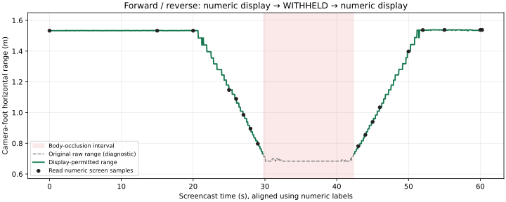

# 走行中の表示ゲート：自己遮蔽による保留と復帰を実画面・全ログで確認

2026-11-13 JST。**今回の条件では「走行中の数値更新→台座遮蔽時の表示保留→後退時の数値復帰」を確認できた。追加提出・同じ試験のやり直しは不要。**

対象は `body_guard_occlusion_r01_full_r02.tar.xz` と `Screencast from 2026年11月13日 20時27分27秒.tar.xz`。
必要18ファイル＋元画面録画1本が完備。車体停止・コーン移動を予定していたが、ユーザーから **車体を前進・後退させた** と確認したため、実績は走行試験として記録する。停止車体でコーンだけ動かした実験の成立とはしない。
独立したオドメトリ・実測距離・接触距離の真値は未提出で、速度や移動距離の精度は認定していない。

## 録画対応区間の結論

録画は1920×1200の約60.290秒。数値のframe表示を直接読んだ最初と最後の **49664〜51472** を評価範囲に固定し、それより前の約28分の待機・調整を混ぜない。
ソフトウェアsource時刻幅は約60.275秒、対応主結果1,787件、bridge受理も1,787件。

| 区間 | 対応frame | 主結果数 | 元測距の数値 | 表示数値を許可 | 表示保留 |
|---|---|---:|---:|---:|---|
| 遮蔽前・接近 | 49664〜50557 | 887 | 887 | 887 | 0 |
| 台座が天板境界へ達した区間 | 50558〜50935 | 373 | 372 | 0 | 自己遮蔽372＋元ROI端保留1 |
| 後退・表示復帰後 | 50936〜51472 | 527 | 527 | 527 | 0 |
| 合計 | 49664〜51472 | 1,787 | 1,786 | 1,414 | 373 |

表示が許可された1,414件は元数値と完全同値。元保留を数値へ救済した件数は0。
元主値が約0.682〜0.731mを返し続ける近接区間でも、自己遮蔽372件は別表示レビューで棄却され、bridgeへも保留として渡されていた。元主ログの数値そのものは変更していない。
この小さい値を「遮蔽していても正しい距離」と採用したのではない。



グレーが元値、緑が表示許可された値、赤帯が遮蔽保留区間。黒点は画面を読んだ数値サンプル。
カメラ画像や画面画像には一切描画・加工していない。

## 実画面とログの対応の強さ

原解像度で25画面を確認。17画面の数値・source session/frame・body-review gen 1を読んで、同frameの表示許可・bridge受理と3桁丸めの数値がすべて一致した。
例えば約1.533mから接近中1.147→0.985→0.895→0.797mとなり、録画約30〜42秒のサンプルは `WITHHELD / possible_self_body_occlusion`。
約43秒の0.781mから後退中0.855→1.034→1.398m、終盤約1.538mへの復帰を直接確認した。数値の一致は独立実測精度の証明ではない。

**保留時の現行UIはframeを表示しない。** そのため保留画面6点を特定の1frameと完全一致したと主張しない。
17点の数値anchorから求めたsource時刻−録画PTSの観測範囲（幅約58.15ms）を使い、保留画面時刻に対応する候補ログ範囲が全件同じ自己遮蔽保留であることを確認した。
これは時系列の整合性確認であり、全GUI描画のframe単位の証明や総遅延の測定ではない。
約5秒・10秒の2サンプルは別アプリでUIが隠れているため、GUI確認の成功件数から除外した。

根拠：[screen_readings.csv](screen_readings.csv)、[screen_audit.json](results_r01/screen_audit.json)、[screen_window.csv](results_r01/screen_window.csv)。
切替区間のframe境界はログの理由変化から決め、画面ではその前後と近接状態を確認した。接触の有無や真の床接地位置を画像だけから断定していない。

## 時間・処理件数

| 録画対応区間の項目 | 値 |
|---|---:|
| 主完了age P50 / P95 / 最大 | 14.28 / 19.21 / 32.89ms |
| 表示レビュー完了age P50 / P95 / 最大 | 14.71 / 19.76 / 33.26ms |
| 主完了→レビュー完了 P50 / P95 / 最大 | 0.42 / 0.60 / 1.54ms |
| 別比較service P95 / 最大 | 5.02 / 7.55ms |
| sourceから別比較完了 P95 / 最大 | 23.74 / 37.69ms |
| 主結果の平均間隔 | 約29.63件/秒 |
| source gap最大 | 約86.83ms |
| 範囲内sequence IDに結果がない数 | 22 |

ageは受信source基準で、露光→送信→GUI描画の総遅延ではない。
「主完了→レビュー完了」には比較offer等も含み、ゲート関数の専有CPU時間ではない。
レビュー完了ageの33.33ms超過は0件だが、入力間隔の揺れとsequenceの欠けがあるため常時30fpsを保証しない。
sequence欠けの原因を個々のネットワークdropやtap_lock_dropへ一律に割り当てていない。

## 全runの照合と正常終了

- 全体の主測距・表示レビュー・bridgeイベント各52,645行が対応一致。比較52,642行も元主へ対応。新表示レビューは同session/frame/source時刻・元値に厳密に結合し、bridge側のレビューコピーも完全一致。
- 参照有効開始はframe39671、表示レビューで参照有効は39673。開始2件は未取得／not_currentで保留。その後の有効化後13,057件では、表示数値12,667・自己遮蔽372・元保留16・開始待機2。物理的な遮蔽を参照失効にすり替えていない。
- 参照有効な現在支持列13,039件をログから再評価し、clear12,667／自己遮蔽372が実レビューと一致。未保存の各元フレームやYOLOを再実行した検証ではない。
- pin1677と17327の両方を、原PNG／復号BGR／sidecar／主JSONL完全元行SHAまで照合。初回・再pinの先行提出バイトとも一致。使用参照は発行pin17327用reference.jsonと完全一致。
- 記録された比較9＋表示7コード（重複除外12）のSHA、profile/configを実ファイルで照合。記録checkpoint SHAも設定と一致。重み本体は未提出のため独立再hashしていない。
- 主sent52,646／returned52,645：終了未返却1件。bridge受理52,644＋初回古い入力による退役1。入力tap_lock_drops=7は比較dropとは別。
- 比較offered52,645／processed52,642：slot上書き2＋終了未処理1と整合。tap_busy_drops=0。
- 主／I/O・比較writerは正常終了。error／強制killなし。child=-15はSIGTERMであり、これだけを異常終了とはしない。終了待ち約56.39ms。

全体集計は [audit.json](results_r01/audit.json)。主全体の最大3.874mなど、参照前・録画前の値を今回の録画内精度やゲートの成功値へ混ぜない。
最初のpin1677と同frameの比較入力に約518.68msのsource gapがある。したがって先行4点だけでgapがpin後と断定しなかった扱いを維持する。今回は再pin17327と実loadで結合を確認できており、旧pinの失効時刻や根本原因まで認定していない。

## 保存場所と再現

原本はGit対象外の `recordings/2026-11-13/body_display_occlusion_full_intake_r01/`。
`logs/{primary,comparison}` に提出18ファイルをバイト一致保存、`video/screen.webm` は元webmと同一バイト。
`screen_samples_r01/r02` は元1920×1200の画面をPNGへ抽出したもの。切抜き・拡大縮小・注釈・色補正なし。各provenanceに元動画SHA・実PTS・frame番号・PNG SHAを保存した。
全52,645件のCSVは `derived/display_timing.csv` に置き、Gitには録画対応1,787件だけを保存している。

新規保存先での例（既存成果物の上書き禁止）：

```bash
cd /home/robo25/theta_ws/RICHO-theta
/home/robo25/theta-env/bin/python3 Experimental_results/2026-11-13/body_display_occlusion_live_audit_r01/review.py intake \
  --archive /home/robo25/Downloads/body_guard_occlusion_r01_full_r02.tar.xz \
  --screen-archive '/home/robo25/Downloads/Screencast from 2026年11月13日 20時27分27秒.tar.xz' \
  --intake-dir recordings/2026-11-13/body_display_occlusion_full_intake_r02
/home/robo25/theta-env/bin/python3 Experimental_results/2026-11-13/body_display_occlusion_live_audit_r01/review.py audit \
  --intake-dir recordings/2026-11-13/body_display_occlusion_full_intake_r02 \
  --output-dir Experimental_results/2026-11-13/body_display_occlusion_live_audit_r01/results_r02
```

画面抽出は既存 `guarded_motion_live_audit_r02/screen_frames.py` を再利用し、時刻r01=0,5,…,60、r02=26,27,28,29,30,31,32,33,34,36,38,40,41,42,43,44,45,46,52,60.25を指定する。
`screen_review.py --intake-dir … --results-dir …` で画面読取り表と既に監査したCSVを照合する。
`plot.py` は今回の `results_r01` のCSV／screen auditから数値グラフだけを生成した。

既存の静止監査を、pin・参照元・要求数・終了未返却数を引数で指定できるようにして再利用した。既定の静止条件は維持。別比較の列もCSVへ追加。実機コードは変更していない。
アーカイブは今回の232MB主ログに合わせ、明示18ファイル・主256MiB・合計512MiBに制限した。制限を撤廃せず、名前／重複／リンク／未完行／SHAを検証した。
新7＋既存関連を含む44テスト成功。数値画面の元値・frame不一致、保留画面の候補区間に数値が混ざるケース、欠損・重複・パストラバーサル・リンク・既存保存先を拒否する検証を含む。

## 確認できた範囲・次段階

この取付・平面床仮定・赤コーン・ROIで、既定OFFの表示ゲートを明示ONにした **走行診断表示の更新・自己遮蔽保留・復帰** は今回の実画面とログで確認できた。
以前残っていた「別比較は保留するのに主表示は数値を出す」問題について、今回は表示側でも保留することを確認できた。

床接地、取付再現、床傾斜補償、base_link／車体接触距離、独立実測に対する精度は未認定。数値をROS・操縦・FFB・自動停止へ使う機能にはしていない。録画の既存青色表示だけを、その制御接続の証拠とは扱わない。
次はこの確認済み構成の運用条件と再開手順を整理する段階。同じ確認のための追加撮影・追加走行は今は不要。
このPCから実カメラ・CUDA・ROS・車体は起動していない。日報・commit/pushは今回未依頼。
